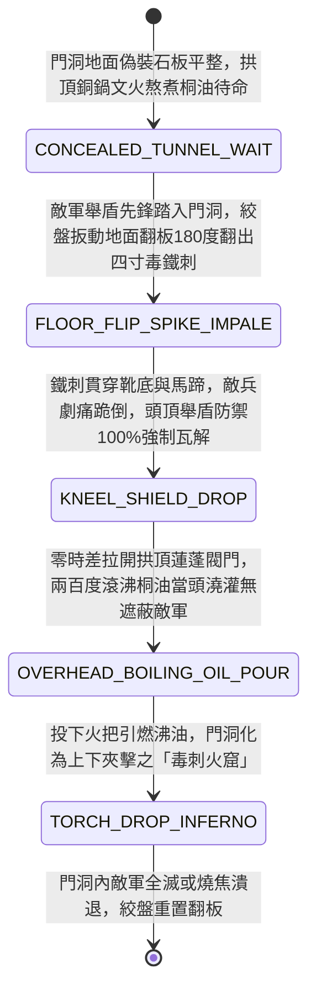

<!-- doc_id: doc_spec_0963 -->
# 城防城門洞內暗置絞盤牽引生鐵地刺翻板與頂部沸油雙重絕殺狀態機規格書

> **文件編號**：`doc_spec_0963`
> **模組代碼**：`GATE-TUNNEL-SPIKE-FLOOR-BOILING-OIL01`
> **對應 WBS**：`FORM-182`（M7 戰場進階機關、城防門洞地刺沸油與精銳步兵擂鼓甕金錘）
> **單一真相來源（SSOT）**：本文件直接定義城門洞內生鐵地刺翻板與頂部沸油雙重絕殺之完整物理與戰鬥狀態機，嚴禁於檔尾附加補丁。

---

## 一、 戰術定位與歷史工程原型

在守城戰中，當外門被破，敵軍舉著包鐵大盾或推著帶頂棚衝車湧入幽暗的「城門洞」時，單靠頂部潑沸油易被舉盾擋開；單靠地面陷阱又可能被搭木板跨過。**城門洞內暗置絞盤牽引生鐵地刺翻板與頂部沸油雙重絕殺（Gate-Tunnel Spike-Floor & Overhead Boiling-Oil Dual Trap）** 採用「下刺腳掌破舉盾、上淋沸油燒全身」的天地上下同步夾擊機制：
1. **地面偽裝翻轉生鐵釘板**：於門洞青石地面下掏空淺槽，鋪設由生鐵轉軸連動的偽裝石面木板，背面密植四寸長淬毒三棱生鐵地刺；敵軍踏上時扳動絞盤，木板瞬間 $180^\circ$ 翻轉使鐵刺朝上刺穿敵軍靴底。
2. **劇痛跪倒與被迫棄盾**：腳底被四寸鐵刺貫穿的劇痛與失衡，使原本高舉大盾護頂的敵兵瞬間痛呼跪倒、雙手本能鬆開大盾扶地，徹底暴露無遮蔽的頭頸與背部。
3. **拱頂蓮蓬銅孔傾瀉沸油**：地面鐵刺翻起瞬間，門樓頂部拉開閥門，兩百度「桐油松脂混合沸油」從拱頂數十個蓮蓬銅孔垂直澆下，精準淋在剛失去頭頂盾牌保護的敵軍身上，隨後投下火把將門洞化為煉獄火窟。

---

## 二、 觸發條件與城防建造參數

| 參數項目 | 規格數值與限制條件 | 備註說明 |
| :--- | :--- | :--- |
| **部署位置限制** | 僅限「城門洞內部通道格（連續 `2 格` 縱深）」 | 天地雙重連動機關，需門樓頂部與側壁暗室完好 |
| **建造資源消耗** | 生鐵地刺 110、桐油松脂 140、石面翻板與銅管 80、城防工事點 45 | 沸油傾瀉點燃後，地面火海與鐵刺效果持續 `3 回合` |
| **作用對象** | 踏入城門洞格之所有「步兵 / 騎兵 / 輕型木械」 | 重型八輪衝車可壓住部分翻板，但仍會承受頂部沸油焚燒 |
| **機關耐久（HP）** | 地面鐵刺板 `1,300` 點；拱頂注油孔不可被地面近戰直接攻擊 | 沸油用盡後需耗時 `2 回合` 重新熬煮裝填 |

---

## 三、 核心狀態機（State Machine）

---

## 四、 數值結算與戰鬥公式

### 1. 第一階段：地刺貫足與強制破除舉盾（Spike Impale & Overhead Shield Drop）
當敵方部隊踏入門洞格觸發 `FLOOR_FLIP_SPIKE_IMPALE` 時：
- **下盤穿刺與定身**：鞋底與馬蹄為全身護甲最薄弱處，地刺無視目標 `80%` 物理防禦力，造成 `125% ATK` 穿刺傷害，並 `100%` 附加 `SPIKE_PINNED_KNEEL`（定身無法移動，持續 2 回合）。
- **強制解除頭頂防護（Overhead Protection Strip）**：因足底劇痛跪倒，敵軍原本開啟的「龜甲舉盾態（Testudo / Overhead Shield）」或「藤牌遮頂」被 **100% 強制解除**，使緊接而來的頂部打擊不再受到任何舉盾減免。

### 2. 第二階段：拱頂沸油澆灌與煉獄引燃（Overhead Boiling-Oil Inferno）
在破除頭頂舉盾的同一瞬間，拱頂沸油傾瀉並點燃，對門洞內 `2 格` 敵軍造成極限高溫灼燒與火焰暴擊：
$$\text{Damage}_{\text{oil\_inferno}} = \text{BaseATK}_{\text{garrison}} \times 2.55 \times \left(1 + 0.40 \times \text{IsShieldStripped}\right)$$
- **天地雙重折磨（Spike & Fire Torture）**：若目標同時處於 `SPIKE_PINNED_KNEEL`（被地刺扎穿腳掌且失去舉盾），沸油順著傷口與甲縫滲入，傷害額外提升 `40%`（即相當於 $2.55 \times 1.40 = 357\%$ 倍率），並附加 `TUNNEL_HELLFIRE_BURN`（每回合流失最大兵力 `12%` 且治療無效，持續 3 回合）。

---

## 五、 反制手段與戰術克制

1. **雙層生牛皮屋脊衝車先行鋪路**：若攻城方先推入「雙層牛皮木屋衝車（`doc_spec_0869`）」，沉重八輪車體能壓死地面翻板，且厚重牛皮屋脊可擋住頂部第一波沸油。
2. **火牛假人誘發機關**：攻城方若先將「竹編火牛假人（`doc_spec_0953`）」推入門洞，可騙取守軍提前翻起地刺並耗盡沸油。

---

## 六、 驗收測試案例（Acceptance Tests）

| 測試案例 ID | 測試情境與輸入條件 | 預期狀態轉移與數值輸出 |
| :--- | :--- | :--- |
| **TC-TUNNEL-01** | 敵方精銳「龜甲重盾兵（開啟頭頂舉盾減傷 80%）」踏入城門洞格 | 第一階段地刺貫足定身並 100% 強制解除龜甲舉盾；第二階段沸油無衰減淋下造成 357% 煉獄火傷 |
| **TC-TUNNEL-02** | 被困於門洞「毒刺火窟」內的敵軍進入下一回合 | 因定身無法逃離火窟，承受 12% 最大兵力真實火傷且無法接受後排醫官治療 |
| **TC-TUNNEL-03** | 敵方先推「雙層生牛皮衝車」進入門洞格，步兵跟在車後 | 衝車重量壓住地面翻板不觸發地刺，牛皮屋頂吸收頂部沸油，保護後隨步兵免受天地夾擊 |
