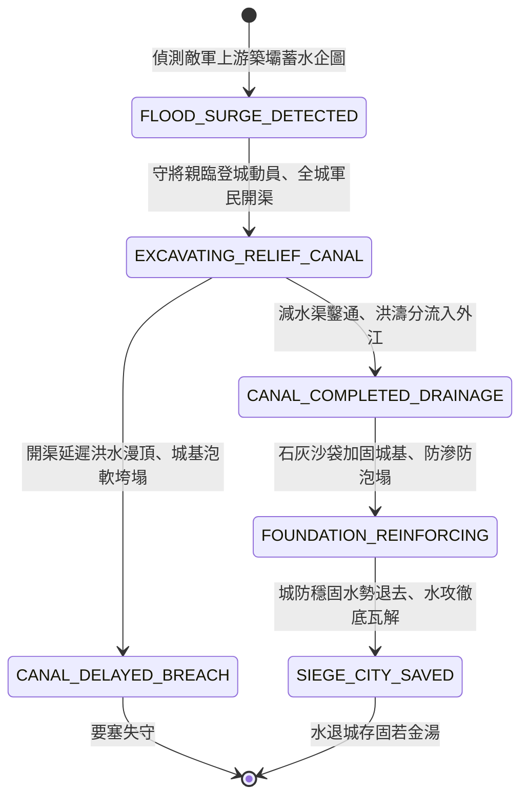

<!-- doc_id: doc_spec_0826 -->
# 3KLife 城防引水外洩開挖環城減水渠防禦水攻狀態機規格書

## 模組基本資訊
- **模組代號**：`SIEGE-DRAINAGE-CANAL01`
- **系統定位**：三國要塞反水攻水利工程與排水洩洪系統，負責守軍勘測洪水走勢、調動軍民開鑿環城減水渠、導流洪峰入江海與加固城腳泡水基礎之完整狀態流。
- **架構依賴**：`WaterGridSystem`、`SiegeCombatController`、`PioneerEngineering`、`VFXBlockRegistry`。

---

## 核心設計概念
面對敵軍築壩蓄水蓄意灌城之險局（如曹仁守樊城大水浸城、郝昭抗蜀反水攻），若坐以待斃，城牆基土經洪水長期浸泡必自內軟化坍塌。守城名將必親冒風雨登城激勵軍民誓死不退，同時緊急組織工兵與全城百姓於城牆外圍低窪處開鑿三道深闊之「環城減水渠（洩洪排澇渠）」。減水渠如水龍引流，將倒灌城腳之洪濤迅速引向城外天然大河或下游窪地，並以草袋石灰填塞牆縫，保全要塞不失。



---

## 狀態機定義與轉換條件

### 1. `FLOOD_SURGE_DETECTED`（水攻預警狀態）
- **進入條件**：城外上游河流地格出現「築壩蓄水」標籤，水利預警響起。
- **行為表現**：
  - 守將下達「全城防洪總動員」法令，徵集 500 名工兵與 1000 名民夫。
  - 提示倒數：洪水來襲前尚有 3 回合準備窗口。
- **轉換**：下達開工指令 -> 轉移至 `EXCAVATING_RELIEF_CANAL`。

### 2. `EXCAVATING_RELIEF_CANAL`（減水渠開鑿狀態）
- **行為表現**：
  - 軍民手持鐵鍬鐵鍤，沿城牆兩翼開挖寬 2 丈、深 1 丈之引水道。
  - 每回合推進工程進度 35%（若守將具備「水利/治水」特技，進度 +20%）。
- **轉換**：
  - 工程進度在洪水抵達前達到 100% -> 轉移至 `CANAL_COMPLETED_DRAINAGE`。
  - 洪水先一步抵達且工程未完成 -> 轉移至 `CANAL_DELAYED_BREACH`。

### 3. `CANAL_COMPLETED_DRAINAGE`（導流分洪運轉狀態）
- **行為表現**：
  - 洪峰奔湧而至，減水渠閘門開啟，將 70% 洪水分流引向下游大河。
  - 城腳水位被強行壓制於 0.3 公尺以下，城門未被沖垮。
- **轉換**：分流平穩 -> 轉移至 `FOUNDATION_REINFORCING`。

### 4. `FOUNDATION_REINFORCING`（城基加固防滲狀態）
- **行為表現**：
  - 工兵用生石灰、桐油麻絲與黏土沙袋密閉封堵城門板縫隙與城角磚縫。
  - 城牆泡水損耗率降低 90%，防止地基土體液化坍陷。
- **轉換**：洪水持續期結束 -> 轉移至 `SIEGE_CITY_SAVED`。

### 5. `CANAL_DELAYED_BREACH`（排水不及城塌狀態）
- **行為表現**：
  - 洪水直灌城門，城牆基土被泡軟成泥漿，發生大面積外鼓崩塌。
  - 城牆耐久歸零，敵軍戰船直接駛入城內。
- **轉換**：城破結算 -> 結束退出。

### 6. `SIEGE_CITY_SAVED`（防洪水退大勝狀態）
- **行為表現**：
  - 天晴水退，城牆巍然屹立，敵軍水攻耗盡氣力無功而返。
  - 全城士氣暴增 40 點，守軍獲得「固若金湯」守城榮譽。
- **轉換**：防禦結算完畢 -> 結束退出。

---

## 數值公式與配置契約

```typescript
export interface DrainageCanalConfig {
  canalId: string;
  excavationTurnCost: number;     // 正常開渠所需標準回合
  floodDiversionEfficiency: number;// 減水渠分洪效率比 (0.0 ~ 1.0)
  waterLevelSuppressionMeter: number; // 水位壓制上限 (米)
  wallSeepageReductionRate: number;// 城基滲水衰減比
  cityMoraleBoostOnSave: number;   // 成功保城士氣暴增值
}

export const DRAINAGE_PRESETS: Record<string, DrainageCanalConfig> = {
  FANCHENG_DRAINAGE_SYSTEM: {
    canalId: 'CANAL_FANCHENG_01',
    excavationTurnCost: 3,
    floodDiversionEfficiency: 0.70,
    waterLevelSuppressionMeter: 0.3,
    wallSeepageReductionRate: 0.90,
    cityMoraleBoostOnSave: 40,
  }
};
```

---

## 單元測試與驗收標準
1. **分洪工程及時驗收**：在洪水衝擊前完成減水渠開鑿，城門所受水擊傷害 100% 削減 70%，水位壓制在 0.3m 以下。
2. **城基防滲泡塌防護**：進入 `FOUNDATION_REINFORCING` 狀態後，城牆耐久在後續 5 個洪水回合內耐久損耗每回合小於 10 點。
3. **退水士氣狂飆**：水攻防禦成功後，城內守軍士氣即刻增加 40 點，並解除全城水浸警報。
