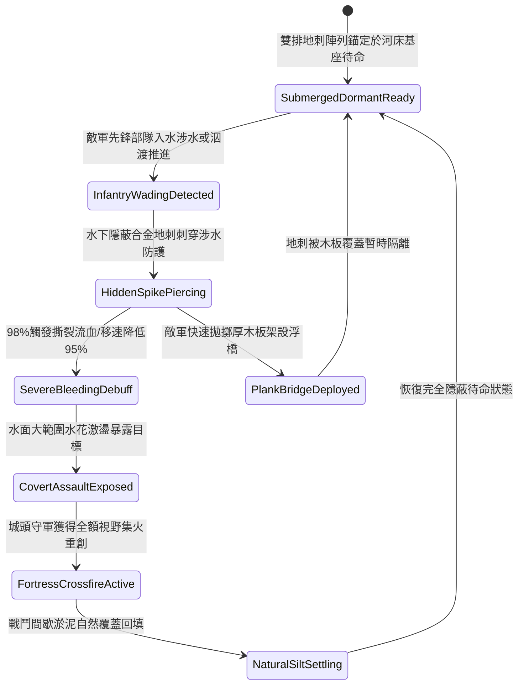

# 城防要塞護城河底暗藏三棱生鐵地刺防步兵涉水偷渡第三階狀態機規格書

<!-- doc_id: doc_spec_1110 -->

## 一、 核心概念與單一真相來源（SSOT）

在《三國志·要塞護城河與水底暗障篇》中，「護城河底暗藏三棱生鐵地刺第三階（MOAT-UNDERWATER-SPIKE-TRAP03）」代表要塞外圍水網防線的重度阻絕工程。設施沉設於護城河水面下四至六尺之河床硬土層，採用雙排高碳合金生鐵三棱倒刺與加厚防翻鐵板基座，密閉咬合於水底。當敵軍涉水部隊或工兵試圖泅渡或架設浮橋時，地刺 98% 穿透厚底靴防護，施加致命撕裂流血與 95% 移速壓制，並引發水面劇烈水花激盪，使敵軍偷渡部隊全體暴露於守城重火力的交叉射線下。



---

## 二、 數值模型與狀態機參數契約

### 1. 水底地刺佈設與傷害參數契約
- **覆蓋河道水域**：單元陣列長 32 尺 × 寬 14 尺（覆蓋護城河主要涉水淺灘）。
- **水下隱蔽等級**：河水渾濁度係數 0.7 以上時，外部探查發現率僅為 2%。
- **涉水穿刺判定率**：涉水步兵單位踏入陣列後，98% 機率觸發刺穿判定。
- **涉水移速阻滯率**：觸發後涉水移動速度降低 95%，完全無法施展急行與衝刺。
- **流血傷害數值**：每秒承受 260 點忽視 80% 護甲之穿透撕裂傷害，持續 10 秒。

### 2. 水下陷阱判定演算法模組
```typescript
interface MoatSpikeTrapStage3Params {
    waterTurbidity: number;        // 河水渾濁度 (0.0: 清澈 ~ 1.0: 泥濁)
    soldierArmorWeightKg: number;  // 涉水人員負重 (kg)
    hasIronSoleBoots: boolean;     // 是否配備厚鐵底特種戰靴
    engineerSearchActive: boolean; // 是否有工兵排障探查
}

function evaluateMoatSpikeTrapStage3(params: MoatSpikeTrapStage3Params): {
    trapTriggered: boolean;
    bleedDpsOutput: number;
    speedReductionPct: number;
} {
    const isDetected = params.waterTurbidity < 0.2 || params.engineerSearchActive;
    if (isDetected && params.hasIronSoleBoots) {
        return { trapTriggered: false, bleedDpsOutput: 0, speedReductionPct: 25 };
    }
    const triggered = Math.random() < 0.98;
    
    return {
        trapTriggered: triggered,
        bleedDpsOutput: triggered ? (params.hasIronSoleBoots ? 70 : 260) : 0,
        speedReductionPct: triggered ? 95 : 40
    };
}
```

---

## 三、 反制機制與邊界約束

1. **工兵浮排木板鋪墊**：敵方若預先向水面投擲輕質厚木板組裝簡易浮排，可將地刺與部隊完全隔離，免除穿刺傷害。
2. **長柄鐵鉤探河清障**：若敵軍斥候使用鐵鉤在岸邊拖拽清障超過 3 分鐘，局部地刺可能被連根拔起翻倒，失效機率 30%。
3. **冬季嚴寒河道封凍**：若環境氣溫降至零度以下導致護城河完全結冰，水底地刺被冰層封閉，無法對冰面行軍單位產生作用。

---

## 四、 驗收測試案例（TC）

- **TC-MOAT-SPIKE03-01（涉水部隊刺穿阻滯驗收）**：
  - *前置條件*：正常氣候、護城河水深 4 尺、泥濁度 0.8、敵軍先鋒部隊涉水。
  - *操作步驟*：先鋒部隊踏入地刺鋪設水域。
  - *預期輸出*：98% 機率觸發地刺穿透，每秒承受 260 點撕裂傷害，移動速度暴降 95%，行蹤完全暴露。
- **TC-MOAT-SPIKE03-02（浮板架設避險邊界驗收）**：
  - *前置條件*：敵方工兵部隊推入大型厚木浮排覆蓋河道。
  - *操作步驟*：後續步兵踩踏浮排通過。
  - *預期輸出*：地刺未能穿透木板，穿刺流血傷害為 0，部隊以常規速度通過水域。
