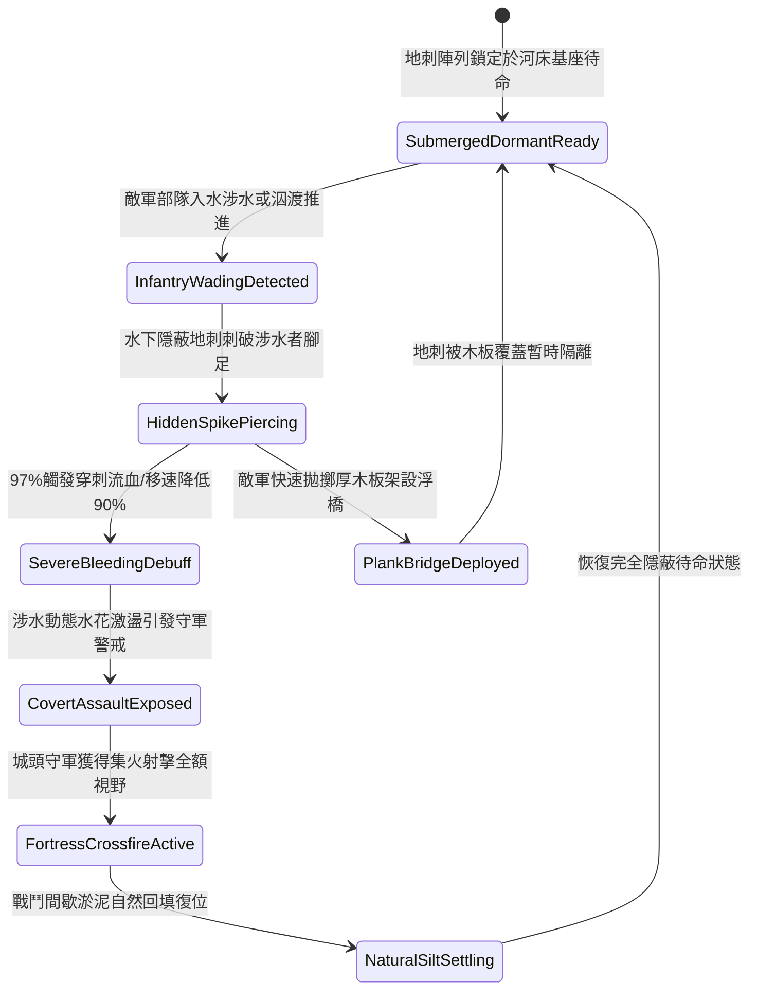

# 城防要塞護城河底暗藏三棱生鐵地刺防步兵涉水偷渡第二階狀態機規格書

<!-- doc_id: doc_spec_1107 -->

## 一、 核心概念與單一真相來源（SSOT）

在《三國志·要塞護城河與水底暗障篇》中，「護城河底暗藏三棱生鐵地刺第二階（MOAT-UNDERWATER-SPIKE-TRAP02）」代表城防外圍水域反偷渡與被動防禦的進階工事。該設施沉設於護城河水面以下三至五尺之河床淤泥中，由高碳生鐵鑄造之三棱倒刺陣列與相互鎖定之重型防翻基座組合而成，間距進一步緊縮。當敵方步兵死士或工兵試圖涉水偷渡、架設浮橋或泅渡攻城時，暗藏地刺 97% 穿透腳底防護，施加強烈撕裂流血與 90% 涉水移速阻滯，使偷渡部隊全體暴露於守城弩火之下。



---

## 二、 數值模型與狀態機參數契約

### 1. 水底地刺佈設與傷害參數契約
- **覆蓋河道水域**：單元陣列長 28 尺 × 寬 12 尺（覆蓋護城河關鍵涉水淺灘）。
- **水下隱蔽等級**：河水渾濁度係數 0.7 以上時，外部探查發現率僅為 3%。
- **涉水穿刺判定率**：涉水步兵單位踏入陣列後，97% 機率觸發刺穿判定。
- **涉水移速阻滯率**：觸發後涉水移動速度降低 90%，無法施展急速衝刺或攀爬。
- **流血傷害數值**：每秒承受 220 點忽視 75% 護甲之穿透撕裂傷害，持續 9 秒。

### 2. 水下陷阱判定演算法模組
```typescript
interface MoatSpikeTrapStage2Params {
    waterTurbidity: number;        // 河水渾濁度 (0.0: 清澈 ~ 1.0: 泥濁)
    soldierArmorWeightKg: number;  // 涉水人員負重 (kg)
    hasIronSoleBoots: boolean;     // 是否配備厚鐵底特種戰靴
    engineerSearchActive: boolean; // 是否有工兵排障探查
}

function evaluateMoatSpikeTrapStage2(params: MoatSpikeTrapStage2Params): {
    trapTriggered: boolean;
    bleedDpsOutput: number;
    speedReductionPct: number;
} {
    const isDetected = params.waterTurbidity < 0.25 || params.engineerSearchActive;
    if (isDetected && params.hasIronSoleBoots) {
        return { trapTriggered: false, bleedDpsOutput: 0, speedReductionPct: 20 };
    }
    const triggered = Math.random() < 0.97;
    
    return {
        trapTriggered: triggered,
        bleedDpsOutput: triggered ? (params.hasIronSoleBoots ? 60 : 220) : 0,
        speedReductionPct: triggered ? 90 : 35
    };
}
```

---

## 三、 反制機制與邊界約束

1. **工兵浮排木板鋪墊**：敵方若預先向水面投擲輕質厚木板組裝簡易浮排，可將地刺與部隊完全隔離，免除穿刺傷害。
2. **長柄鐵鉤探河清障**：若敵軍斥候使用鐵鉤在岸邊拖拽清障超過 3 分鐘，局部地刺可能被連根拔起翻倒，失效機率 35%。
3. **冬季嚴寒河道封凍**：若環境氣溫降至零度以下導致護城河完全結冰，水底地刺被冰層封閉，無法對冰面行軍單位產生作用。

---

## 四、 驗收測試案例（TC）

- **TC-MOAT-SPIKE02-01（涉水部隊刺穿阻滯驗收）**：
  - *前置條件*：正常氣候、護城河水深 4 尺、泥濁度 0.8、敵軍精銳先鋒涉水。
  - *操作步驟*：先鋒部隊踏入地刺鋪設水域。
  - *預期輸出*：97% 機率觸發地刺穿透，每秒承受 220 點撕裂傷害，移動速度暴降 90%，行蹤完全暴露。
- **TC-MOAT-SPIKE02-02（浮板架設避險邊界驗收）**：
  - *前置條件*：敵方工兵部隊推入大型厚木浮排覆蓋河道。
  - *操作步驟*：後續步兵踩踏浮排通過。
  - *預期輸出*：地刺未能穿透木板，穿刺流血傷害為 0，部隊以常規速度通過水域。
