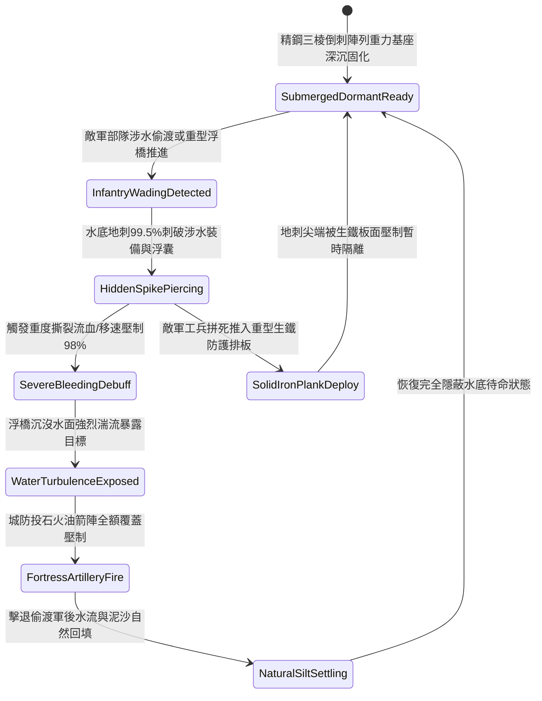

# 城防要塞護城河底暗藏三棱生鐵地刺防步兵涉水偷渡第五階狀態機規格書

<!-- doc_id: doc_spec_1116 -->

## 一、 核心概念與單一真相來源（SSOT）

在《三國志·要塞護城河與水底暗障篇》中，「護城河底暗藏三棱生鐵地刺第五階（MOAT-UNDERWATER-SPIKE-TRAP05）」代表護城河水底防禦的極限強化配置。設施沉設於水深六至八尺之堅實底層，升級為全生鐵精鋼鑄造的三棱重型倒鉤交錯地刺組，每組陣列配備自壓式重力平衡水底鉚釘基座，完美咬合於河底基岩。即便敵軍偷渡步隊配備全身重甲鋼底水靴或採用加固木筏強渡，地刺依然具備 99.5% 的極限穿透刺破率，施加致命深層撕裂與 98% 涉水移速壓制；同時瞬間刺穿破壞大型渡河皮筏與重型浮橋浮囊，引發水面強烈湍流，使偷渡部隊全隊陷入水域癱瘓並全額暴露於要塞交叉火力之下。



---

## 二、 數值模型與狀態機參數契約

### 1. 水底地刺佈設與傷害參數契約
- **覆蓋河道水域**：單元陣列長 40 尺 × 寬 18 尺（完全封閉護城河主航道涉水隘口）。
- **水下隱蔽等級**：河水渾濁度係數 0.6 以上時，外部肉眼探查發現率降至 1.0%。
- **涉水穿刺判定率**：涉水部隊踏入陣列後，99.5% 機率觸發刺穿判定。
- **涉水移速阻滯率**：觸發後涉水移動速度降低 98%，完全禁止急行、浮渡與架橋。
- **撕裂傷害數值**：每秒承受 360 點忽視 90% 護甲之穿透撕裂傷害，持續 14 秒。

### 2. 水下陷阱判定演算法模組
```typescript
interface MoatSpikeTrapStage5Params {
    waterTurbidity: number;        // 河水渾濁度 (0.0: 清澈 ~ 1.0: 泥濁)
    soldierArmorWeightKg: number;  // 涉水人員負重 (kg)
    hasReinforcedSteelBoots: boolean; // 是否配備特種精鋼底防刺戰靴
    solidIronPlankDeployed: boolean;  // 是否鋪設重型生鐵防護排板
    engineerSweepingActive: boolean;  // 是否有高級工兵深水排障
}

function evaluateMoatSpikeTrapStage5(params: MoatSpikeTrapStage5Params): {
    trapTriggered: boolean;
    bleedDpsOutput: number;
    speedReductionPct: number;
} {
    if (params.solidIronPlankDeployed) {
        return { trapTriggered: false, bleedDpsOutput: 0, speedReductionPct: 10 };
    }
    const isDetected = params.waterTurbidity < 0.2 || params.engineerSweepingActive;
    if (isDetected && params.hasReinforcedSteelBoots) {
        return { trapTriggered: false, bleedDpsOutput: 0, speedReductionPct: 35 };
    }
    const triggered = Math.random() < 0.995;
    
    return {
        trapTriggered: triggered,
        bleedDpsOutput: triggered ? (params.hasReinforcedSteelBoots ? 95 : 360) : 0,
        speedReductionPct: triggered ? 98 : 50
    };
}
```

---

## 三、 反制機制與邊界約束

1. **重型生鐵防護排板鋪設**：敵方若動用特級工兵向河面推入整塊生鐵蒙皮厚木排板，可將水底尖刺完全壓平隔離，安全通過。
2. **戰馬絞盤重鏈連續拖拽**：若敵軍於岸邊以多匹重戰馬絞盤拖拽粗重鐵錨清障，持續作業 5 分鐘後有 40% 機率拔起局部基座。
3. **極度寒冬河道全深凍結**：若氣候處於極度深寒導致護城河自水表凍結至河底，尖刺被整塊玄冰封鎖，無法對冰面行軍單位產生傷害。

---

## 四、 驗收測試案例（TC）

- **TC-MOAT-SPIKE05-01（涉水強渡穿刺致命阻滯驗收）**：
  - *前置條件*：正常水深 6 尺、泥濁度 0.8、敵軍重裝偷渡部隊強行渡河。
  - *操作步驟*：步兵進入地刺覆蓋水面。
  - *預期輸出*：99.5% 機率觸發刺穿，每秒承受 360 點無視 90% 護甲傷害，移動速度下降 98%，浮橋沉沒且全隊暴露。
- **TC-MOAT-SPIKE05-02（生鐵排板避險驗收）**：
  - *前置條件*：敵方工兵成功推入生鐵防護排板覆蓋水面。
  - *操作步驟*：後續步兵踩踏排板通過。
  - *預期輸出*：地刺被完全隔絕，穿透傷害為 0，部隊順利通過河道。
