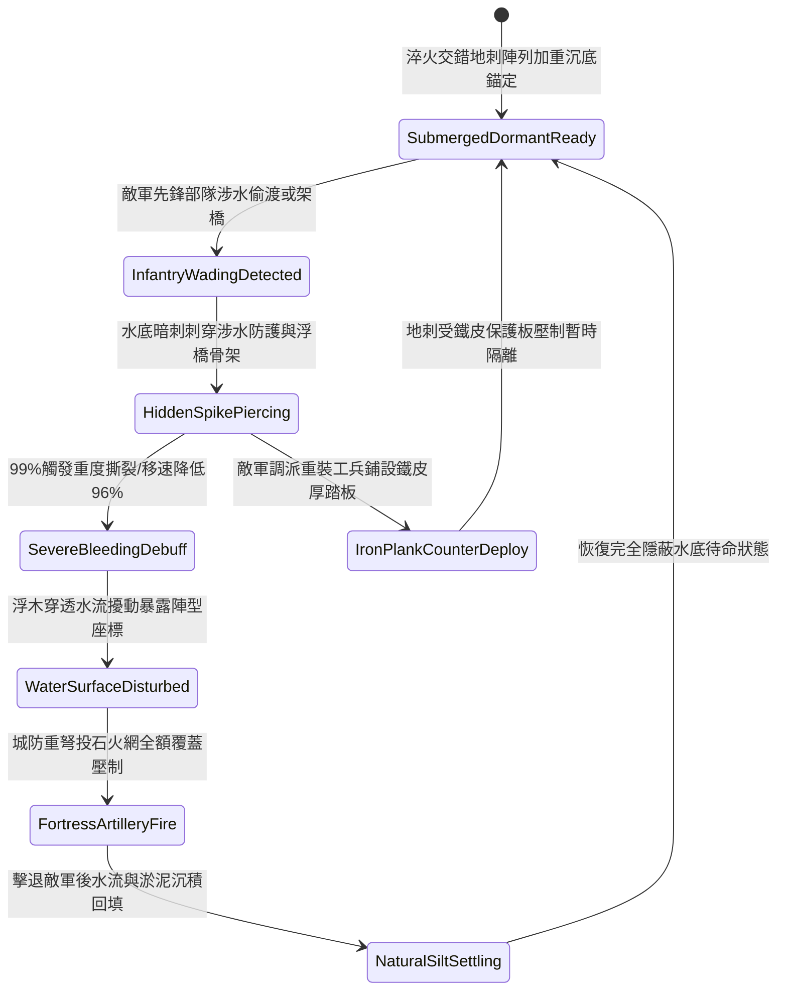

# 城防要塞護城河底暗藏三棱生鐵地刺防步兵涉水偷渡第四階狀態機規格書

<!-- doc_id: doc_spec_1113 -->

## 一、 核心概念與單一真相來源（SSOT）

在《三國志·要塞護城河與水底暗障篇》中，「護城河底暗藏三棱生鐵地刺第四階（MOAT-UNDERWATER-SPIKE-TRAP04）」代表外圍防禦工事進入自動密閉阻截體系。該設施沉設於護城河水面下五至七尺之河床硬土層，升級為淬火四棱與三棱交錯倒鉤生鐵地刺，每組陣列配備自重力水壓自鎖加重底座。即便敵軍先鋒部隊身著加厚鋼底戰靴或以木盾鋪底，仍具備 99% 的強力穿透率，施加重度撕裂與 96% 涉水移速壓制；同時刺破涉水皮筏與簡易浮橋，引發強烈水流漩渦，迫使偷渡部隊全隊暴露於守城投石機與重弩的火力覆蓋下。



---

## 二、 數值模型與狀態機參數契約

### 1. 水底地刺佈設與傷害參數契約
- **覆蓋河道水域**：單元陣列長 36 尺 × 寬 16 尺（覆蓋護城河主航道涉水區）。
- **水下隱蔽等級**：河水渾濁度係數 0.65 以上時，外部探查發現率降至 1.5%。
- **涉水穿刺判定率**：涉水步兵踏入陣列後，99% 機率觸發刺穿判定。
- **涉水移速阻滯率**：觸發後涉水移動速度降低 96%，完全封鎖衝刺與攀登指令。
- **撕裂傷害數值**：每秒承受 310 點忽視 85% 護甲之穿透撕裂傷害，持續 12 秒。

### 2. 水下陷阱判定演算法模組
```typescript
interface MoatSpikeTrapStage4Params {
    waterTurbidity: number;        // 河水渾濁度 (0.0: 清澈 ~ 1.0: 泥濁)
    soldierArmorWeightKg: number;  // 涉水人員負重 (kg)
    hasIronBoots: boolean;         // 是否配備鐵底加固防刺戰靴
    heavyPlankDeployed: boolean;   // 是否鋪設加固鐵皮木板
    engineerSweeping: boolean;     // 是否有工兵水下排障
}

function evaluateMoatSpikeTrapStage4(params: MoatSpikeTrapStage4Params): {
    trapTriggered: boolean;
    bleedDpsOutput: number;
    speedReductionPct: number;
} {
    if (params.heavyPlankDeployed) {
        return { trapTriggered: false, bleedDpsOutput: 0, speedReductionPct: 15 };
    }
    const isDetected = params.waterTurbidity < 0.25 || params.engineerSweeping;
    if (isDetected && params.hasIronBoots) {
        return { trapTriggered: false, bleedDpsOutput: 0, speedReductionPct: 30 };
    }
    const triggered = Math.random() < 0.99;
    
    return {
        trapTriggered: triggered,
        bleedDpsOutput: triggered ? (params.hasIronBoots ? 85 : 310) : 0,
        speedReductionPct: triggered ? 96 : 45
    };
}
```

---

## 三、 反制機制與邊界約束

1. **工兵鐵皮加厚踏板鋪設**：敵方若動用重裝工兵向水面鋪設包覆生鐵皮之重木浮排，可將地刺尖端徹底壓平隔離，部隊得以無損通過。
2. **長柄重型拖網翻轉清障**：若敵軍於岸邊以戰馬絞盤拖曳粗鐵鏈拖網清障，作業 4 分鐘後有 35% 機率將地刺基座翻轉拔起而失效。
3. **冬季嚴寒河道深層封凍**：若環境氣溫降至零度以下導致護城河結冰，水底地刺被冰層包裹，無法對冰面行進部隊造成威脅。

---

## 四、 驗收測試案例（TC）

- **TC-MOAT-SPIKE04-01（涉水偷渡穿刺阻滯驗收）**：
  - *前置條件*：正常氣候、水深 5 尺、泥濁度 0.85、敵軍先鋒部隊涉水。
  - *操作步驟*：先鋒部隊進入地刺覆蓋水域。
  - *預期輸出*：99% 機率觸發地刺刺穿，每秒承受 310 點撕裂傷害，移動速度下降 96%，行蹤完全暴露。
- **TC-MOAT-SPIKE04-02（鐵皮木板覆蓋避險驗收）**：
  - *前置條件*：敵方工兵鋪設鐵皮踏板覆蓋水面。
  - *操作步驟*：後續步兵踩踏鐵皮踏板行軍通過。
  - *預期輸出*：地刺被完全隔絕，穿刺傷害為 0，部隊維持正常行進速度通過河道。
