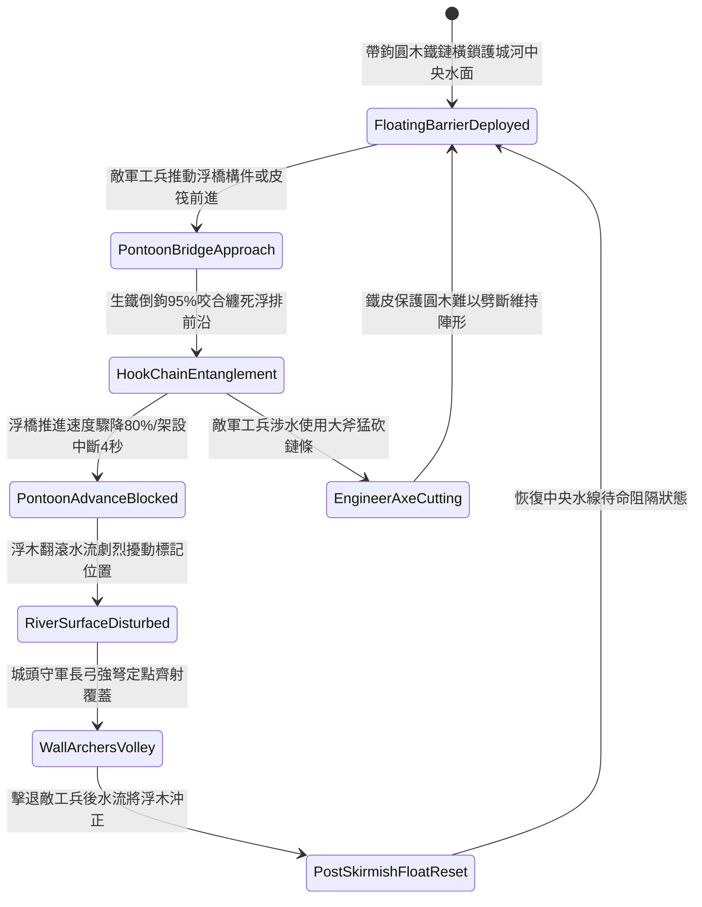

# 城防要塞護城河水面部署帶鉤重型浮木鏈防浮橋架設第一階狀態機規格書

<!-- doc_id: doc_spec_1119 -->

## 一、 核心概念與單一真相來源（SSOT）

在《三國志·城池護城河水網阻斷篇》中，「護城河水面部署帶鉤重型浮木鏈第一階（MOAT-SURFACE-FLOATING-LOG-BARRIER01）」代表針對敵軍架橋工兵與皮筏渡河部隊的水面阻隔工程。防線沿護城河中央水線橫向鋪設，以粗硬圓木外包薄鐵皮、四周鑲嵌兩寸生鐵倒鉤，各浮木間由生鐵粗鏈串連，兩端深鎖於兩岸地石鐵環。當敵軍工兵推動浮橋架板或皮筏意圖強渡時，水面浮木鏈 95% 勾纏阻截浮排前端，阻斷推進速度 80%，並引發水面拉扯使敵軍架橋進度中斷 4 秒，讓城頭弓弩隊可定點狙殺渡河工兵。



---

## 二、 數值模型與狀態機參數契約

### 1. 浮木阻隔陣列參數契約
- **浮木單元尺寸**：每節圓木長 12 尺、直徑 1.5 尺，四周鑄裝 16 枚兩寸生鐵倒鉤。
- **生鐵索鏈規格**：雙股生鐵鏈環，抗拉拔極限 9,500 牛頓，兩端錨固於河岸地基石。
- **浮排攔截成功率**：對正面推進之浮橋構件或渡河皮筏，判定 95% 機率成功勾纏。
- **推進速度削弱率**：遭勾纏之渡河載具，推進速度即時降低 80%，強行推進將導致翻覆。
- **工兵架橋中斷時效**：勾纏觸發後，工兵部隊施展架設動作強制中斷 4 秒。

### 2. 水面浮木攔截演算法模組
```typescript
interface MoatLogBarrierStage1Params {
    waterFlowSpeed: number;        // 河水流速 (米/秒)
    pontoonPushForce: number;      // 敵方浮橋推進推力
    isLogChainTensioned: boolean;  // 兩端鎖鏈是否張滿錨定
    hasIronHookFittings: boolean;  // 浮木是否配備生鐵倒鉤
}

function evaluateMoatLogBarrierStage1(params: MoatLogBarrierStage1Params): {
    bridgeIntercepted: boolean;
    speedReductionPct: number;
    constructionDelaySec: number;
} {
    if (!params.isLogChainTensioned) {
        return { bridgeIntercepted: false, speedReductionPct: 20, constructionDelaySec: 0 };
    }
    const success = Math.random() < (params.hasIronHookFittings ? 0.95 : 0.65);
    
    return {
        bridgeIntercepted: success,
        speedReductionPct: success ? 80 : 30,
        constructionDelaySec: success ? 4.0 : 1.0
    };
}
```

---

## 三、 反制機制與邊界約束

1. **工兵長柄鐵剪斷鏈**：若敵方配備特製重型雙手破鏈剪，並有掩護部隊近身剪切，連續作業 2 分鐘有 25% 機率剪斷鏈環。
2. **投擲燃燒猛火油櫃**：敵軍若自對岸使用小型投石機投擲猛火油櫃燃燒浮木，火勢延燒 3 分鐘後木質碳化浮力減弱。
3. **枯水期河道乾涸**：若季節更迭護城河水位降至 1 尺以下，浮木沉底陷入淤泥，失去水面浮動阻截效果。

---

## 四、 驗收測試案例（TC）

- **TC-MOAT-LOG01-01（渡河浮橋推進阻截驗收）**：
  - *前置條件*：護城河水深 5 尺、浮木鏈兩端牢固錨定、敵方工兵推動輕型浮排推進。
  - *操作步驟*：浮排前端接觸浮木鏈邊緣。
  - *預期輸出*：95% 機率觸發倒鉤勾死，推進速度下降 80%，工兵架設中斷 4 秒，城頭獲得射擊窗口。
- **TC-MOAT-LOG01-02（岸邊鎖鏈鬆弛邊界驗收）**：
  - *前置條件*：浮木鏈兩端地錨未拉緊（鏈條鬆弛度大於 2 米）。
  - *操作步驟*：承受浮排直衝。
  - *預期輸出*：浮木被浮排順勢推擠漂移，攔截失敗，推進速度僅降低 20%。
