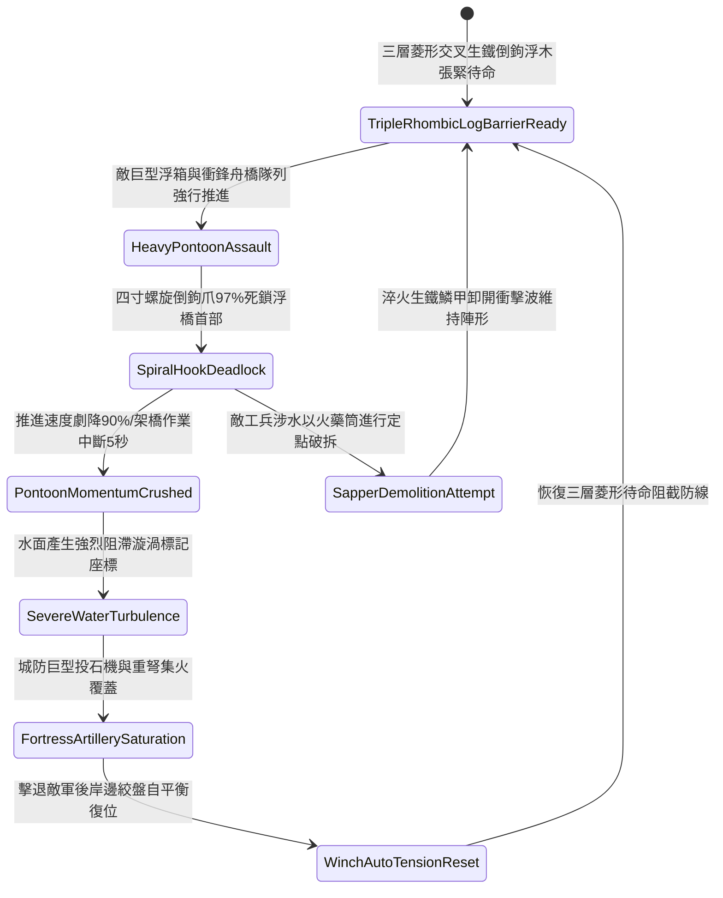

# 城防要塞護城河水面部署帶鉤重型浮木鏈防浮橋架設第三階狀態機規格書

<!-- doc_id: doc_spec_1125 -->

## 一、 核心概念與單一真相來源（SSOT）

在《三國志·城池護城河水網阻斷篇》中，「護城河水面部署帶鉤重型浮木鏈第三階（MOAT-SURFACE-FLOATING-LOG-BARRIER03）」代表要塞外圍水網防線針對敵軍大型機械化浮橋與衝鋒舟橋隊列的深層立體阻斷工程。防禦線升級為三層菱形交叉浮動粗圓木陣列，表面全面包裹加厚淬火生鐵鱗片甲，並鑄造四寸高強度生鐵螺旋倒鉤爪。各組浮木由六道雙股高碳冷鍛重鏈緊扣，並由兩岸深埋之自平衡水壓重力絞盤實時調節浮動張力。當敵軍重裝架橋工兵推動巨型浮箱與皮筏強行渡河時，浮木鏈 97% 強力死鎖浮橋首部骨架，強行削弱推進速度 90%，並引發連鎖水流阻力迫使架橋作業強制中斷 5 秒，為城頭巨型投石機與床弩提供全額覆蓋打擊窗口。



---

## 二、 數值模型與狀態機參數契約

### 1. 浮木阻隔陣列參數契約
- **浮木單元配置**：三層菱形交叉排列，每節圓木長 16 尺、直徑 2 尺，表面滿布 32 枚四寸生鐵螺旋倒鉤。
- **生鐵索鏈規格**：六道高碳冷鍛重鏈，單環破斷拉力 16,000 牛頓，兩端錨固於河岸石壁重力自平衡絞盤。
- **浮排攔截成功率**：對正面推進之巨型浮橋與機械化舟橋，判定 97% 機率強力死鎖。
- **推進速度削弱率**：遭死鎖後推進速度即時降低 90%，強行拖拽將導致舟橋骨架受扭曲撕裂。
- **工兵架橋中斷時效**：死鎖判定觸發後，工兵部隊施展架設動作強制中斷 5 秒。

### 2. 水面浮木攔截演算法模組
```typescript
interface MoatLogBarrierStage3Params {
    waterFlowSpeed: number;        // 河水流速 (米/秒)
    pontoonThrustForce: number;    // 敵方浮橋總推進推力
    isHydraulicWinchActive: boolean; // 自平衡重力絞盤是否作動
    outerIronScaleArmor: boolean;  // 是否覆蓋淬火生鐵鱗甲
}

function evaluateMoatLogBarrierStage3(params: MoatLogBarrierStage3Params): {
    bridgeIntercepted: boolean;
    speedReductionPct: number;
    constructionDelaySec: number;
} {
    if (!params.isHydraulicWinchActive) {
        return { bridgeIntercepted: false, speedReductionPct: 30, constructionDelaySec: 1.0 };
    }
    const success = Math.random() < 0.97;
    
    return {
        bridgeIntercepted: success,
        speedReductionPct: success ? 90 : 40,
        constructionDelaySec: success ? 5.0 : 2.0
    };
}
```

---

## 三、 反制機制與邊界約束

1. **工兵重型鏈鋸定點切割**：敵方若動用特種多人工兵重型鋼鋸連續鋸切關鍵鏈節超過 3 分鐘，該處鏈條有 20% 斷裂風險。
2. **岸邊投擲千斤巨石精準重砸**：若敵方投石車發射千斤巨石直接命中浮木交匯節點，存在 25% 結構損壞導致局部沉降。
3. **極度寒冬水面整體封凍**：若環境氣溫驟降導致河面完全凍結，浮木鏈被玄冰整體鎖死，無法產生水面浮動阻滯效果。

---

## 四、 驗收測試案例（TC）

- **TC-MOAT-LOG03-01（巨型舟橋推進全面阻隔驗收）**：
  - *前置條件*：三層菱形浮木張緊、水深 7 尺、自平衡絞盤就緒、敵軍巨型浮橋推進。
  - *操作步驟*：舟橋首部推入菱形浮木防禦區。
  - *預期輸出*：97% 機率螺旋倒鉤死鎖，推進速度暴跌 90%，架橋作業強制中斷 5 秒，城防投石機獲得滿額命中窗口。
- **TC-MOAT-LOG03-02（自平衡絞盤未啟動邊界驗收）**：
  - *前置條件*：岸邊自平衡絞盤鎖定銷未拔出（處於剛性僵死狀態）。
  - *操作步驟*：遭受重舟橋全速衝擊。
  - *預期輸出*：浮木受衝擊拉扯過載，阻截率降至 30%，浮木單元位移散開。
