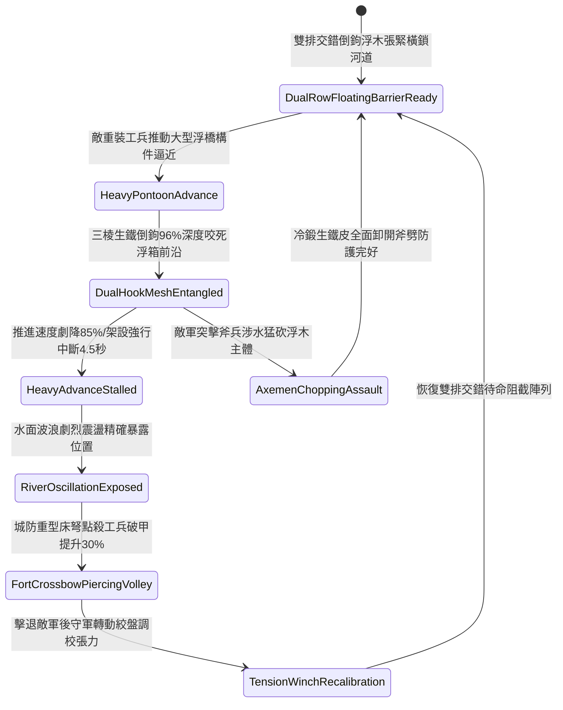

# 城防要塞護城河水面部署帶鉤重型浮木鏈防浮橋架設第二階狀態機規格書

<!-- doc_id: doc_spec_1122 -->

## 一、 核心概念與單一真相來源（SSOT）

在《三國志·城池護城河水網阻斷篇》中，「護城河水面部署帶鉤重型浮木鏈第二階（MOAT-SURFACE-FLOATING-LOG-BARRIER02）」代表要塞外圍防禦針對敵方重型浮箱與大型渡河工兵梯隊的水網升級配置。防禦線升級為雙排交錯浮動圓木陣列，表面全面覆蓋防腐冷鍛生鐵皮，並加鑄加長三寸三棱雙向生鐵倒鉤。兩側由四道粗重雙股淬火鐵鏈橫向絞緊，並透過兩岸深固石基絞盤實施張力微調。當敵軍工兵推動重型浮排或大型浮橋構件強渡時，雙排浮木鏈 96% 深度咬合死鎖浮箱前端，削弱推進速度 85%，並引發強烈水面擺動迫使工兵架設中斷 4.5 秒，為城頭重型床弩創造絕佳破甲齊射窗口。



---

## 二、 數值模型與狀態機參數契約

### 1. 浮木阻隔陣列參數契約
- **浮木單元配置**：雙排交錯排列，每節圓木長 14 尺、直徑 1.8 尺，表面鑲嵌 24 枚三寸生鐵雙向倒鉤。
- **生鐵索鏈規格**：四道雙股淬火鐵鏈，抗拉極限提升至 12,500 牛頓，兩端深鎖於河岸石壁重型絞盤。
- **浮排攔截成功率**：對正面推進之重型浮橋構件，判定 96% 機率成功咬死死鎖。
- **推進速度削弱率**：遭死鎖後推進速度即時降低 85%，強行牽引將導致浮箱側翻進水。
- **工兵架橋中斷時效**：咬死判定觸發後，工兵部隊架設動作強制中斷 4.5 秒。

### 2. 水面浮木攔截演算法模組
```typescript
interface MoatLogBarrierStage2Params {
    waterFlowSpeed: number;        // 河水流速 (米/秒)
    pontoonPushForce: number;      // 敵方浮橋總推進力
    isDualChainWinchTensioned: boolean; // 岸邊四道鎖鏈絞盤是否張緊
    hasArmorPlating: boolean;      // 圓木是否包覆防劈生鐵皮
}

function evaluateMoatLogBarrierStage2(params: MoatLogBarrierStage2Params): {
    bridgeIntercepted: boolean;
    speedReductionPct: number;
    constructionDelaySec: number;
} {
    if (!params.isDualChainWinchTensioned) {
        return { bridgeIntercepted: false, speedReductionPct: 25, constructionDelaySec: 0 };
    }
    const success = Math.random() < 0.96;
    
    return {
        bridgeIntercepted: success,
        speedReductionPct: success ? 85 : 35,
        constructionDelaySec: success ? 4.5 : 1.5
    };
}
```

---

## 三、 反制機制與邊界約束

1. **工兵長柄炸藥包定點爆破**：敵方特種工兵若趁大霧涉水向浮木鏈關鍵鉸環投擲雷火炸藥筒，有 25% 機率炸斷局部連接環。
2. **岸邊巨石投射直接砸斷**：若敵方投石機以五百斤巨石正面直接砸中浮木單元，該節圓木存在 30% 斷裂沉沒風險。
3. **枯水期河道淤積卡死**：若水位大幅下降致雙排浮木陷入底層爛泥，浮動自適應彈性消失，攔截面縮減 50%。

---

## 四、 驗收測試案例（TC）

- **TC-MOAT-LOG02-01（大型重型浮橋推進阻截驗收）**：
  - *前置條件*：雙排浮木張緊到位、護城河水深 6 尺、敵軍重裝工兵部隊強渡推動大浮排。
  - *操作步驟*：浮排前端接觸雙排浮木邊界。
  - *預期輸出*：96% 機率咬死鎖定，推進速度暴跌 85%，架橋動作延遲中斷 4.5 秒，城防床弩破甲提升 30%。
- **TC-MOAT-LOG02-02（岸邊絞盤未鎖定邊界驗收）**：
  - *前置條件*：岸邊絞盤齒輪未完全鎖定卡位。
  - *操作步驟*：遭受重浮排直衝。
  - *預期輸出*：鎖鏈受力滑齒釋放，浮木位移散開，攔截成功率降至 25%。
