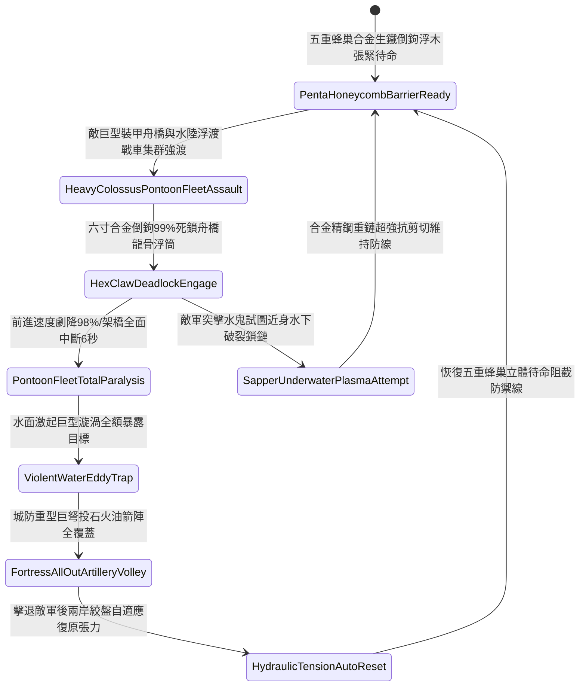

# 城防要塞護城河水面部署帶鉤重型浮木鏈防浮橋架設第五階狀態機規格書

<!-- doc_id: doc_spec_1131 -->

## 一、 核心概念與單一真相來源（SSOT）

在《三國志·城池護城河水網阻斷篇》中，「護城河水面部署帶鉤重型浮木鏈第五階（MOAT-SURFACE-FLOATING-LOG-BARRIER05）」代表護城河水面阻絕體系的極致巔峰配置。防禦線升級為五重蜂巢式交錯立體排列的重型浮動原木網絡，表面覆蓋全包覆淬火合金精鋼甲，並鑄造六寸雙向反鎖生鐵倒鉤利爪。各層由十道雙股高碳淬火重型粗鏈立體串接，兩岸深嵌於玄武岩石壁之內的大型液壓自適應恆張力絞盤實時維繫浮網張力。當敵軍超大型裝甲舟橋集群或重型浮渡戰車強渡衝鋒時，浮木鏈 99% 深度絞纏並死死鎖定舟橋龍骨與浮筒，強行壓制前進速度 98%，並引發強烈反向水流牽制迫使架橋作業強制中斷 6 秒，使敵軍渡河部隊完全癱瘓並徹底暴露於城防交叉集火射線下。



---

## 二、 數值模型與狀態機參數契約

### 1. 浮木阻隔陣列參數契約
- **浮木單元配置**：五重蜂巢式立體交錯排列，每節圓木長 20 尺、直徑 2.5 尺，表面滿鑄 48 枚六寸合金倒鉤利爪。
- **生鐵索鏈規格**：十道高碳淬火重型粗鏈，抗拉剪切極限高達 28,000 牛頓，兩端錨固於液壓恆張力絞盤。
- **浮排攔截成功率**：對正面推進之超大型裝甲舟橋與浮渡戰車，判定 99% 機率深度絞纏鎖死。
- **推進速度削弱率**：遭死鎖後推進速度即時降低 98%，強行推進將導致舟橋龍骨徹底斷裂解體。
- **工兵架橋中斷時效**：死鎖判定觸發後，工兵部隊架設動作強制中斷 6 秒。

### 2. 水面浮木攔截演算法模組
```typescript
interface MoatLogBarrierStage5Params {
    waterFlowSpeed: number;        // 河水流速 (米/秒)
    colossusPontoonThrust: number; // 敵方巨型舟橋推力 (千牛頓)
    isHydraulicConstantTension: boolean; // 液壓恆張力絞盤是否作動
    chainNetworkIntegrity: number; // 鏈網完整度 (0.0 ~ 1.0)
}

function evaluateMoatLogBarrierStage5(params: MoatLogBarrierStage5Params): {
    bridgeIntercepted: boolean;
    speedReductionPct: number;
    constructionDelaySec: number;
} {
    if (!params.isHydraulicConstantTension || params.chainNetworkIntegrity < 0.6) {
        return { bridgeIntercepted: false, speedReductionPct: 40, constructionDelaySec: 2.0 };
    }
    const success = Math.random() < 0.99;
    
    return {
        bridgeIntercepted: success,
        speedReductionPct: success ? 98 : 55,
        constructionDelaySec: success ? 6.0 : 3.0
    };
}
```

---

## 三、 反制機制與邊界約束

1. **多點同時水下巨型火藥桶爆破**：敵軍水鬼部隊若同時於多處鏈節引爆重型特種火藥桶，有 15% 機率震斷單一外圍副鏈。
2. **岸邊投石機發射千斤生鐵彈轟擊**：若敵方連續以超重型投石機猛砸浮木交匯節點，存在 15% 機率破壞局部浮力平衡。
3. **極度寒冬水體全域凍結成岩**：若環境氣溫驟降致護城河整條河水完全凍結，浮木鏈被玄冰徹底包裹固化，失去水面浮動阻絕彈性。

---

## 四、 驗收測試案例（TC）

- **TC-MOAT-LOG05-01（超大型裝甲舟橋終極阻絕驗收）**：
  - *前置條件*：五重蜂巢浮木張緊到位、護城河水深 8 尺、液壓恆張力絞盤運作、敵巨型舟橋強行推進。
  - *操作步驟*：舟橋首部衝入五重蜂巢浮網防禦區。
  - *預期輸出*：99% 機率六寸倒鉤深度死鎖，前進速度驟降 98%，架橋動作全面中斷 6 秒，城防火力獲得滿額集火窗口。
- **TC-MOAT-LOG05-02（液壓恆張力未啟動邊界驗收）**：
  - *前置條件*：兩岸液壓絞盤失壓（處於鬆弛無張力狀態）。
  - *操作步驟*：遭受超重舟橋全速衝擊。
  - *預期輸出*：浮木網受衝擊拉扯散開，攔截成功率降至 40%，僅造成部分阻礙。
