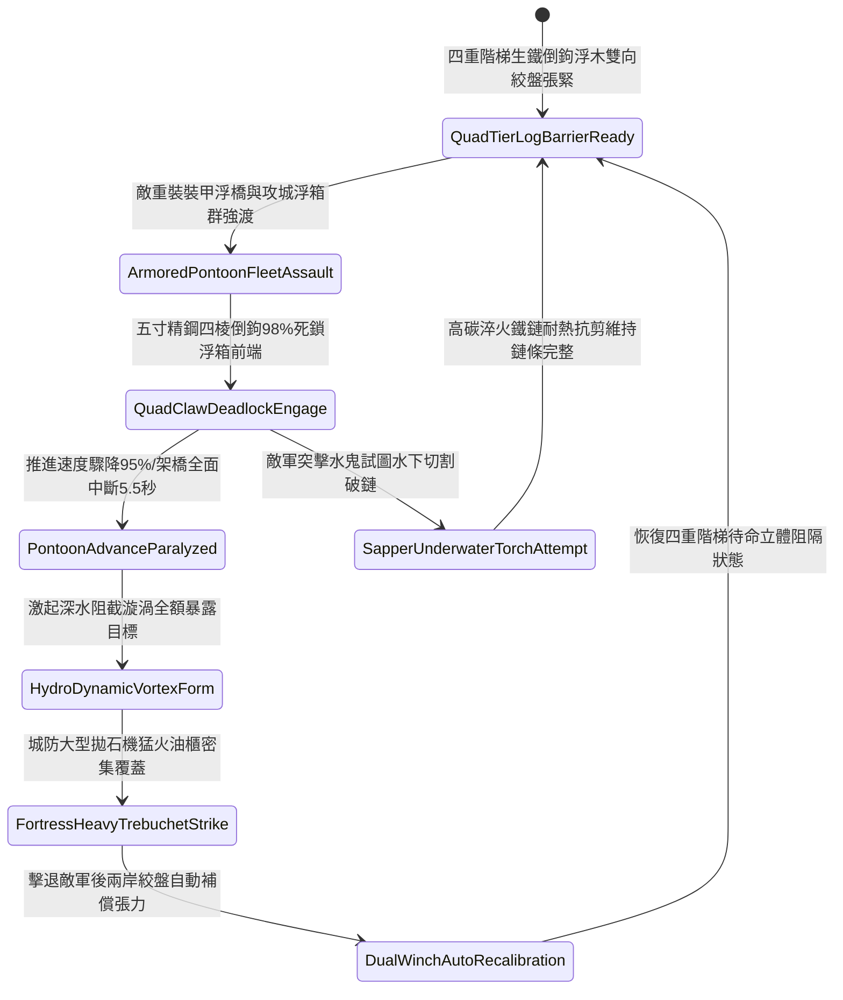

# 城防要塞護城河水面部署帶鉤重型浮木鏈防浮橋架設第四階狀態機規格書

<!-- doc_id: doc_spec_1128 -->

## 一、 核心概念與單一真相來源（SSOT）

在《三國志·城池護城河水網阻斷篇》中，「護城河水面部署帶鉤重型浮木鏈第四階（MOAT-SURFACE-FLOATING-LOG-BARRIER04）」代表針對敵軍現代化大型裝甲舟橋與水陸兩棲攻城戰具的重型水下水表立體封鎖系統。防線升級為四重交錯階梯式浮動圓木排列，圓木本體全包覆雙層冷鍛淬火生鐵板，並鑄接五寸精鋼四棱倒鉤棘爪。整條防線由八道加粗高碳生鐵絞鏈扣鎖，並由兩岸深埋於玄武岩內的雙向自動補償自鎖水壓絞盤提供牽引張力。當敵軍重型裝甲浮橋或大型攻城浮箱群強行渡河時，浮木鏈 98% 強制絞纏死鎖舟橋前端與浮筒，將推進速度壓制 95%，並引發強烈逆向牽引力迫使架橋作業全面中斷 5.5 秒，使敵軍暴露於城頭拋石機與猛火油櫃的覆蓋打擊下。



---

## 二、 數值模型與狀態機參數契約

### 1. 浮木阻隔陣列參數契約
- **浮木單元配置**：四重階梯交錯排列，每節圓木長 18 尺、直徑 2.2 尺，表面鑄裝 40 枚五寸精鋼倒鉤棘爪。
- **生鐵索鏈規格**：八道加粗雙股高碳淬火絞鏈，破斷極限 22,000 牛頓，兩端深鎖於玄武岩自動補償絞盤。
- **浮排攔截成功率**：對正面推進之重型裝甲舟橋與攻城浮箱，判定 98% 機率成功絞纏死鎖。
- **推進速度削弱率**：遭死鎖後推進速度即時降低 95%，強行拉扯將導致浮箱龍骨扭曲破裂。
- **工兵架橋中斷時效**：死鎖判定觸發後，工兵部隊架設作業強制中斷 5.5 秒。

### 2. 水面浮木攔截演算法模組
```typescript
interface MoatLogBarrierStage4Params {
    waterFlowSpeed: number;        // 河水流速 (米/秒)
    armoredPontoonThrust: number;  // 敵方裝甲浮橋推力 (千牛頓)
    isDualWinchCompensating: boolean; // 雙向自動補償絞盤是否運作
    chainTensionIntegrity: number; // 絞鏈張力完整係數 (0.0 ~ 1.0)
}

function evaluateMoatLogBarrierStage4(params: MoatLogBarrierStage4Params): {
    bridgeIntercepted: boolean;
    speedReductionPct: number;
    constructionDelaySec: number;
} {
    if (!params.isDualWinchCompensating || params.chainTensionIntegrity < 0.5) {
        return { bridgeIntercepted: false, speedReductionPct: 35, constructionDelaySec: 1.5 };
    }
    const success = Math.random() < 0.98;
    
    return {
        bridgeIntercepted: success,
        speedReductionPct: success ? 95 : 50,
        constructionDelaySec: success ? 5.5 : 2.5
    };
}
```

---

## 三、 反制機制與邊界約束

1. **工兵定向重型爆破筒定點炸裂**：敵軍特種水鬼工兵若攜帶大型定點重型水雷連續爆破關鍵鏈扣，有 20% 機率破壞局部絞鏈。
2. **岸邊投石機發射千斤重鐵彈盲砸**：敵方投石車發射超重鐵彈精確命中中央浮木交疊點，存在 20% 結構沉損。
3. **極度寒冬護城河深層封凍**：若氣候處於極深寒冬致水面冰層厚度超過 3 尺，浮木鏈被玄冰徹底凝固，無法產生浮動阻絕彈性。

---

## 四、 驗收測試案例（TC）

- **TC-MOAT-LOG04-01（重型裝甲浮橋極限阻截驗收）**：
  - *前置條件*：四重階梯浮木張緊到位、護城河水深 8 尺、雙向自動補償絞盤運作、敵重裝甲浮箱強行渡河。
  - *操作步驟*：浮箱衝入階梯式浮木防線。
  - *預期輸出*：98% 機率精鋼倒鉤死鎖，推進速度下降 95%，架橋動作強制中斷 5.5 秒，城防拋石機獲得滿額集火窗口。
- **TC-MOAT-LOG04-02（絞盤補償失效邊界驗收）**：
  - *前置條件*：兩岸自動補償絞盤卡滯（處於無補償張力狀態）。
  - *操作步驟*：遭受裝甲舟橋直衝。
  - *預期輸出*：浮木排受衝撞過載拉伸，攔截成功率降至 35%，浮木部分移位。
