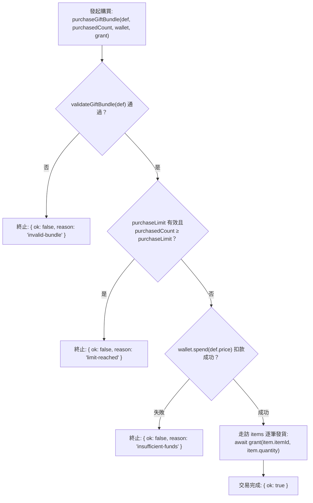

<!-- doc_id: doc_spec_0418 -->
# 多道具禮包組合架構與批次入庫核驗規格書

> 本規格書為 3KLife 百寶閣多道具禮包組合定義（`GiftBundleDef`）、Schema 嚴格檢驗與原子購買發貨協議之唯一真相來源（Single Source of Truth）。
> 相關實作對齊：`assets/scripts/core/systems/GiftBundle.ts`、`ItemShopPricing.ts`、`ItemDef.ts`。

---

## 1. 系統定位與商業設計

1. **一鍵打包與複合商品運營（Composite Bundle Offer）**：
   - 禮包組合允許運營配置單一商品包含多款、多數量之道具，透過單次扣除精元（`gem`）完成批次入庫發貨。
   - 支援個人限購次數控制（`purchaseLimit`），滿足新手禮包、特惠月包與節慶限定促銷需求。
2. **三段式交易保證（Validate-Check-Spend-Grant Flow）**：
   - 購買流程嚴格遵循「Schema 語義驗證 $\to$ 限購次數審查 $\to$ 錢包扣款 $\to$ 逐項發貨」之不可逆安全管道，任何階段不符立即中止且不扣費。

---

## 2. 禮包定義結構契約（GiftBundleDef）

```typescript
export interface GiftBundleItem {
    readonly itemId: string;
    readonly quantity: number;
}

export interface GiftBundleDef {
    readonly id: string;
    readonly name: string;
    readonly currency: 'gem';
    readonly price: number;
    readonly items: readonly GiftBundleItem[];
    readonly purchaseLimit?: number; // 省略表示不限購
}
```

---

## 3. Schema 靜態驗證機制（validateGiftBundle）

在進入購買邏輯前，必須先通過靜態規格校驗，任何項不合規即回傳問題清單：

| 檢驗項目 | 合法條件 | 異常回傳錯誤提示 |
|---|---|---|
| **商品 ID** | `Boolean(def.id) === true` | `缺少 id` |
| **定價金額** | `Number.isInteger(price) && price >= 0` | `{id}: 價格須為非負整數` |
| **內容清單** | `Array.isArray(items) && items.length > 0` | `{id}: 至少要有一項道具` |
| **道具存在性** | 每個 `itemId` 必須已登錄於 `ITEM_DEFS` | `{id}: 未知道具 {itemId}` |
| **道具數量** | `Number.isInteger(quantity) && quantity > 0` | `{id}: {itemId} 數量須為正整數` |
| **限購次數** | 若有設定，必須 `Number.isInteger(limit) && limit > 0` | `{id}: 限購須為正整數` |

---

## 4. 交易狀態機與發貨流程（purchaseGiftBundle）



---

## 5. 驗收標準與測試用例

1. **非法禮包安全阻擋**：
   - 含有未知道具 ID、負數價格或空道具清單之禮包，購買直接回傳 `invalid-bundle`。
2. **限購防禦驗證**：
   - 禮包設定 `purchaseLimit = 1`，當玩家已買次數 `purchasedCount = 1` 時，呼叫購買直接回傳 `limit-reached`，且完全不呼叫 `wallet.spend`。
