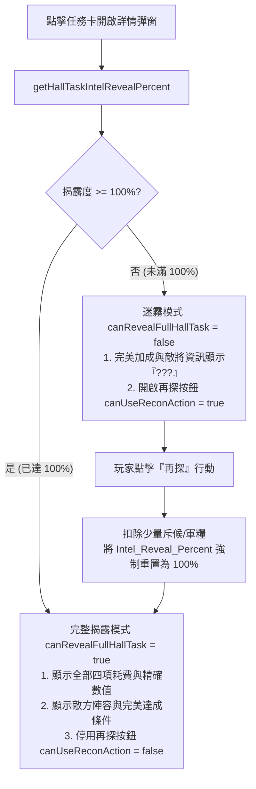

<!-- doc_id: doc_spec_0454 -->
# 大廳任務情報度再探揭露與AI委任決策規格書

## 1. 核心定位與職責範圍

本規格書定義大廳任務詳情視圖中的情報揭露度（`Intel_Reveal_Percent`）、斥候「再探（Recon）」機制與自動委任（`AI_Assign_Enabled`）決策邏輯，對應 WBS **HALL-05**。
軍國大事情報先行。任務在未完全探明前，其真實難度、敵方守將與完美加成條件處於迷霧狀態。
系統實行「門檻情報（可見性）」與「內容情報（揭露度）」雙重解耦架構，由純邏輯無副作用服務（`HallTaskIntel.ts`）提供即時權限判斷，杜絕作弊窺視與未解鎖委任。

---

## 2. 雙重情報分離原則（Dual-Intel Separation）

```mermaid
flowchart LR
    Task[大廳任務資料] --> Intel1[門檻情報 Required_Intel\n決定任務是否在牆上可見 (可見性門檻)]
    Task --> Intel2[內容情報 Intel_Reveal_Percent\n決定任務詳情是否完整可視 (內容揭露度)]
    
    Intel1 -. 互不混淆 .-> Intel2
```

### 2.1 兩大情報維度定義
- **可見性情報（`Required_Intel`）**：全局軍事情報值，決定任務是否具備上牆資格（見 `HALL-03`）。
- **揭露度情報（`Intel_Reveal_Percent`）**：針對該單一任務的偵察進度（合法區間 $[0, 100]$，預設基準為 `50%`）。

---

## 3. 情報揭露與再探狀態機（`canUseReconAction`）



### 3.1 數值邊界防護公式
```typescript
export function getHallTaskIntelRevealPercent(task: Readonly<HallTaskIntelInput>): number {
    const value = task.Intel_Reveal_Percent;
    if (typeof value !== 'number' || !Number.isFinite(value)) return 50;
    return Math.max(0, Math.min(value, 100));
}
```
- 若資料缺漏或異常，統一安全回退為 `50%`，絕不產生 NaN 或越界數值。

---

## 4. AI 委任決策機制（`isAutoAssignEnabled`）

### 4.1 委任權限判定
- 僅當任務資料明確宣告 `AI_Assign_Enabled === true` 時，詳情介面的「委任（ASSIGN）」按鈕方才點亮可點擊。
- 特殊緊急劇情任務或君主親征討伐令，`AI_Assign_Enabled` 預設為 `false`，強制玩家手動決策。

### 4.2 智慧選將與回看記錄
- 點擊委任後，系統委任演算法（`HallAutoAssign.ts`）依據任務屬性需求（如統率高於 80、擁有騎兵適性等），自動從大廳閒置武將中遴選最優人選派遣。
- 委任執行完畢後生成可回看之結算記錄（`AssignmentLog`），供玩家事後審閱得失。

---

## 5. 驗收標準與單元測試契約

1. **揭露度邊界驗證**：
   - 傳入 `Intel_Reveal_Percent: 120`，函式自動夾回 `100`；傳入負數夾回 `0`；傳入 `undefined` 兜底為 `50`。
2. **完整揭露旗標驗證**：
   - 當數值為 99 時，`canRevealFullHallTask` 必須為 `false`，`canUseReconAction` 為 `true`。
   - 當數值為 100 時，`canRevealFullHallTask` 必須為 `true`，`canUseReconAction` 為 `false`。
3. **委任開關驗證**：
   - 當 `AI_Assign_Enabled` 為 `false` 或缺漏時，`isAutoAssignEnabled` 必須回傳 `false`。
