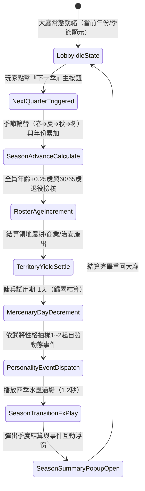

# 大廳季度推進時間發動機與武將性格事件狀態機規格書

<!-- doc_id: doc_spec_1169 -->

## 一、 核心概念與單一真相來源（SSOT）

本規格書定義《三國志·漢末霸業》（3KLife）大廳核心時序驅動核心——**季度推進時間發動機（SeasonPass Engine）**與**武將性格自發動態事件系統**。
解決過去遊戲大廳時間靜止、武將不老化、子嗣不成長、傭兵不退役的停滯狀態。玩家每次點擊大廳「下一季」按鈕，觸發時序演化、領地產出、年齡累加、傭兵天數扣減與性格事件分派。



---

## 二、 數值模型與狀態機參數契約

### 1. 時序演化與年齡增長契約
- **季度時序循環**：`SPRING (春) ➔ SUMMER (夏) ➔ AUTUMN (秋) ➔ WINTER (冬)`。
- **年號與年齡**：
  $$\text{Age}_{t+1} = \text{Age}_t + 0.25$$
  每滿 4 季（冬季結算後）年號年份 $+1$。
- **壽命退役檢核**：
  - $\ge 60$ 歲：標記 `can_retire = true`（榮譽退役選項）。
  - $\ge 65$ 歲：強烈提示轉化為「先祖教官卡」（`MentorCard`）。
- **傭兵試用倒數**：試用武將 `trialDaysLeft -= 1`，當 `trialDaysLeft <= 0` 時彈出「結義轉正／離隊退場」二選一。

### 2. 四大性格自發動態事件池
換季時自名冊隨機挑選 1~2 位在役武將，依其 `personality` 屬性觸發微互動：

| 性格分類 | 代表武將 | 事件情境 | 玩家選項與效果 |
| :--- | :--- | :--- | :--- |
| **豪爽／猛將** | 張飛、許褚 | **【軍中索酒】**：訓練操演結束，請求撥款犒賞全軍。 | ❶ 撥款（-50銅錢，全軍士氣+15，好感+10）<br>❷ 嚴詞拒絕（將領士氣-5） |
| **沉穩／謀士** | 諸葛亮、荀彧 | **【預修水利】**：夏秋之際夜觀星象，提議修築堤防。 | ❶ 批准（-100木材，本季免受天災，農業產出+15%）<br>❷ 暫緩（無影響） |
| **戰狂／剛毅** | 呂布、魏延 | **【校場苦練】**：自發進行十日封閉極限特訓。 | ❶ 親往校閱（該武將武力經驗+20，步騎適性+5）<br>❷ 由他自練（武力經驗+10） |
| **通達／仁者** | 劉備、魯肅 | **【撫恤遺孤】**：巡視城鄉，提議救濟陣亡士卒家屬。 | ❶ 撥糧施粥（-50糧草，領地治安+10，民心+15）<br>❷ 庫存吃緊（無影響） |

### 3. 資料結構契約（TypeScript Interface）
```typescript
export interface SeasonAdvanceResult {
    year: number;
    season: 'SPRING' | 'SUMMER' | 'AUTUMN' | 'WINTER';
    resourceYield: { gold: number; food: number; wood: number };
    agedGeneralsCount: number;
    retireCandidates: string[];
    expiredMercenaries: string[];
    events: Array<{
        generalId: string;
        generalName: string;
        title: string;
        desc: string;
        options: Array<{ label: string; effectKey: string }>;
    }>;
}
```

---

## 三、 邊界約束與防呆規範

1. **不可中斷性**：換季計算屬於原子操作（Atomic Transaction），計算期間鎖定大廳其他按鈕，防止重複點擊。
2. **存檔完整性**：換季完成後自動觸發 `saveGame()`，記錄最新季度、產出與事件歷史。
3. **傭兵戰場鎖定保護**：若當前正處於出征編隊狀態，試用傭兵到期結算暫緩至戰後執行。

---

## 四、 驗收測試案例（TC）

- **TC-SEASON-01（四季輪替與年齡精確累加）**：
  - *前置條件*：大廳時間為建安元年春，張飛年齡 30.0 歲。
  - *操作步驟*：連續點擊「下一季」4 次。
  - *預期輸出*：年份變為建安二年春，張飛年齡變為 31.0 歲，糧草銅錢累積 4 季收成。
- **TC-SEASON-02（傭兵到期結算彈窗）**：
  - *前置條件*：名冊持有 1 名剩餘 1 日之試用傭兵。
  - *操作步驟*：點擊「下一季」。
  - *預期輸出*：換季完成後即刻彈出結義/離隊確認框。
