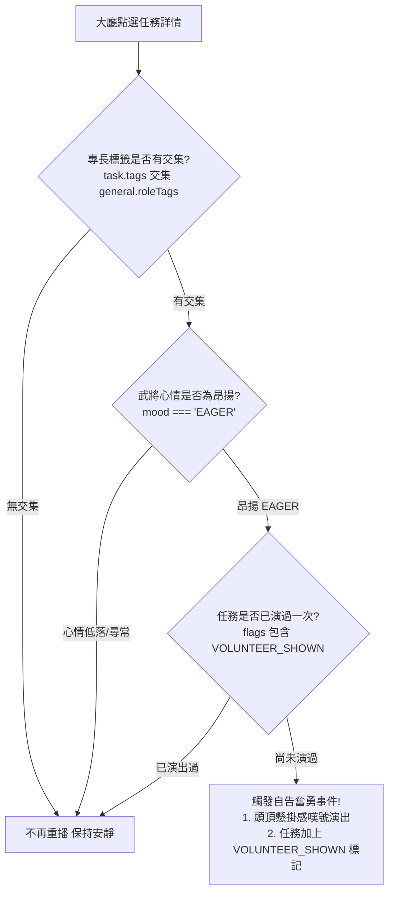

<!-- doc_id: doc_spec_0455 -->
# 大廳武將自告奮勇事件判定與成功率加成規格書

## 1. 核心定位與職責範圍

本規格書定義大廳任務板中的「武將自告奮勇（Volunteer）」事件觸發判定、毛遂自薦徽章展示、選將清單優先排序與成功率數值加成模型，對應 WBS **HALL-06**。
為了賦予大廳生動的武將微觀性格反應，當大廳發布與特定武將專長高度相符之政令或軍務時，士氣高昂的武將將主動毛遂自薦。
模組由純邏輯無副作用服務（`HallVolunteer.ts`）實現，確保一次性彩蛋演出不產生騷擾，並以顯著成功率加成獎勵知人善任的君主。

---

## 2. 自告奮勇觸發判定狀態機（`shouldShowVolunteerEvent`）



### 2.1 判定核心常數與型別
- **昂揚心情標記（`VOLUNTEER_EAGER_MOOD`）**：`'EAGER'`。
- **演出防重複旗標（`VOLUNTEER_SHOWN_FLAG`）**：`'VOLUNTEER_SHOWN'`。
- **任務介面契約（`HallVolunteerTask`）**：`{ id: string; tags: readonly string[]; flags: readonly string[] }`。
- **武將介面契約（`HallVolunteerGeneral`）**：`{ id: string; roleTags: readonly string[]; mood: string }`。

---

## 3. 選將清單優先排序（`sortVolunteersFirst`）

當玩家開啟指派武將下拉選單或彈窗時，毛遂自薦的將領獲得置頂展示權限：
```typescript
export function sortVolunteersFirst<T extends HallVolunteerGeneral>(
    candidates: readonly T[],
    task: Readonly<HallVolunteerTask>,
): T[] {
    const volunteers: T[] = [];
    const others: T[] = [];
    for (const general of candidates) {
        if (shouldShowVolunteerEvent(task, general)) volunteers.push(general);
        else others.push(general);
    }
    return [...volunteers, ...others];
}
```
- **穩態排序保護**：自薦者組與常規組內部均保持既有列表相對順序，絕不打亂。
- **徽章呈現契約**：自薦武將條目右側點亮專屬毛遂自薦徽章（`VolunteerBadge`），標注文案「自告奮勇」。

---

## 4. 任務成功率加成模型（`applyVolunteerBonus`）

武將主動請纓代表心氣合一，享有大幅度的任務執行成功率增幅：
$$\text{Rate}_{\text{effective}} = \begin{cases} \min(1.0, \text{Rate}_{\text{base}} + 0.5), & \text{if } \text{volunteered} = \text{true} \\ \text{Rate}_{\text{base}}, & \text{otherwise} \end{cases}$$
- **加成常數（`VOLUNTEER_SUCCESS_BONUS`）**：`+0.5`（即提升 50 個百分點）。
- **數值邊界防護**：基礎成功率與加成後數值強制夾回 $[0, 1.0]$，杜絕溢出異常。

---

## 5. 驗收標準與單元測試契約

1. **三重條件嚴格檢核**：
   - 標籤吻合但武將心情為 `CALM` 時，`shouldShowVolunteerEvent` 必須回傳 `false`。
   - 標籤吻合且心情為 `EAGER`，但任務 flags 已有 `VOLUNTEER_SHOWN` 時，必須回傳 `false`。
2. **一次性標記寫入驗證**：
   - 呼叫 `markVolunteerShown` 後，回傳之新任務物件 flags 陣列必定包含 `VOLUNTEER_SHOWN`。
3. **成功率加成截斷驗證**：
   - 基礎成功率為 0.7，自薦後計算值為 $\min(1.0, 0.7 + 0.5) = 1.0$。
