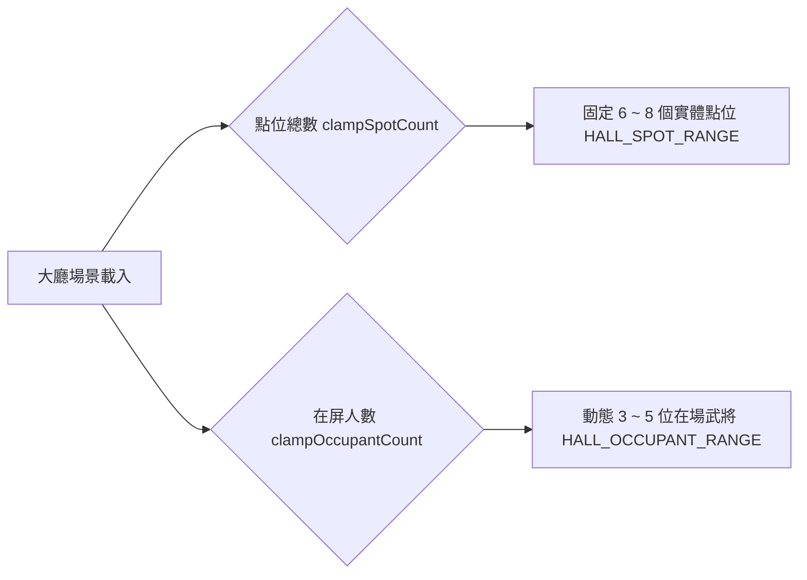

<!-- doc_id: doc_spec_0456 -->
# 大廳武將點位加權抽樣與60秒洗牌輪播規格書

## 1. 核心定位與職責範圍

本規格書定義大廳場景中武將走動點位的動態分派、偏好/在任加權抽樣演算法與 60 秒定時洗牌輪播狀態機，對應 WBS **HALL-07**。
為了營造大廳幕府人聲鼎沸、文武各司其職的沉浸氛圍，大廳設有固定數量的閒暇點位。
系統透過無副作用的加權不放回抽樣演算法（`HallCharacterRoll.ts`），依據收藏標記與在任狀態動態調配同屏角色，並於冷卻間隔達標時自動執行平滑輪播。

---

## 2. 點位規模與在屏人數邊界約束



### 2.1 數值區間常數定義
- **點位數量區間（`HALL_SPOT_RANGE`）**：$\min = 6, \max = 8$。
- **在屏人數區間（`HALL_OCCUPANT_RANGE`）**：$\min = 3, \max = 5$。
- **邊界夾回規則**：傳入非整數或溢出數值時，系統自動將數值向下取整並夾回合法區間。

---

## 3. 加權不放回抽樣演算法（`rollHallCharacters`）

```mermaid
flowchart TD
    Pool[全營可用武將候選池 pool] --> CalcWeight[計算候選人權重 hallWeight]
    
    subgraph WeightFormula [權重乘法模型]
        CalcWeight --> WBase[基礎權重: 1.0]
        CalcWeight --> WFav{favorite === true?}
        WFav -- 是 --> MulFav[乘以 2.0 倍 HALL_FAVORITE_WEIGHT]
        WFav -- 否 --> MulOne1[乘以 1.0]
        CalcWeight --> WAssign{assigned === true?}
        WAssign -- 是 --> MulAssign[乘以 1.2 倍 HALL_ASSIGNED_WEIGHT]
        WAssign -- 否 --> MulOne2[乘以 1.0]
    end
    
    MulFav --> SumTotal[累加剩餘池總權重 TotalWeight]
    MulAssign --> SumTotal
    SumTotal --> RollDice[呼叫注入之 random 函式抽取]
    RollDice --> PickOne[抽出命中武將 ID 加入 picked 清單]
    PickOne --> RemoveFromPool[自 remaining 池中移除 (不放回)]
    RemoveFromPool --> LoopCheck{picked.length === target?}
    LoopCheck -- 否 --> SumTotal
    LoopCheck -- 是 --> ReturnList[回傳最終名單 string 陣列]
```

### 3.1 權重疊加公式（`hallWeight`）
武將權重支援雙重加成相乘：
$$\text{Weight} = (\text{favorite} ? 2.0 : 1.0) \times (\text{assigned} ? 1.2 : 1.0)$$
- 既是玩家喜愛收藏、又正在執行任務之武將，其被抽中在大廳巡邏之權重高達 $2.0 \times 1.2 = 2.4$。

---

## 4. 60秒洗牌輪播狀態機（`isHallRefreshDue`）

- **輪播週期常數（`HALL_REFRESH_SECONDS`）**：`60` 秒。
- **冷卻判定公式**：
  $$\text{isDue} = (\text{nowSec} - \text{lastRefreshSec} \ge 60)$$
- **無縫過渡契約**：定時器觸發輪播時，大廳底層不銷毀場景，僅對角色節點執行淡入淡出（Fade-in / Fade-out）與位移重調，杜絕畫面卡頓。

---

## 5. 驗收標準與單元測試契約

1. **區間安全截斷驗證**：
   - 傳入點位數 12，`clampSpotCount` 必須精確回傳 8；傳入人數 2，`clampOccupantCount` 必須回傳 3。
2. **刷新冷卻精準度**：
   - 上次刷新為 100 秒，當前為 159 秒，`isHallRefreshDue` 回傳 `false`；當前為 160 秒，回傳 `true`。
3. **加權不放回抽樣分佈**：
   - 注入固定偽隨機源，驗證高權重武將之抽中頻率顯著高於普通武將，且回傳清單內**絕對不包含重複武將 ID**。
