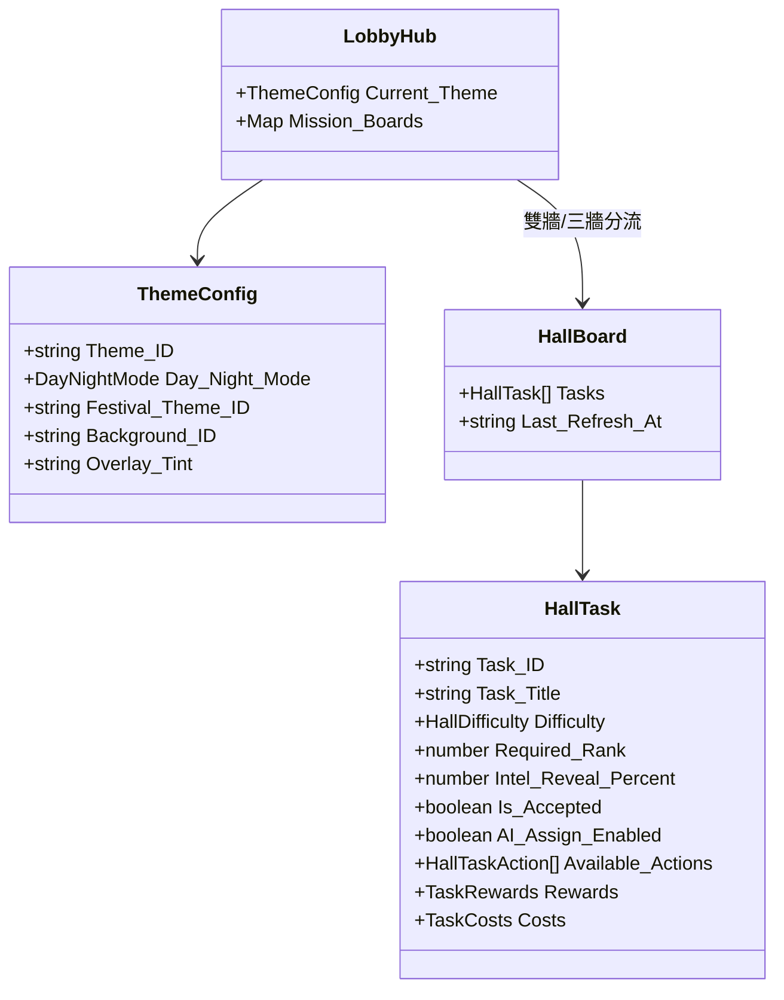

<!-- doc_id: doc_spec_0452 -->
# 大廳總控幕府LobbyHub資料架構與Schema校驗規格書

## 1. 核心定位與職責範圍

本規格書定義大廳場景（LobbyScene）的核心總控資料模型 `Lobby_Hub` 與其靜態結構校驗引擎，對應 WBS **HALL-01**。
大廳作為君主治理、政令發布、雙牆任務接取與天下沙盤調度的核心幕府樞紐，其資料層必須具備嚴格的契約定義與防腐屏障。
模組由純邏輯服務（`LobbyHubSchema.ts`）實現，透過深層驗證函式 `validateLobbyHub` 在資料進入渲染管線前進行全面攔截，杜絕不合規之壞資料污染客戶端場景。

---

## 2. 大廳資料模型實體結構（LobbyHub）



### 2.1 核心列舉常數定義
- **任務難度（`HALL_DIFFICULTIES`）**：`['EASY', 'NORMAL', 'ELITE', 'ADVANCED', 'HELL']`（五級難度體系）。
- **可用行動（`HALL_TASK_ACTIONS`）**：`['RECON', 'EXECUTE', 'WAIT', 'ASSIGN']`（再探/執行/等待/委任）。
- **晝夜模式（`HALL_DAY_NIGHT_MODES`）**：`['DAY', 'NIGHT']`。
- **任務牆維度（`HALL_BOARD_KEYS`）**：`'Military'`（軍事牆）、`'Domestic'`（內政牆）、選填 `'Expedition'`（世界沙盤遠征牆）。

---

## 3. 任務實體欄位契約（`HallTask`）

每項大廳任務具備雙軌獎勵與四維資源耗費定義：
1. **雙軌獎勵架構（`Rewards`）**：
   - 基礎獎勵（`Base`）：常規完成必定發放之軍糧（`GRAIN`）、白銀（`SILVER`）或武將經驗（`GENERAL_EXP`）。
   - 完美加成（`Perfect_Bonus`）：達成特定嚴苛條件（如高智力名將委任）額外發放之官職功勳（`OFFICER_EXP`）。
2. **四維執行代價（`Costs`）**：
   - `GRAIN`（軍糧扣減）、`TROOPS`（城市兵源調遣）、`SILVER`（國庫資金）、`TIME_MINUTES`（執行耗時）。

---

## 4. 全面深層校驗引擎（`validateLobbyHub`）

```mermaid
flowchart TD
    RawData[接收外部傳入之 Lobby_Hub JSON] --> CheckRoot{根物件型態是否為 Record?}
    CheckRoot -- 否 --> ErrRoot[回報根節點型態錯誤]
    CheckRoot -- 是 --> ParallelCheck[執行多節點深層檢查]
    
    subgraph ValidationNodes [無中斷錯誤收集]
        ParallelCheck --> ValidateTheme[校驗 Current_Theme 欄位與列舉]
        ParallelCheck --> ValidateBoards[校驗 Mission_Boards 必填牆是否存在]
        ParallelCheck --> ValidateTasks[逐筆校驗 Tasks 陣列內各項欄位]
    end
    
    ValidateTheme --> CollectIssues[累積所有欄位路徑錯誤 issues]
    ValidateBoards --> CollectIssues
    ValidateTasks --> CollectIssues
    
    CollectIssues --> OutputResult{issues.length === 0?}
    OutputResult -- 是 --> ValidOk[回傳 ok: true, issues: []]
    OutputResult -- 否 --> ValidFail[回傳 ok: false, issues: 詳細錯誤清單]
```

### 4.1 無提前截斷守則（Non-Short-Circuiting）
- 驗證引擎**絕不在遇到第一個錯誤時立即中斷退出**，而是完整歷遍所有節點，產出包含精確 JSON Path（如 `Mission_Boards.Military.Tasks[0].Difficulty`）與錯誤描述之問題清單（`LobbyHubIssue[]`）。
- 輸入物件保持唯讀，不進行任何原地位移或修補。

---

## 5. 驗收標準與單元測試契約

1. **結構完備性驗證**：
   - 傳入合規之完整 `LobbyHub` 物件，驗證回傳 `ok: true` 且 `issues` 陣列為空。
2. **非法難度代碼攔截**：
   - 任務難度填寫非列舉值（如 `SUPER_HARD`），驗證精確回報對應路徑之列舉非法錯誤。
3. **時段與主題格式驗證**：
   - 晝夜模式非 `DAY` 或 `NIGHT` 時，驗證產生型別錯誤。
