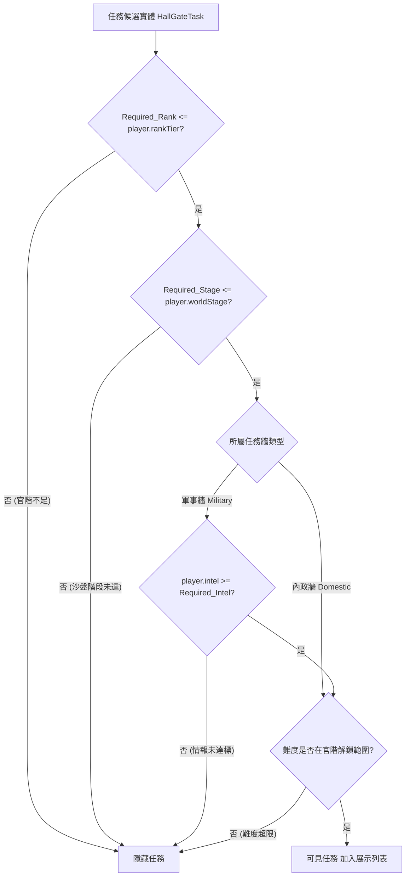

<!-- doc_id: doc_spec_0453 -->
# 大廳雙牆任務板可見性過濾與置頂排序演算法規格書

## 1. 核心定位與職責範圍

本規格書定義大廳軍事牆與內政牆任務的可見性過濾、難度階梯解鎖、已接取任務置頂排序與任務池重算觸發機制，對應 WBS **HALL-03**。
為了讓玩家在不同治理階段面對相應權責的政令與軍機，系統依據玩家當前官職（`rankTier`）、天下沙盤階段（`worldStage`）與軍事情報值（`intel`）進行三重動態過濾。
模組由純邏輯無副作用函式庫（`HallMissionBoard.ts`）實現，保證排序穩定且與 Cocos 畫面呈現層完全解耦。

---

## 2. 三重可見性過濾狀態機（`getVisibleHallTasks`）



### 2.1 五級難度官職解鎖階梯表（HALL_DIFFICULTY_MIN_RANK）
官階直接決定玩家能批閱與指派之政令難度上限：
| 任務難度代碼 | 中文顯示稱謂 | 解鎖所需最低官階（`Required_Rank`） | 適用任務型態範例 |
|:---:|:---:|:---:|---|
| **`EASY`** | 簡易 | **階位 1（九品、縣丞）** | 巡城治安、鄉野安撫、斥候偵察 |
| **`NORMAL`** | 一般 | **階位 2（八品、縣令）** | 剿滅流寇、興修水利、徵調糧秣 |
| **`ELITE`** | 菁英 | **階位 3（七品/六品、太守）** | 征討叛將、開拓商路、修築要塞 |
| **`ADVANCED`** | 高級 | **階位 4（五品/四品、州牧）** | 破軍拔寨、跨州聯盟、鎮壓叛亂 |
| **`HELL`** | 地獄 | **階位 5（三品以上、公卿）** | 決戰敵國主力、收復名城天險 |

---

## 3. 已接取任務置頂穩態排序（`arrangeHallTasks`）

為了保障玩家操作連續性，已派遣或進行中的任務在任務列表中始終處於最醒目的頂部位置：
```typescript
export function arrangeHallTasks<T extends HallGateTask>(tasks: readonly T[]): T[] {
    const accepted = tasks.filter(task => task.Is_Accepted);
    const others = tasks.filter(task => !task.Is_Accepted);
    return [...accepted, ...others];
}
```
- **穩態排序保證（Stable Arrangement）**：已接取組內部維持原入庫順序，未接取組內部亦維持原順序，絕不因排序導致同類任務位置突變。

---

## 4. 任務板重算時機狀態機（`shouldRecomputeBoard`）

任務池並非無休止每秒刷新，系統規範明確的重算觸發時機（`HallRecomputeTrigger`）：
1. **進入大廳（`ENTER_LOBBY`）**：自其他場景返回大廳時強制全量重算。
2. **手動刷新（`MANUAL_REFRESH`）**：玩家點擊刷新令主動重置。
3. **時段跨越切換（`TICK`）**：
   - 每日依真實小時劃分為三巡：
     - **晨巡（`MORNING`）**：06:00 ~ 11:59
     - **午巡（`NOON`）**：12:00 ~ 17:59
     - **晚巡（`EVENING`）**：18:00 ~ 05:59
   - 僅當當前時段與上一時段不一致（`lastPeriod !== currentPeriod`）時，觸發自動任務板重算。

---

## 5. 驗收標準與單元測試契約

1. **官職門檻過濾驗證**：
   - 玩家階位為 2 時，難度為 `ELITE`（需階位 3）的任務必定被 `getVisibleHallTasks` 濾除。
2. **軍事情報過濾驗證**：
   - 軍事任務要求情報度 80，玩家當前情報度為 70，驗證該軍事任務不可見；同等條件下內政任務不受情報值影響。
3. **已接取置頂驗證**：
   - 輸入含 3 個未接取與 2 個已接取任務，輸出結果前 2 項必須為已接取任務，且後 3 項保持原有先後順序。
