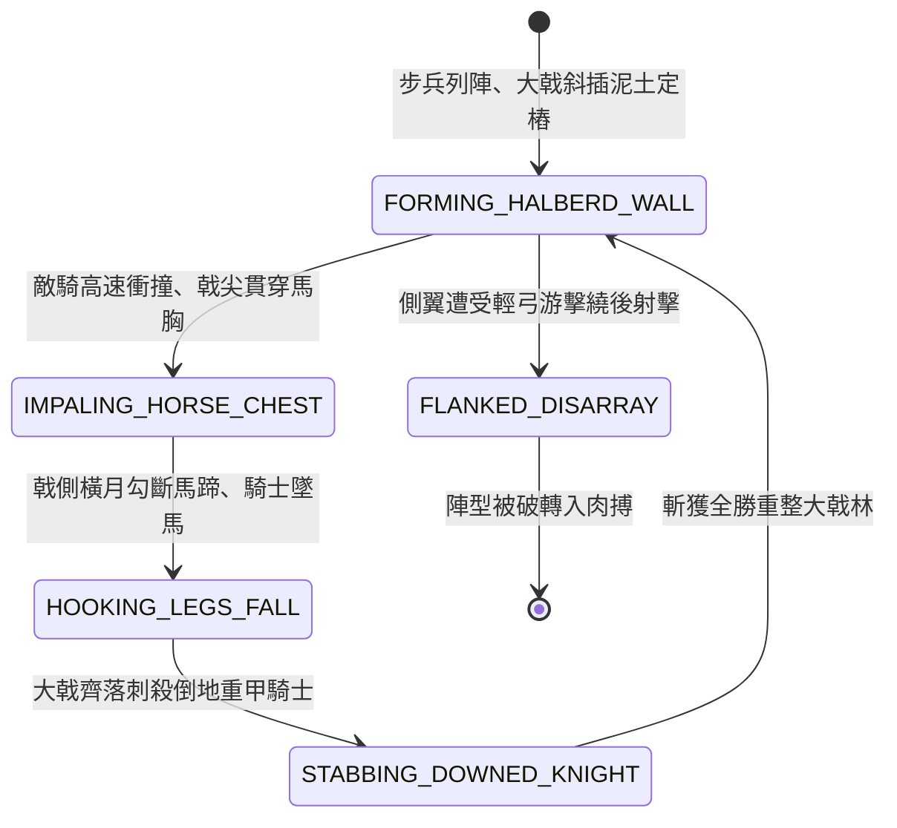

<!-- doc_id: doc_spec_0830 -->
# 3KLife 大戟士重甲長戟如林下克上刺馬破騎方陣狀態機規格書

## 模組基本資訊
- **模組代號**：`HEAVY-HALBERD-PHALANX01`
- **系統定位**：三國重步兵反騎陣型與下克上阻截系統，負責一丈八尺大戟如林結陣、馬胸貫穿破甲、橫勾挑落騎士與騎兵衝鋒動能清零之完整狀態流。
- **架構依賴**：`BattleGridSystem`、`BattleFormationController`、`TroopTypeMovement`、`VFXBlockRegistry`。

---

## 核心設計概念
界橋之戰中袁紹大將鞠義以八百大戟士大破公孫瓚萬騎「白馬義從」。大戟士人皆負重甲、執一丈八尺生鐵大戟。列陣之時，前排八百士卒單膝跪地、戟柄支於地面土坎，尖鋒斜指戰馬胸膛；後排大戟層層架疊，宛如鋼鐵刺蝟。當敵騎排山倒海衝鋒而至，前排戰馬直接撞向戟尖，長戟藉衝鋒慣性貫穿馬體挑飛半空，後排橫刃勾斬馬腿。騎兵雷霆萬鈞之衝鋒在密林大戟前徹底撞碎。



---

## 狀態機定義與轉換條件

### 1. `FORMING_HALBERD_WALL`（大戟立林定樁狀態）
- **進入條件**：大戟士部隊下達「大戟如林反騎方陣」指令（移動力降為 0）。
- **行為表現**：
  - 佔用 1x3 橫向正面地格，前排戟尖泛出冷冽寒光。
  - 對正面 1 格扇形區域形成「絕對刺馬 ZOC」（騎兵衝鋒無條件截停）。
- **轉換**：敵騎兵單位正面衝鋒撞擊 -> 轉移至 `IMPALING_HORSE_CHEST`。

### 2. `IMPALING_HORSE_CHEST`（戟尖貫穿刺馬狀態）
- **行為表現**：
  - 將騎兵奔馳動能反向轉化為貫穿傷害：傷害 = 基礎 450 + (騎兵衝鋒速度 * 150)。
  - 敵前排戰馬胸膛被洞穿，戰馬悲鳴暴斃倒地。
- **轉換**：反衝貫穿完成（延遲 0.2 秒） -> 轉移至 `HOOKING_LEGS_FALL`。

### 3. `HOOKING_LEGS_FALL`（橫月勾蹄折骨狀態）
- **行為表現**：
  - 後排大戟橫向揮斬，鋒利月牙刃削斷戰馬膝關節。
  - 後續跟進騎兵被前排屍首絆翻，形成骨牌式連環倒地。
- **轉換**：敵騎士倒地陷入無防備 -> 轉移至 `STABBING_DOWNED_KNIGHT`。

### 4. `STABBING_DOWNED_KNIGHT`（下刺圍殲殘敵狀態）
- **行為表現**：
  - 大戟士整齊下刺，無視重甲防禦，對倒地騎士造成 300 點真實穿透打擊。
  - 敵騎兵小隊兵力損失 60% 以上，士氣暴跌 45 點。
- **轉換**：近戰剿滅完畢 -> 回歸 `FORMING_HALBERD_WALL`。

### 5. `FLANKED_DISARRAY`（側後受襲散亂狀態）
- **行為表現**：
  - 若敵弓手繞至方陣側翼或背後射擊，大戟士轉身緩慢，受到傷害增加 35%。
- **轉換**：方陣瓦解 -> 結束退出。

---

## 數值公式與配置契約

```typescript
export interface HeavyHalberdConfig {
  unitId: string;
  frontHorseImpaleDamageBase: number;// 刺馬基礎傷害
  chargeSpeedReflectMultiplier: number;// 衝鋒動能反震乘數
  antiCavalryCritChance: number;      // 對騎兵暴擊率
  flankDefenseVulnerabilityRate: number;// 側翼受創脆弱比
  stopChargeMomentum: boolean;        // 完全吸收衝鋒動能
}

export const HALBERD_PRESETS: Record<string, HeavyHalberdConfig> = {
  JUYI_EIGHT_HUNDRED_HALBERD: {
    unitId: 'HALBERD_JUYI_01',
    frontHorseImpaleDamageBase: 450,
    chargeSpeedReflectMultiplier: 150,
    antiCavalryCritChance: 0.85,
    flankDefenseVulnerabilityRate: 0.35,
    stopChargeMomentum: true,
  }
};
```

---

## 單元測試與驗收標準
1. **衝鋒動能反衝計算**：速度為 5 的虎豹騎衝撞大戟方陣，所受傷害嚴格計算為 `450 + 5 * 150 = 1200` 點，前鋒戰馬直接陣亡。
2. **騎兵衝鋒動能清零**：任何騎兵兵種撞擊大戟正面，衝鋒加成 100% 被消除且強制停止移動。
3. **側翼繞後易傷懲罰**：大戟方陣側向受到遠程射擊時，傷害乘上 1.35 倍，且刺馬被動暫時失效。
