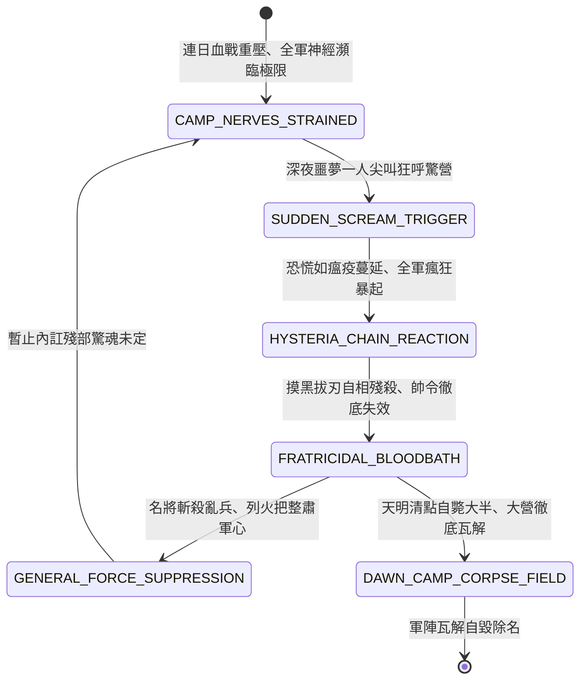

<!-- doc_id: doc_spec_0828 -->
# 3KLife 大軍夜宿營嘯炸營自相殘殺神經崩潰狂暴狀態機規格書

## 模組基本資訊
- **模組代號**：`NIGHT-CAMP-HYSTERIA-ROUT01`
- **系統定位**：三國戰場軍隊集體心理極限崩潰與夜間炸營反噬系統，負責精神疲憊累積、驚聲尖叫引爆、摸黑瘋狂自相殘殺與黎明全軍覆沒之完整狀態流。
- **架構依賴**：`BattleGridSystem`、`TimeOfDaySystem`、`MoraleSystem`、`VFXBlockRegistry`。

---

## 核心設計概念
古代兵書所載最為恐怖之無形災難「營嘯（炸營）」。大軍連日死戰、糧草匱乏、軍紀森嚴動輒處死，又頻繁遭受敵軍夜襲與刁斗驚擾。全營數萬士卒神經繃緊如即斷之弓弦。深夜三更萬籟俱寂之時，若忽有一士卒因噩夢發出一聲淒厲尖叫，連鎖心理暗示瞬間引發集體精神失常。士卒紛紛躍起，狂叫「敵軍入營矣！」，拔出利刃摸黑見人便砍。主帥斬之不絕，父子相戮、兄弟相殘，整座堅固大營於一夜之間血流漂杵、自斃過半。



---

## 狀態機定義與轉換條件

### 1. `CAMP_NERVES_STRAINED`（神經緊繃狀態）
- **進入條件**：大軍夜宿營寨，士氣低於 30 且連續 2 夜遭受夜襲騷擾，疲憊值 >= 80。
- **行為表現**：
  - 士卒輾轉反側無法入眠，眼眶通紅，稍有風吹草動即抓緊刀柄。
- **轉換**：深夜（23:00 ~ 03:00）觸發突發驚恐檢定 -> 轉移至 `SUDDEN_SCREAM_TRIGGER`。

### 2. `SUDDEN_SCREAM_TRIGGER`（一聲驚呼觸發狀態）
- **行為表現**：
  - 一名士卒夢魘尖叫「劫營了！敵人殺進來了！」，撕裂寂靜夜空。
  - 觸發「炸營連鎖率」判定（基礎機率 65%，糧缺率 +20%）。
- **轉換**：判定成功 -> 轉移至 `HYSTERIA_CHAIN_REACTION`。

### 3. `HYSTERIA_CHAIN_REACTION`（群體歇斯底里狀態）
- **行為表現**：
  - 尖叫聲在數秒內傳遍全營各帳，數千士卒赤身赤腳躍起。
  - 陷入狂暴幻覺，所有相鄰單位均被識別為「突入之刺客敵軍」。
- **轉換**：拔刀亂砍（延遲 0.2 秒） -> 轉移至 `FRATRICIDAL_BLOODBATH`。

### 4. `FRATRICIDAL_BLOODBATH`（自相殘殺血流狀態）
- **行為表現**：
  - 全軍部隊陷入「瘋狂自殘」（每秒全體削扣 5% 兵力，且攻擊目標為相鄰袍澤）。
  - 將校呼喊無人聽聞，軍紀防線全面破裂。
- **轉換**：
  - 主帥威望 >= 90，親率親兵點燃數十支巨大火炬持刀彈壓 -> 轉移至 `GENERAL_FORCE_SUPPRESSION`。
  - 無力彈壓持續至黎明（05:00） -> 轉移至 `DAWN_CAMP_CORPSE_FIELD`。

### 5. `GENERAL_FORCE_SUPPRESSION`（名將強行彈壓狀態）
- **行為表現**：
  - 名將斬殺數十名帶頭瘋癲士卒，擂鼓敲鑼喝令「擅動者立斬！」。
  - 強光火炬驅散夜暗幻象，暴亂逐漸平息，但仍損失 20% 兵力。
- **轉換**：殘軍驚魂未定 -> 回歸警戒。

### 6. `DAWN_CAMP_CORPSE_FIELD`（黎明死地瓦解狀態）
- **行為表現**：
  - 旭日升起，士卒驚醒方知整夜砍殺皆為同袍兄弟，撫屍痛哭、鬥志全無。
  - 營寨自相殘殺減員超過 60%，全軍士氣歸零潰散。
- **轉換**：部隊自解潰退 -> 結束退出。

---

## 數值公式與配置契約

```typescript
export interface CampHysteriaConfig {
  hysteriaId: string;
  lowMoraleThreshold: number;      // 低士氣易感閾值
  fatigueExhaustionThreshold: number; // 疲憊觸發閾值
  fratricidalDamagePerSecRate: number;// 自殘每秒損血比
  generalSuppressResolveMin: number;  // 主帥強行彈壓威望門檻
  dawnSelfCasualtyPercent: number;    // 天明自斃總損耗比
}

export const CAMP_HYSTERIA_PRESETS: Record<string, CampHysteriaConfig> = {
  NIGHT_ROUT_SEVERE: {
    hysteriaId: 'HYSTERIA_ROUT_01',
    lowMoraleThreshold: 30,
    fatigueExhaustionThreshold: 80,
    fratricidalDamagePerSecRate: 0.05,
    generalSuppressResolveMin: 90,
    dawnSelfCasualtyPercent: 0.60,
  }
};
```

---

## 單元測試與驗收標準
1. **觸發前置條件驗收**：士氣 >= 50 或未受夜襲騷擾之大營，絕不觸發營嘯機制。
2. **自相殘殺傷害判定**：進入 `FRATRICIDAL_BLOODBATH` 期間，傷害來源全部標記為內部友軍，每秒穩定消耗 5% 總兵力。
3. **威望主將及時整肅**：威望 92 名將在 1 回合內啟動火炬彈壓，成功終止自殘，將總損失控制於 20% 以內。
