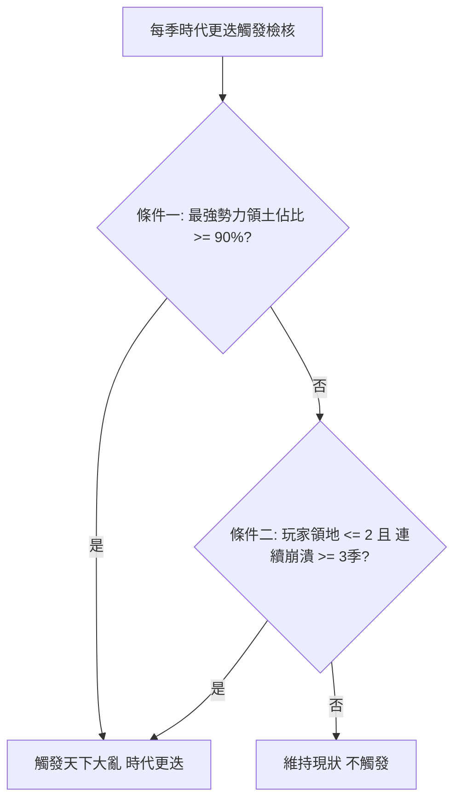
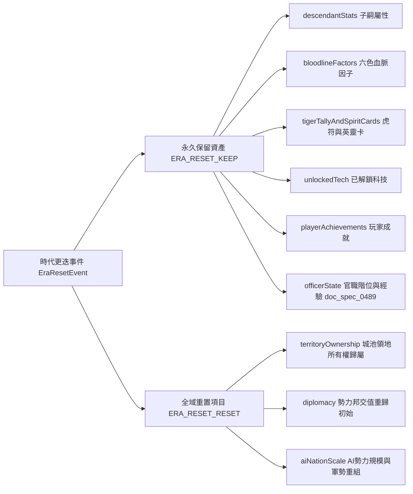

<!-- doc_id: doc_spec_0495 -->
<!-- spec_id: RAI-12 -->
# 天下大亂時代更迭觸發條件與地圖資產重組規格書

> 標籤：`系統規格` `天下大勢` `時代更迭` `地圖重組` `RAI-12`
> 狀態：`正式生效` · 責任模組：`RivalRiseFall` · 參照：`RAI-12` / `PROG-2-1475` / `TIME-10`

---

## 1. 核心定位與設計理念

在三國遊戲長線進程中，當某一霸權勢力幾乎統一天下，或是玩家自身陷入無法挽回的戰略死局時，世界將觸發「天下大亂 / 時代更迭（Era Shift / Era Reset）」。
本機制如同大型歷史週期輪迴：
1. **動態破局防僵死**：提供世界沙盤動態重組的大洗牌機制，讓世界重歸諸侯割據初期。
2. **血脈與養成永久繼承**：絕不破壞玩家累積之元進度（Meta-progression），培育武將、血脈因子與官職特權 100% 完整保留。
3. **確定性週期與雙重觸發條件**：透過精準公式判定大勢走向，杜絕突兀重置。

---

## 2. 時代更迭觸發判定條件 (shouldTriggerEraShift)

每季季末結算時，系統輸入 `EraShiftInput` 檢核是否滿足重組條件：

### 2.1 觸發條件一：天下歸一前夕 (Dominance Condition)
- `ERA_SHIFT_DOMAIN_RATIO = 0.9`（90%）：
  當全地圖任意單一最強勢力（AI 或玩家）之領土佔比 $\ge 90\%$ 時，象徵當前王朝時代走向終結，觸發大勢崩解與新一輪諸侯割據。
- 佔比公式：
  $$R_{strong} = \frac{\max(\text{territoryCounts})}{\sum \max(0, \text{territoryCounts})}$$

### 2.2 觸發條件二：玩家死局輪迴 (Player Deadlock Condition)
- `ERA_SHIFT_PLAYER_MAX_TERRITORIES = 2`
- `ERA_SHIFT_PLAYER_COLLAPSE_SEASONS = 3`
- 當玩家勢力城池數 $\le 2$ 且連續 3 季以上處於 `COLLAPSING`（國力 $\le 1000$）狀態時，系統主動觸發時代輪迴，給予玩家重啟征途的歷史轉機。

---

## 3. 定期輪迴紀元模型 (EraReset Cycle)

除上述戰略觸發外，時間系統原生支援定期輪迴模型（`EraReset.ts`）：
- `MONTHS_PER_SEASON = 3`（1 季 = 3 個遊戲月）
- `ERA_RESET_INTERVAL_MONTHS = 60`（每 60 個遊戲月，即 5 年 / 20 季大重組）
- 判定公式：
  $$\text{isEraResetSeason}(S) = (S \times 3) \pmod{60} === 0 \quad (\text{且 } S > 0)$$
- 觸發時封裝 `EraResetEvent`，標記當前為第幾紀元（`eraIndex`）。

---

## 4. 資產保全與環境重置白名單

時代更迭發生時，遵循明確的資產分流原則，由各系統嚴格執行：

### 4.1 永久保留資產 (ERA_RESET_KEEP)
玩家長線養成與帳號權限全數保全，包括：
1. 子嗣後代屬性 (`descendantStats`)
2. 傳承血脈因子 (`bloodlineFactors`)
3. 英靈卡與虎符資產 (`tigerTallyAndSpiritCards`)
4. 已解鎖科技樹節點 (`unlockedTech`)
5. 世代傳承成就記錄 (`playerAchievements`)
6. 官職階位、官職經驗與特權解鎖歷史 (`officerState`，依 `OFC-09` 憲章)

### 4.2 全域環境重置 (ERA_RESET_RESET)
沙盤世界回歸新起點：
1. 城池歸屬 (`territoryOwnership`)：領地重新劃分至 8 大初始割據勢力。
2. 邦交網絡 (`diplomacy`)：所有好感度與同盟重設為歷史基準值。
3. 勢力兵力 (`aiNationScale`)：AI 資源庫恢復初始配置。
