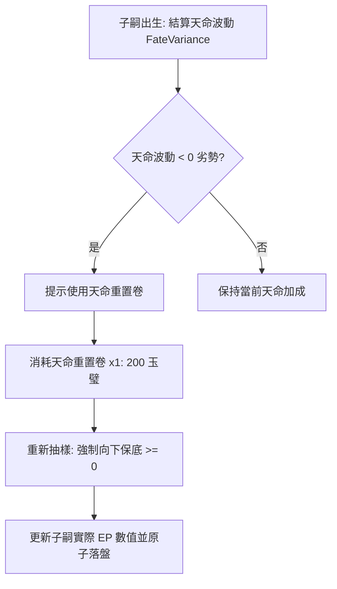

<!-- doc_id: doc_spec_0644 -->
# 天命重置卷天命波動重擲與高運氣種母培育商業規格書

> **規格代碼**：`LUK-07`
> **版本**：v1.0 (Single Source of Truth)
> **狀態**：正式定案 (Approved)
> **檔案大小限制**：嚴格 <6144 bytes

---

## 1. 系統定位與商業化邊界裁決

本規格定義遊戲內「天命重置卷（`ITEM_FATE_RESET_SCROLL`）」重擲子嗣天命波動之運算模型，以及「高運氣（LUK）名門種母」在配種結緣時的商業化加成協議。
**平衡約束原則（Single Source of Truth）**：
- 天命重置卷單一子嗣**一生限用 1 次**，杜絕課金玩家無限次重複刷滿數值。
- 高運氣種母僅提供天命波動向下保底，不得破壞五維繼承的基本常態分佈。



---

## 2. 天命重置卷業務協議（Fate Reset Protocol）

```typescript
export interface FateResetRequest {
  childId: string;
  clientTimestamp: number;
}

export interface FateResetResult {
  success: boolean;
  childId: string;
  previousVariance: number; // 原始負值天命 (例: -12)
  newVariance: number;      // 重擲後天命 (保底 >= 0, 例: +8)
  epDifference: number;     // EP 增益差值
  errorCode?: "ALREADY_RESET" | "INSUFFICIENT_ITEM" | "CHILD_ADULT";
}
```

### 2.1 重擲演算規則
1. **使用條件**：子嗣年齡處於 $0 \sim 4$ 歲且未曾使用過該道具（`isFateReset == false`）。
2. **保底抽樣（Non-negative Sampling）**：
   - 原始天命波動分佈為 $[-15, +15]$。
   - 使用天命重置卷後，抽樣區間收斂為 $[0, +15]$，以均勻隨機數（Uniform Random）重新判定：
     $$\text{NewVariance} = \text{floor}(\text{Random}(0, 15))$$
3. **單次鎖定**：操作完成後立即將子嗣標記為 `isFateReset = true`，不可再次使用。

---

## 3. 高運氣名門種母商業化連動

```typescript
export interface NobleMotherProfile {
  motherId: string;
  lukStat: number;           // 基準運氣 (通常 >= 85)
  innateFateBias: number;    // 天命偏置 (+5 ~ +10)
  commercialGrade: "HEROINE_SSR" | "HEROINE_UR";
}
```

- **天命正向偏置（Fate Incline）**：當母方武將運氣 $\text{LUK} \ge 85$ 時，子嗣初次天命波動最低保底為 $-3$（消除極端 $-15$ 厄運），且平均偏置 $+5$。
- **名冊標記**：自紅顏天香池或名門迎娶之女性武將，自動賦予 `NOBLE_LINEAGE` 標籤，結緣介面點擊顯示金龍祥雲特效。
