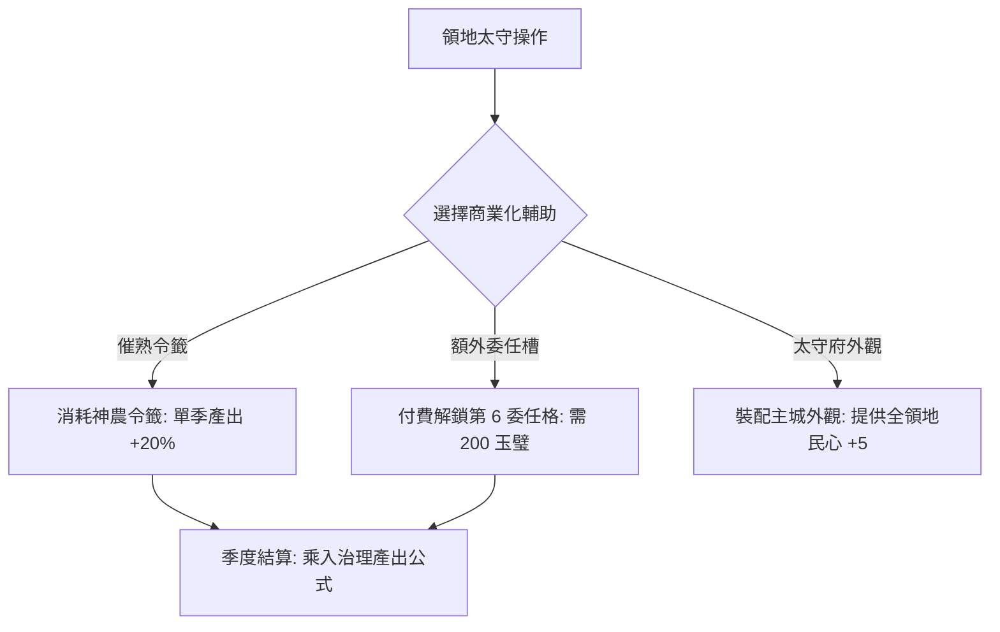

<!-- doc_id: doc_spec_0635 -->
# 太守府商業化擴展與治理效率提升道具平衡規格書

> **規格代碼**：`GOV-14`
> **版本**：v1.0 (Single Source of Truth)
> **狀態**：正式定案 (Approved)
> **檔案大小限制**：嚴格 <6144 bytes

---

## 1. 系統定位與商業化平衡裁決

本規格定義太守府領地治理之商業化增益道具、額外委任槽位與自動治理特權之平衡約束。
**歷史爭議裁決（Single Source of Truth）**：
- 恪守單機手遊友善機制：自動治理 AI（`DomesticAutoGovernance`）全面對全體玩家免費開放，**絕對不設置為純 VIP 付費特權**。
- 商業化定位收斂至「季度催熟神農令籤」、「太守府景觀外觀裝潢」以及「特派秘書額外輔助委任槽」。



---

## 2. 治理增益道具規格清單

```typescript
export interface DomesticBuffItem {
  itemId: string;
  name: string;
  targetTaskType: "ALL" | "AGRICULTURE" | "COMMERCE" | "CONSCRIPTION" | "PATROL";
  outputMultiplier: number;  // 產出增益倍率 (例: 1.20)
  durationSeasons: number;   // 持續季度數 (通常為 1 季)
  gemCost: number;           // 玉璧定價
  seasonalMaxUsage: number;  // 每季使用上限 (防止數值膨脹)
}

export const DOMESTIC_BUFF_CATALOG: DomesticBuffItem[] = [
  {
    itemId: "ITEM_SHENNONG_TOKEN",
    name: "神農開荒令",
    targetTaskType: "AGRICULTURE",
    outputMultiplier: 1.20,
    durationSeasons: 1,
    gemCost: 50,
    seasonalMaxUsage: 2,
  },
  {
    itemId: "ITEM_LUBUWEI_TOKEN",
    name: "管子富國策",
    targetTaskType: "COMMERCE",
    outputMultiplier: 1.20,
    durationSeasons: 1,
    gemCost: 50,
    seasonalMaxUsage: 2,
  },
  {
    itemId: "ITEM_SECRETARY_SLOT",
    name: "特派長史任官狀",
    targetTaskType: "ALL",
    outputMultiplier: 1.0,
    durationSeasons: 999, // 永久解鎖第 6 槽
    gemCost: 200,
    seasonalMaxUsage: 1,
  },
];
```

---

## 3. 產出公式乘法疊加防穿透

治理產出計算嚴格遵循上限夾制公式：
$$\text{FinalOutput} = \min\left(\text{BaseOutput} \times (1 + \text{StatBonus} + \text{PolicyBonus}) \times \text{ItemMultiplier}, \text{ResCap} - \text{CurrentRes}\right)$$

- **單季上限**：任何任務受商業化道具加成之總倍率不得超過 $1.30$（即 $+30\%$ 為硬上限）。
- **資源庫存保護**：若產出後超過國庫上限（`ResCap`），超出部分自然溢出，系統派發 `UI_RES_CAP_OVERFLOW` 警告。
