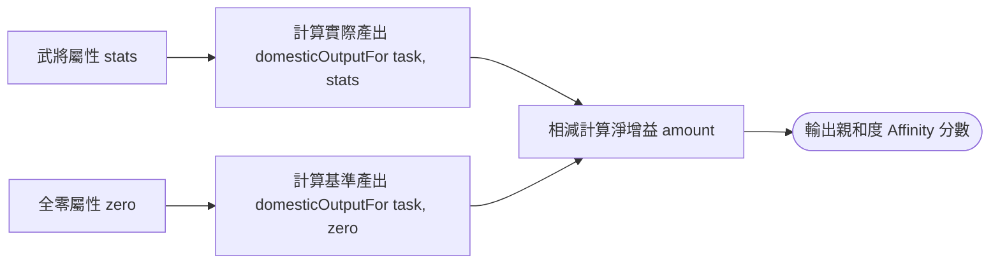
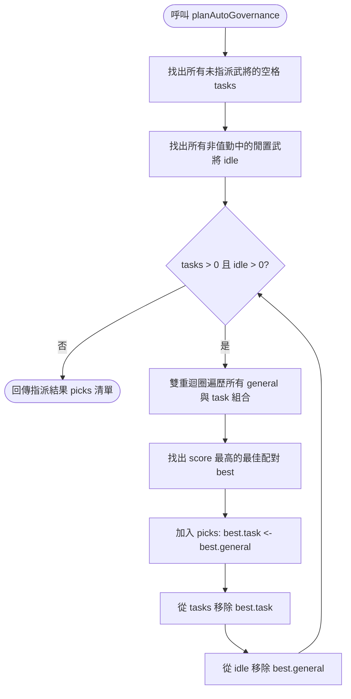

<!-- doc_id: doc_spec_0503 -->
<!-- spec_id: GOV-06 -->
# 太守府自動治理全域親和度匹配與指派演算法規格書

> 標籤：`系統規格` `領地治理` `自動治理` `親和度匹配` `GOV-06`
> 狀態：`正式生效` · 責任模組：`DomesticAutoGovernance` · 參照：`GOV-06` / `PROG-2-1160`

---

## 1. 模組定位與設計理念

在太守府領地治理日常營運中，隨著武將陣容日益龐大，手動為五大內政任務逐一挑選最適人選將帶來繁重操作負擔。
自動治理系統（`DomesticAutoGovernance.ts`）提供一鍵最優指派服務，遵循以下核心原則：
1. **淨產能增量為唯一親和度度量**：以武將四維屬性扣除基礎值後的「淨增產能」作為任務親和度（`Task_Affinity`），兼顧科學性與直觀性。
2. **尊重手動指派優先權**：玩家已手動設定之任務格視為不可侵犯鎖定，自動治理僅對空置任務格進行填補。
3. **全域最優解迭代（Global Greedy Argmax）**：每次迭代在「全體閒置武將 $\times$ 全體空任務格」的笛卡爾積中選取親和度最高的一對，徹底杜絕因武將清單排序而導致的局部次佳解。
4. **純函式與唯讀規劃器**：不直接修改存檔或全域狀態，回傳規劃建議（`AutoGovernancePick[]`）由呼叫端原子套用。

---

## 2. 任務親和度度量演算法 (domesticAffinity)

武將對特定任務的親和度定義為該武將在該任務下的淨產能貢獻：

$$\text{Affinity}(\text{task}, \text{stats}) = \text{Output}(\text{task}, \text{stats}) - \text{Output}(\text{task}, \vec{0})$$

- **屬性權重天然反映**：
  - 農耕（`farming`）：$\text{Affinity} = \text{pol} \times 2$
  - 商業（`commerce`）：$\text{Affinity} = \text{cha} \times 3$
  - 外交（`diplomacy`）：$\text{Affinity} = \text{int} \times 1 + \text{cha} \times 1$
  - 軍備（`arms`）：$\text{Affinity} = \text{str} \times 2$
  - 偵察（`scouting`）：$\text{Affinity} = \text{int} \times 2$

---

## 3. 全域貪心指派流程 (planAutoGovernance)

自動指派演算法以動態清單與全域最大值迭代推進：

### 3.1 演算法細節
1. **輸入過濾**：
   - 提取當前已佔用之武將集合 `busy = Set(assigned)`。
   - 待填補任務清單 `tasks = filter(!assigned(t))`。
   - 可用閒置候選池 `idle = filter(!busy.has(c.id))`。
2. **全域最大匹配**：
   - 遍歷所有 `general \in idle` 與 `task \in tasks`，計算其 `score = domesticAffinity(task, general.stats)`。
   - 記錄全場最高分組 `best = { task, general, score }`。
   - 若最高分有多組相同，保持穩定先得性。
3. **推進與終止**：
   - 將 `best` 推入 `picks`。
   - 自 `tasks` 與 `idle` 中同步剔除該項，繼續下一輪迭代，直到空格填滿或無人可用。

---

## 4. 驗收標準與單元測試契約

1. **手動保留保證**：若商業格已手動指派貂蟬，自動治理執行後絕不替換貂蟬，僅在剩餘四格中尋求最適配對。
2. **跨屬性全域最優**：
   - 設有諸葛亮（智 98 / 魅 92）與張飛（武 98 / 智 30）。
   - 空格為偵察（智 $\times 2$）與軍備（武 $\times 2$）。
   - 無論名冊先後順序，必定產出：張飛 $\to$ 軍備、諸葛亮 $\to$ 偵察，絕不因諸葛亮排在前面而搶佔軍備。
3. **無可用人員安全中斷**：當候選清單為空時，平滑回傳空陣列 `[]`，不拋出異常。
