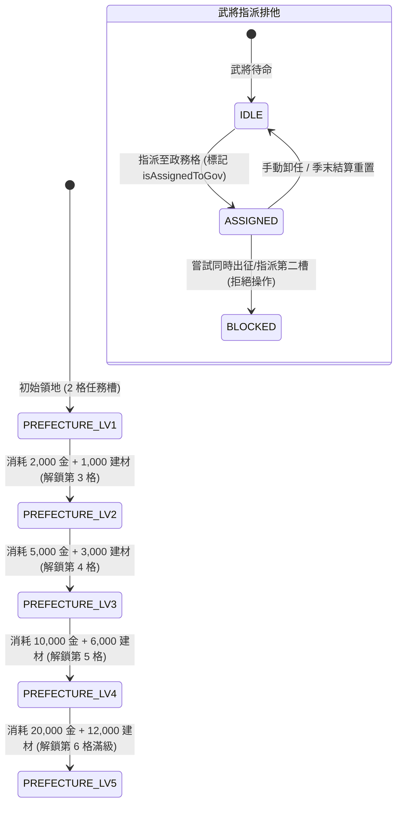

<!-- doc_id: doc_spec_0587 -->
# 太守府領地升級格數模型與武將指派排他狀態機規格書

> 標記：Single Source of Truth（單一真相來源）  
> 涵蓋工作包：`GOV-04`、`GOV-08`  
> 狀態：正式發布 / 核心邏輯規格

---

## 1. 系統定位與架構

本模組規範國家領地之政務核心「太守府（Prefecture）」的建築升級模型以及政務任務格的「武將指派與衝突排他狀態機（`GovernanceAssignment`）」。透過消耗領地治理物資推進太守府等級，可擴充可指派的內政任務格上限（`Max_Task_Slots`），並提供嚴格的「單季單職排他機制」，杜絕同一名武將跨槽重複履職或與軍事出征產生併發衝突。



---

## 2. 太守府升級格數模型（GOV-08）

### 2.1 升級階梯常數表
太守府共分 5 個等級，等級直接決定同時指派的政務格總數：

| 太守府等級 | 最大任務槽位（`Max_Task_Slots`） | 升級需求黃金 | 升級需求石木建材 | 前置官職門檻 |
|:---:|:---:|:---:|:---:|:---:|
| **Lv 1** | 2 格 | 初始預設 | 初始預設 | 無 |
| **Lv 2** | 3 格 | 2,000 | 1,000 | TIER_1（校尉） |
| **Lv 3** | 4 格 | 5,000 | 3,000 | TIER_2（中郎將） |
| **Lv 4** | 5 格 | 10,000 | 6,000 | TIER_3（裨將軍） |
| **Lv 5** | 6 格（滿級） | 20,000 | 12,000 | TIER_4（偏將軍） |

### 2.2 升級原子操作
- 扣除領地國庫之黃金與建材資源。
- 升級成功後，`prefectureLevel += 1`，並將可用任務槽陣列容量即時同步擴充至對應上限。

---

## 3. 武將指派服務與排他約束（GOV-04）

### 3.1 指派資格檢驗規則
在將武將拖放或指派至指定任務槽位時，必須通過以下四重閘門：
1. **槽位邊界檢查**：目標槽位索引必須小於當前太守府 `maxTaskSlots`。
2. **重複指派排他**：該武將 `generalId` 不得存在於任何已指派政務槽中。
3. **軍事與健康狀態檢查**：武將不得處於「出征中（`isSortie`）」、「待產中（`isPregnant`）」或「重傷關押中（`isPrisoner`）」。
4. **同槽置換規則**：若目標槽位已有武將，系統自動將原武將卸任回歸待命名單，並將新武將綁定至該槽。

### 3.2 資料模型與服務介面
```typescript
export interface IGovSlotAssignment {
  readonly slotIndex: number;
  taskId: string;            // 例如：'FARMING' | 'COMMERCE' | 'DEFENSE'
  assignedGeneralId: string | null;
}

export interface IPrefectureState {
  level: number;
  maxTaskSlots: number;
  slots: IGovSlotAssignment[];
}

export function assignGeneralToGovSlot(
  state: IPrefectureState,
  slotIndex: number,
  generalId: string,
  isGeneralBusy: (id: string) => boolean
): boolean {
  if (slotIndex < 0 || slotIndex >= state.maxTaskSlots) return false;
  if (isGeneralBusy(generalId)) return false;

  // 檢查是否已在其他槽位
  const isAlreadyAssigned = state.slots.some(
    s => s.slotIndex !== slotIndex && s.assignedGeneralId === generalId
  );
  if (isAlreadyAssigned) return false;

  state.slots[slotIndex].assignedGeneralId = generalId;
  return true;
}
```

---

## 4. 驗收與測試標準

1. **升級容量擴展測試（TC-GOV-08-01）**：
   - 驗證從 Lv 1 升至 Lv 2 時，`maxTaskSlots` 自 2 正確增加為 3，第 3 格開放指派。
2. **跨槽重複指派防護（TC-GOV-04-01）**：
   - 指派關羽至槽位 0，再次嘗試指派關羽至槽位 1，檢核回傳 `false` 且槽位 1 保持為空。
3. **狀態衝突排他驗證（TC-GOV-04-02）**：
   - 當武將處於出征狀態時，嘗試指派至太守府，檢核被攔截拒絕。
