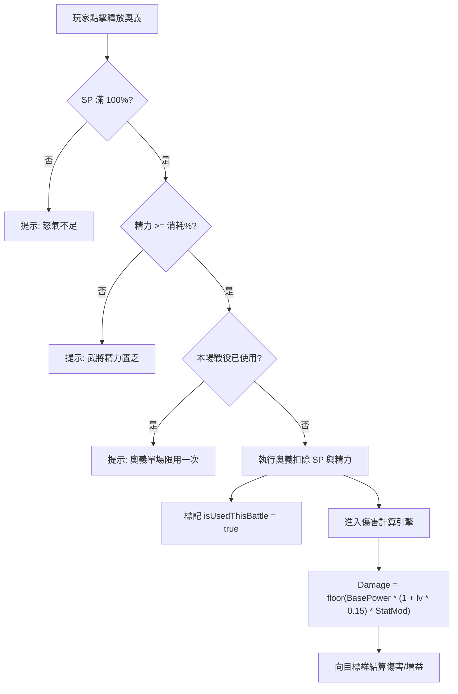

<!-- doc_id: doc_spec_0594 -->
# 奧義施放精力限制與階梯傷害加成公式規格書

> 標記：Single Source of Truth（單一真相來源）  
> 涵蓋工作包：`ULT-04`、`ULT-05`  
> 狀態：正式發布 / 核心邏輯規格

---

## 1. 系統定位與架構

本模組規範戰場核心戰法引擎中名將「奧義技能（Ultimate Skill）」之釋放門檻檢驗與傷害精算演算法。奧義作為決定戰局走勢的終極手段，受三重安全閘門保護：
1. **SP 怒氣值滿載（100%）**。
2. **戰役精力百分比消耗（5% ~ 10%）**。
3. **單場戰鬥每槽限用一次（Once Per Battle）**。

透過明確的「基底威力 $\times$ 技能等級 $\times$ 屬性修正」階梯乘區，確保奧義兼具震撼演出威力與長期數值平衡。



---

## 2. 奧義施放前置檢查與精力扣除（ULT-04）

### 2.1 三重施放門檻規則
1. **SP 怒氣蓄力**：武將必須在戰鬥中透過普攻、受擊或策略累積 SP 達到 100 點上限。施放後 SP 立即歸零。
2. **戰役精力消耗（Vitality Cost）**：
   - 1 ~ 2 階奧義：扣除武將最大精力的 $5\%$。
   - 3 ~ 4 階奧義：扣除武將最大精力的 $8\%$。
   - 5 階終極奧義：扣除武將最大精力的 $10\%$。
   - 若武將當前精力低於需求量，系統攔截並彈出 `UI_VITALITY_LOW`，杜絕過度透支。
3. **單場限用一次限制**：
   - 每個奧義槽位在單次戰役中僅可施放一次，施放後該槽位按鈕置灰並顯示「已釋放（Exhausted）」。

---

## 3. 奧義傷害公式精算（ULT-05）

奧義最終傷害公式嚴格遵循線性等級加成與主屬性修正乘區：

$$\text{FinalDamage} = \lfloor \text{BasePower} \times (1 + \text{Level} \times 0.15) \times \left(1 + \frac{\text{Stat} - 100}{200}\right) \times \text{AffinityBonus} \rfloor$$

### 3.1 五檔基礎威力表（BasePower）
| 威力檔次 | 檔次代碼 | 基礎威力（`BasePower`） | 典型奧義範例 | 主導屬性 |
|:---:|:---:|:---:|:---|:---:|
| **小威力** | `POWER_LIGHT` | 120 | 陣前鼓舞、疾風連刺 | 武力 / 統率 |
| **中威力** | `POWER_MEDIUM` | 180 | 橫掃千軍、烈火燎原 | 武力 / 智力 |
| **大威力** | `POWER_HEAVY` | 260 | 百步穿楊、神算奇謀 | 武力 / 智力 |
| **特大威力** | `POWER_MASSIVE` | 360 | 萬人辟易、天下歸心 | 武力 / 魅力 |
| **崩山滅國** | `POWER_EXTREME` | 500 | 萬劍歸宗、天火同人 | 專屬五維極值 |

### 3.2 傷害計算介面與純函式
```typescript
export interface IUltimateDamageParams {
  basePower: number;
  level: number;         // 奧義等級（1 ~ 10）
  statValue: number;     // 對應主屬性數值（如 STR 或 INT）
  affinityBonus?: number;// 兵種或地形適性加成（預設 1.0）
}

export function calculateUltimateDamage(params: IUltimateDamageParams): number {
  const { basePower, level, statValue, affinityBonus = 1.0 } = params;
  const levelMod = 1.0 + level * 0.15;
  const statMod = Math.max(0.2, 1.0 + (statValue - 100) / 200.0);
  return Math.floor(basePower * levelMod * statMod * affinityBonus);
}
```

---

## 4. 驗收與測試標準

1. **施放前置門檻檢驗（TC-ULT-04-01）**：
   - 模擬 SP=99 點時點擊施放，檢核回傳 `SP_NOT_READY`。
   - 模擬精力低於 5% 時點擊施放，檢核回傳 `VITALITY_INSUFFICIENT`。
2. **單場限用鎖定測試（TC-ULT-04-02）**：
   - 施放成功後再次點擊該槽位，檢核回傳 `ALREADY_USED_THIS_BATTLE`。
3. **傷害公式邊界校驗（TC-ULT-05-01）**：
   - 輸入 `basePower = 200, level = 1, statValue = 100`，計算：$200 \times 1.15 \times 1.0 = 230$，檢核傷害數值精確無誤。
