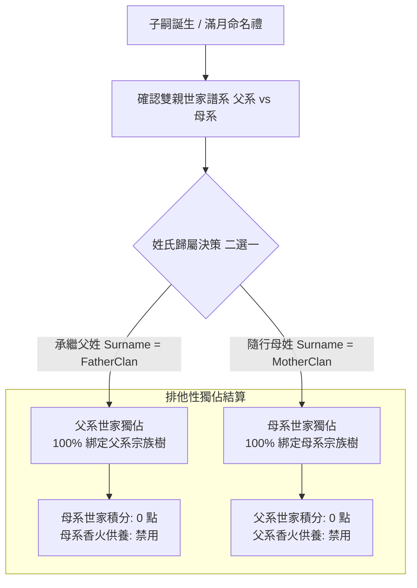

<!-- doc_id: doc_spec_0448 -->
# 姓氏零和歸屬原則與非本姓絕學弱化數值規格書

## 1. 核心定位與職責範圍

本規格書定義子嗣誕生時的「姓氏零和歸屬（Zero-Sum Surname Binding）」機制，以及裝備非本家英靈卡時的「家傳絕學弱化」數值衰減模型，對應 WBS **SPI-09**。
三國時代宗法制度森嚴，氏族傳承講求宗脈唯一。
系統杜絕同一後代同時通吃父系與母系兩大家族資源的「雙吃漏洞」，貫徹排他性零和原則。
同時，規範外姓將領借用名門先祖信物時的威力折損，確保門閥嫡傳的核心競爭力。

---

## 2. 姓氏零和原則狀態機（Zero-Sum Binding）



### 2.1 零和綁定核心守則
1. **嚴格二選一**：任何新生子嗣必須在「父姓」與「母姓」之間完成正式姓氏登錄。
2. **單向貢獻鐵律**：
   - 子嗣戎馬一生所立下的功勳分（`MeritScore`），**100% 僅能撥入其所屬姓氏的世家總庫**。
   - 嚴禁父系與母系兩家平分、重複計算或雙向灌注。
3. **宗族樹節點歸屬**：該子嗣在世家譜系圖（Ancestral Tree）中僅作為所選姓氏之嫡傳後代展開，另一方家族譜系中僅標註「出嗣」或「外嫁」，不參與該門閥之階位評定。

---

## 3. 家傳絕學弱化數值模型（Clan Art Attenuation）

英靈卡與虎符卡所附帶之專屬奧義與家傳絕學，在不同血統宿主身上展現差異化威能：

```mermaid
flowchart LR
    ArtTrigger[發動家傳絕學/專屬奧義] --> CheckSurname{宿主姓氏 === 秘傳姓氏?}
    
    CheckSurname -- 相同 (本姓傳人 / 正式共鳴) --> FullPower[100% 完整神威\n觸發專屬額外質變特效]
    CheckSurname -- 不同 (非本姓外將) --> AttenuatedPower[50% 威力衰減 (弱化版)\n禁用質變特效與破防特權]
```

### 3.1 數值衰減係數定義
對於非本姓將領裝備他族英靈卡或虎符卡：
$$Damage_{\text{effective}} = \lfloor Damage_{\text{base}} \times 0.5 \rfloor$$
$$Duration_{\text{effective}} = \lfloor Duration_{\text{base}} \times 0.5 \rfloor$$

### 3.2 權限與特權封鎖矩陣
| 絕學功能層次 | 本家正統傳人（同姓/正式血脈） | 異姓借用外將 |
|---|:---:|:---:|
| **基礎傷害/治療數值** | **100%** 全額輸出 | **50%** 弱化衰減 |
| **增益/減益持續回合** | **100%** 完整持續 | **50%** 減半持續（小數無條件捨去） |
| **無視防禦/真實傷害** | **完全啟用** | **強制封鎖（退化為一般物理/法術判定）** |
| **世家虎符連攜共鳴** | **觸發額外軍團增幅** | **無法觸發** |

---

## 4. 防火牆與反作弊防護（H-2 同宗不相殘）

1. **同宗內戰功勳折損**：
   - 當戰役雙方主將均屬於同一世家姓氏時，該場戰役所產生的擊殺與傷害功勳分**一律打 3 折（$\times 0.3$）結算**。
   - 徹底杜絕玩家透過派遣同族小號或自導自演「刷功勳」來快速培育英靈卡。

---

## 5. 驗收標準與單元測試契約

1. **零和計分驗證**：
   - 子嗣選擇隨母姓，戰場斬敵 5 員獲得功勳 50 點。結算後驗證：母系家族積分準確增加，父系家族積分維持 0 變動。
2. **絕學弱化精準折半驗證**：
   - 家傳奧義基礎傷害為 400 點、附帶 2 回合眩暈。
   - 外姓武將施放時，驗證傷害值嚴格為 200 點，眩暈持續時間為 1 回合，且無視防禦特效不生效。
3. **同宗互戰折損驗證**：
   - 雙方主將 `familyKey` 相同時，戰後結算功勳自動乘上 0.3 保底折算。
