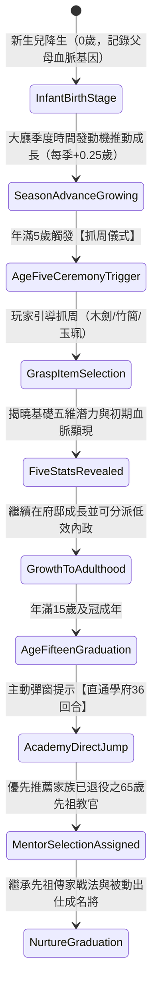

# 子嗣五歲抓周揭曉與及冠入學直通學府代際傳承規格書

<!-- doc_id: doc_spec_1172 -->

## 一、 核心概念與單一真相來源（SSOT）

本規格書定義《三國志·漢末霸業》（3KLife）**子嗣自然生命週期演化**、**五歲抓周天資揭曉儀式**與**十五歲成年（及冠）直通學府代際傳承閉環**。
解決目前家族育兒、學府 36 回合與 65 歲名將退役教官卡模組割裂、無法自然串聯的缺陷。
當大廳季度發動機推動時間時，子嗣自然跨越成長階段，完成由「幼年萌芽 ➔ 少年啟蒙 ➔ 及冠拜師 ➔ 功成出仕」的完整二代人生鏈路。

---

## 二、 核心儀式規則與數值加成契約

### 1. 五歲抓周天資揭曉儀式（人生首個關鍵分流）
- **觸發條件**：換季結算時，檢核到子嗣年齡自 $< 5.0$ 歲跨越至 $\ge 5.0$ 歲。
- **儀式表現**：彈出朱紅毛筆水墨畫卷，擺放三件代表志向之抓周物件：

| 抓周物件 | 象徵志向 | 屬性潛力加成 | 性格偏向 | 初始解鎖戰法傾向 |
| :--- | :--- | :--- | :--- | :--- |
| **小木劍** | 尚武雄豪 | $\text{STR} +10\%$，$\text{LEA} +10\%$ | 剛毅／戰狂 | 突擊、旋風斬、破陣槍 |
| **小竹簡** | 博學文雅 | $\text{INT} +10\%$，$\text{POL} +10\%$ | 沉穩／智謀 | 火計、鼓舞、神機妙算 |
| **青玉珮** | 經世通達 | $\text{CHA} +10\%$，$\text{LUK} +10\%$ | 豪爽／仁德 | 仁政、招降、四海歸心 |

- 選擇完成後，子嗣的問號數值（`???`）正式翻牌為具體數值，並解鎖「少主」頭像邊框。

### 2. 少年期（5~14 歲）低效內政實習
- 子嗣滿 5 歲後，允許被指派至「農耕」或「商業」內政崗位實習。
- 收益依據 `doc_spec_0638` 執行**五折產出（50%）**，但每季實習有 30% 機率使子嗣對應屬性經驗額外 $+5$。

### 3. 十五歲及冠成年與學府直通車（串接 36 回合）
- **觸發時機**：年滿 15.0 歲時，於換季後彈出金榜題名【及冠成年】通知。
- **直通學府行為**：點擊通知上的「【送入學府】」，系統直接打開 `NurtureFlowController` 培育會話。
- **先祖教官自然繼承（接軌 PROG-2-2148）**：
  - 導師選擇清單中，系統自動將**本家族已退役之 65 歲名將教官（如退役的關羽、張飛、趙雲）**置頂並高亮標記「先祖傳承」。
  - 選擇先祖教官後，先祖之專長標籤（`Specialty`）、訓練加成（`Training_Rate`）與傳家戰法（`FamilyTactic`）無損注入培育會話。
  - 完成學府 36 回合後，二代子嗣正式以完整戰鬥武將姿態編入出征軍團！

---

## 三、 防呆規範與架構邊界

1. **多子嗣並行隊列**：若家族中同季有多名子嗣滿 5 歲或 15 歲，採隊列逐一彈窗處理，不遺漏任何子嗣。
2. **缺導師保護機制**：若家族中尚無 65 歲退役教官，學府培育介面自動提供「客卿名儒（水鏡先生）」作為備選導師，絕不卡死。
3. **姓氏繼承規範**：MVP 階段子嗣預設統一繼承父姓（主公姓氏），暫不開啟複雜的母姓切換。

---

## 四、 驗收測試案例（TC）

- **TC-LINEAGE-01（五歲抓周五維翻牌驗收）**：
  - *前置條件*：子嗣年齡 4.75 歲，當前數值均為遮罩狀態。
  - *操作步驟*：點擊「下一季」推進至 5.0 歲，於抓周彈窗點選【小木劍】。
  - *預期輸出*：五維數值完整揭曉，武力與統率獲得 $+10\%$ 修正，志向標記為尚武。
- **TC-LINEAGE-02（及冠入學拜先祖教官驗收）**：
  - *前置條件*：家族中關羽已滿 65 歲退役為教官卡，子嗣達到 15.0 歲。
  - *操作步驟*：點擊及冠通知進入學府。
  - *預期輸出*：導師首位推薦關羽教官卡，培育會話正確讀取關羽傳家戰法。
