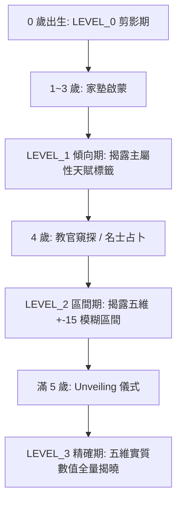

<!-- doc_id: doc_spec_0643 -->
# 子嗣資質四階分層揭露狀態機與UI契約規格書

> **規格代碼**：`NUR-12`
> **版本**：v1.0 (Single Source of Truth)
> **狀態**：正式定案 (Approved)
> **檔案大小限制**：嚴格 <6144 bytes

---

## 1. 系統定位與架構

本規格定義武將子嗣自 0 歲至 5 歲培育期間，五維屬性與潛在因子之「四階分層揭露（Revelation Level 0~3）」狀態機與 UI 渲染契約。
補齊過往「揭露來源（窺探/教官等級）未定」之空白，營造子嗣逐步成長、驚喜漸次揭曉之養成沉浸感。



---

## 2. 四階揭露狀態與資料模型

```typescript
export enum StatRevelationLevel {
  REV_0_SILHOUETTE = 0, // 0 歲: 水墨襁褓剪影，五維顯示 ???
  REV_1_TREND = 1,      // 1~3 歲: 揭露五維最高項天賦偏向標籤
  REV_2_RANGE = 2,      // 4 歲: 揭露五維 +-15 點粗估範圍 (例: 70~85)
  REV_3_EXACT = 3,      // 5 歲: 正式開獎，五維精確整數揭曉
}

export interface ChildRevelationView {
  childId: string;
  age: number;
  revelationLevel: StatRevelationLevel;
  displayStats: {
    war: string;  // "???" | "卓越" | "70~85" | "82"
    lead: string;
    int: string;
    pol: string;
    cha: string;
  };
  dominantTraitTag?: string; // 例: "天生神力", "機敏若狐"
}
```

---

## 3. 揭露推進途徑與判定規則

| 揭露等級 | 達成年齡門檻 | 必須觸發途徑 | UI 呈現表現 |
|---|:---:|---|---|
| **Level 0 (剪影)** | 0 歲 | 出生預設狀態 | 灰階剪影立繪，雷達圖置灰，點擊提示「嬰孩尚幼，難辨資質」 |
| **Level 1 (傾向)** | 1~3 歲 | 太守府指派 $\ge 2\text{★}$ 教官啟蒙 | 揭露五維中數值最高一項之特徵標籤（例：『骨骼驚奇』） |
| **Level 2 (區間)** | 4 歲 | 培育中觸發「教官窺探」或消耗求籤令占卜 | 雷達圖顯示模糊波狀外圈，數值顯示為 `[Value-7, Value+8]` 範圍 |
| **Level 3 (精確)** | 滿 5 歲 | 推進至 5 歲自動觸發 `Unveiling` 開獎 | 破繭金色金光動效，五維定型，開放職能分流（武官/文官） |

---

## 4. UI 格式化與防作弊安全契約

1. **記憶體防偷看（Anti-Cheat Obfuscation）**：
   - 當 `revelationLevel < REV_3_EXACT` 時，前端 ViewModel 中絕不傳遞精確數值欄位，由 Server/Core 僅回傳預先遮罩之字串。
2. **區間計算邊界**：
   - `REV_2_RANGE` 之顯示區間一律限制在 $[0, 100]$ 之合法整數範圍內，避免出現負數或超越規格上限之破綻。
