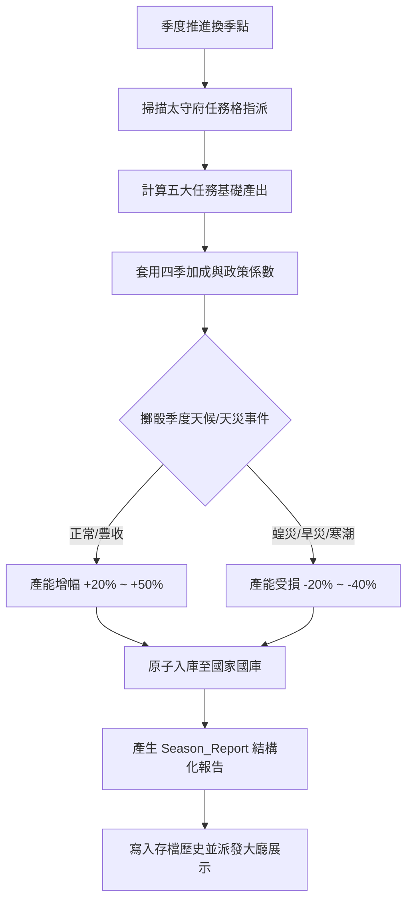

<!-- doc_id: doc_spec_0588 -->
# 季度內政結算模型與天災產出季度報告資料結構規格書

> 標記：Single Source of Truth（單一真相來源）  
> 涵蓋工作包：`GOV-05`  
> 狀態：正式發布 / 核心邏輯規格

---

## 1. 系統定位與架構

本模組規範國家領地在季度推進終點觸發的「季度政務結算引擎（`DomesticSeasonTick`）」與「季度政績報告資料結構（`Season_Report`）」。在春、夏、秋、冬換季之際，系統依據太守府各任務格所指派武將之能力值、領地人口基底、當季氣候加成以及天災隨機事件，精算「糧草、黃金、名聲、預備兵源、軍事情報」五大核心資源之增減，並輸出結構化報告供大廳彈窗展示與歷史留存。



---

## 2. 產出精算公式與天候天災修正（GOV-05）

### 2.1 五大核心產出計算
單項任務之產能計算公式：
$$\text{Output} = \lfloor (\text{Base} + \text{Attribute} \times \text{Weight}) \times \text{PopMultiplier} \times \text{SeasonModifier} \times \text{EventModifier} \rfloor$$

- **糧草（Food）**：農業開墾（主屬性：`POL`，權重 1.5）。
- **黃金（Gold）**：商市繁榮（主屬性：`CHA`，權重 1.2）。
- **名聲（Fame）**：祭祀安民（主屬性：`CHA`，權重 1.0）。
- **城市兵源（Troops）**：軍營練兵（主屬性：`LEA`，權重 1.4）。
- **情報點數（Intel）**：斥候偵查（主屬性：`INT`，權重 1.3）。

### 2.2 季度天候與天災修正矩陣
| 季度 | 自然天候預設加成 | 可能觸發之天災/良兆 | 影響乘數（`EventModifier`） |
|:---:|:---|:---|:---:|
| **春季** | 商業稅收 $+10\%$ | 春耕風調雨順 / 倒春寒 | 糧草產能 $\times 1.30$ 或 $\times 0.80$ |
| **夏季** | 治水建設速度 $\times 2.0$ | 大旱災 / 伏天暴雨 | 糧草產能 $\times 0.60$、水患損害金銀 |
| **秋季** | 糧草徵收 $+50\%$ | 萬家大豐收 / 飛蝗蔽日 | 糧草產能 $\times 1.50$ 或 $\times 0.70$ |
| **冬季** | 宗族結緣親密 $+10\%$ | 瑞雪兆豐年 / 暴風寒潮 | 兵源補充 $\times 1.20$ 或 凍傷減產 $-20\%$ |

---

## 3. 季度報告資料模型（`Season_Report`）

```typescript
export interface IDisasterEventImpact {
  readonly eventId: string;
  readonly eventName: string;
  readonly affectedResource: 'FOOD' | 'GOLD' | 'FAME' | 'TROOPS' | 'INTEL';
  readonly modifierMultiplier: number;
}

export interface ISeasonReport {
  readonly year: number;
  readonly season: 'SPRING' | 'SUMMER' | 'AUTUMN' | 'WINTER';
  readonly gainedFood: number;
  readonly gainedGold: number;
  readonly gainedFame: number;
  readonly gainedTroops: number;
  readonly gainedIntel: number;
  readonly triggeredEvents: readonly IDisasterEventImpact[];
  readonly totalCityPopulation: number;
  readonly generatedTimestamp: number;
}
```

---

## 4. 驗收與測試標準

1. **五維結算原子性（TC-GOV-05-01）**：
   - 驗證單季結算時五大資源同步遞增，國庫資料原子更新，無部分入庫之異常。
2. **天候與天災加權精算（TC-GOV-05-02）**：
   - 輸入秋季大豐收條件，檢核糧草最終產能精確呈現基礎值的 $1.5 \times 1.5 = 2.25$ 倍。
3. **報告結構完整性（TC-GOV-05-03）**：
   - 檢核產出之 `ISeasonReport` 欄位完整，且序列化存檔後讀回之各項數值一致。
