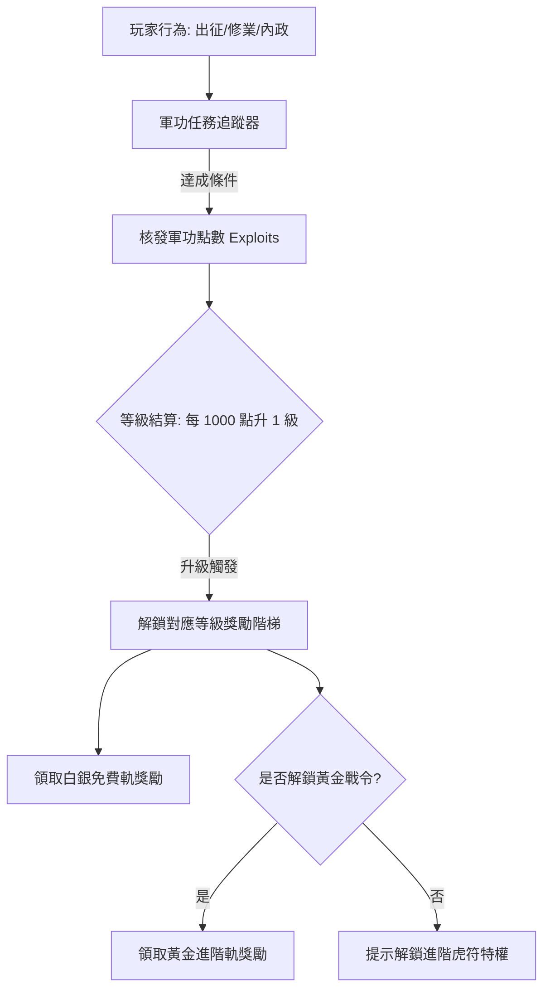

<!-- doc_id: doc_spec_0627 -->
# 季度通行證軍功任務追蹤與雙軌獎勵階梯規格書

> **規格代碼**：`ECO-13`
> **版本**：v1.0 (Single Source of Truth)
> **狀態**：正式定案 (Approved)
> **檔案大小限制**：嚴格 <6144 bytes

---

## 1. 系統定位與架構

本規格定義遊戲內「季度通行證（軍功戰令）」之完整運作架構，包含軍功任務發布、進度追蹤、等級躍升、白銀與黃金雙軌獎勵領取及賽季過期自動清算機制。
徹底裁決過往歷史空白（原註記「僅有一句季度任務獎勵，未定義任務、等級與獎勵表」）。



---

## 2. 通行證等級與經驗模型

```typescript
export interface SeasonPassConfig {
  seasonId: string;
  seasonDurationDays: number;    // 單季週期: 90 天
  maxLevel: number;               // 滿級: 50 級
  expPerLevel: number;            // 每級所需軍功: 1000 點
  unlockPremiumCostGems: number;  // 解鎖進階黃金虎符: 680 玉璧
}

export const SEASON_PASS_DEFAULTS: SeasonPassConfig = {
  seasonId: "SEASON_2026_Q2",
  seasonDurationDays: 90,
  maxLevel: 50,
  expPerLevel: 1000,
  unlockPremiumCostGems: 680,
};
```

---

## 3. 三層軍功任務體系

| 類別 | 重置週期 | 典型任務範例 | 獎勵軍功 | 每日/季上限 |
|---|---|---|---|---|
| **每日修業** | 每日 00:00 | 完成 1 場戰鬥出征<br>進行 1 次學府修業<br>執行 1 次主城委派 | 200 點 / 項 | 每日上限 600 點 |
| **季度演武** | 單季固定 (共 5 項) | 攻克 3 座敵對城池<br>斬獲 10 名名將首級<br>累計糧草收益達 50,000 | 2500 點 / 項 | 每季累計 12,500 點 |
| **功業里程碑** | 賽季全程 (共 3 項) | 晉升至偏將軍 (Tier 3)<br>培育 1 名 3★ 因子子嗣<br>獲得 1 件金色傳世裝備 | 5000 點 / 項 | 每季累計 15,000 點 |

---

## 4. 雙軌獎勵階梯配置

滿級 50 級，分為免費軌與進階軌：

```typescript
export interface PassTierReward {
  level: number;
  freeReward: { itemId: string; count: number };
  premiumReward: { itemId: string; count: number };
  isMilestone: boolean;
}

export const PASS_MILESTONE_REWARDS: Record<number, { free: string; premium: string }> = {
  10: { free: "精元 ×100", premium: "求籤令 ×5" },
  20: { free: "名將好感禮盒 ×1", premium: "限定主城外觀·銅雀春深" },
  30: { free: "高級補元散 ×5", premium: "先祖傳承印記 ×1" },
  40: { free: "精元 ×300", premium: "傳世天工圖紙箱 ×1" },
  50: { free: "求籤令 ×10", premium: "專屬限定動態頭像框·虎符破軍" },
};
```

---

## 5. 獎勵領取與賽季末清算協議

1. **一鍵領取（Claim All）**：
   - 遍歷當前已達到且未領取之等級。
   - 檢查玩家背包空間；若容量不足，先領取至上限，其餘保留待領。
2. **季末防遺憾補發（Season Expiry Auto-Claim）**：
   - 賽季倒數結束（`now >= seasonEndTime`）時觸發結算排程。
   - 系統自動掃描所有已解鎖但未手動點擊領取之獎勵。
   - 透過「軍機處快遞（Mailbox）」一次性打包寄送至玩家信箱，保存期限 30 天。
3. **賽季重置**：
   - 等級與軍功點數歸零，黃金戰令解鎖狀態重置，舊賽季成就歸檔。
