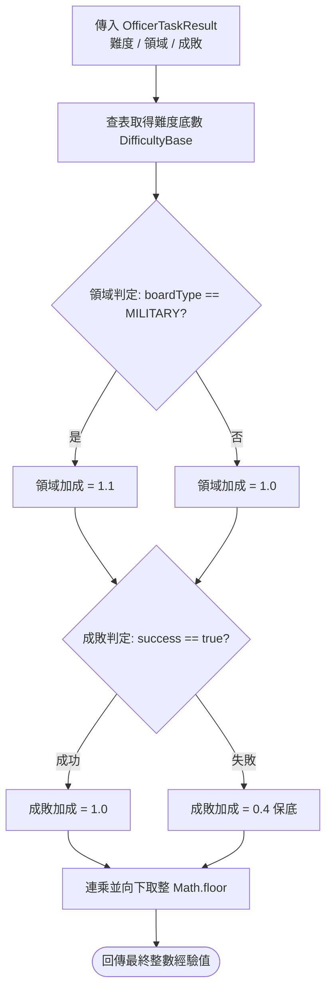

<!-- doc_id: doc_spec_0488 -->
<!-- spec_id: OFC-02 -->
# 官職經驗值獲取演算法與成敗領域加成規格書

> 標籤：`系統規格` `國家官職` `官職經驗` `演算法` `OFC-02`
> 狀態：`正式生效` · 責任模組：`OfficerState` · 參照：`OFC-02` / `PROG-2-0825`

---

## 1. 模組定位與設計理念

官職經驗值（Officer Exp）是衡量玩家於三國亂世中治理天下、征戰四方之長線功勳進度。與單一武將的戰場將階（General Rank）不同，官職經驗值屬於帳號/勢力層級的總體成長指標，直接決定雙牆任務上限、世界沙盤探索階段與外交權限。

本規格書定義官職經驗值計算核心演算法（`calcOfficerExpGain`），確保：
1. **難度階梯分明**：透過五級難度底數，確保高風險高難度委託提供顯著的功勳回報。
2. **領域適性激勵**：強化軍事征伐（MILITARY）之戰功加成，內政（DOMESTIC）與遠征（EXPEDITION）維持穩定收益。
3. **成敗公平補償**：任務失敗給予基礎保底經驗，避免挫敗感過大，同時透過折扣維持成功挑戰的價值。
4. **純邏輯與整數運算**：全程採用無副作用之純函式與向下取整（`Math.floor`），確保跨平台數值絕對一致。

---

## 2. 經驗值計算公式與乘數表

任務結算時，官職經驗獲取值由任務難度底數、所屬領域加成與成敗結果三者相乘後無條件捨去小數：

$$\text{ExpGain} = \left\lfloor \text{DifficultyBase}(\text{difficulty}) \times \text{DomainBonus}(\text{boardType}) \times \text{SuccessBonus}(\text{success}) \right\rfloor$$

### 2.1 難度底數配置表 (DIFFICULTY_BASE)
任務難度依據大廳任務牆分為五個階梯：

| 難度代碼 (Difficulty) | 中文難度 | 基礎經驗底數 (DifficultyBase) | 設計定位與解鎖要求 |
|---|---|:---:|---|
| `EASY` | 簡單 | 10 | 初始新手任務、常規巡邏 |
| `NORMAL` | 普通 | 18 | 日常治安維護、基層剿匪 |
| `ELITE` | 精英 | 30 | 地方叛亂平定、中階郡縣治理 |
| `HIGH` | 困難 | 48 | 大規模敵軍進犯、重大水利內政 |
| `HELL` | 地獄 | 72 | 州級決戰、反霸權會盟討伐 |

### 2.2 領域加成係數 (DomainBonus)
1. **軍事委託 (`MILITARY`)**：加成係數為 **`1.1`**。軍事行動涉及兵力耗損與高危險性，享有額外 10% 功績激勵。
2. **內政委託 (`DOMESTIC`)**：加成係數為 **`1.0`**。提供平穩基石貢獻。
3. **遠征委託 (`EXPEDITION`)**：加成係數為 **`1.0`**。長距離探勘與物資運送。

### 2.3 成敗加成係數 (SuccessBonus)
1. **任務成功 (`success: true`)**：加成係數為 **`1.0`**，全額領取功績。
2. **任務失敗 (`success: false`)**：加成係數為 **`0.4`**，僅獲得 40% 的撫恤功績，象徵雖敗猶有勞苦。

---

## 3. 正式戰鬥戰功映射機制 (Battle Merit)

為使戰場即時戰鬥與大廳官職系統順暢接軌，常規戰鬥勝利無縫折算為官職經驗：
- 每場正式副本或大地圖遭遇戰結算時，對齊常數物件 `BATTLE_MERIT_OFFICER_TASK`：
  - `difficulty`: `'NORMAL'`
  - `boardType`: `'MILITARY'`
- 勝利時經驗計算：$\lfloor 18 \times 1.1 \times 1.0 \rfloor = \lfloor 19.8 \rfloor = 19$ 點。
- 戰敗時經驗計算：$\lfloor 18 \times 1.1 \times 0.4 \rfloor = \lfloor 7.92 \rfloor = 7$ 點。

---

## 4. 數值對照表與邊界驗收契約

依據公式推導之全難度與成敗組合標準產出對照表（皆為純整數）：

| 難度 | 領域 | 成敗 | 浮點計算值 | 最終取得經驗 (`calcOfficerExpGain`) |
|---|---|:---:|:---:|:---:|
| `EASY` | DOMESTIC | 成功 | $10 \times 1.0 \times 1.0 = 10.0$ | **10** |
| `EASY` | DOMESTIC | 失敗 | $10 \times 1.0 \times 0.4 = 4.0$ | **4** |
| `EASY` | MILITARY | 成功 | $10 \times 1.1 \times 1.0 = 11.0$ | **11** |
| `EASY` | MILITARY | 失敗 | $10 \times 1.1 \times 0.4 = 4.4$ | **4** |
| `NORMAL` | MILITARY | 成功 | $18 \times 1.1 \times 1.0 = 19.8$ | **19** |
| `NORMAL` | MILITARY | 失敗 | $18 \times 1.1 \times 0.4 = 7.92$ | **7** |
| `ELITE` | MILITARY | 成功 | $30 \times 1.1 \times 1.0 = 33.0$ | **33** |
| `ELITE` | MILITARY | 失敗 | $30 \times 1.1 \times 0.4 = 13.2$ | **13** |
| `HIGH` | MILITARY | 成功 | $48 \times 1.1 \times 1.0 = 52.8$ | **52** |
| `HIGH` | MILITARY | 失敗 | $48 \times 1.1 \times 0.4 = 21.12$ | **21** |
| `HELL` | MILITARY | 成功 | $72 \times 1.1 \times 1.0 = 79.2$ | **79** |
| `HELL` | MILITARY | 失敗 | $72 \times 1.1 \times 0.4 = 31.68$ | **31** |

單元測試須 100% 覆蓋上述五級難度、軍事加成與成敗分歧，確保無任何浮點精度溢出。
