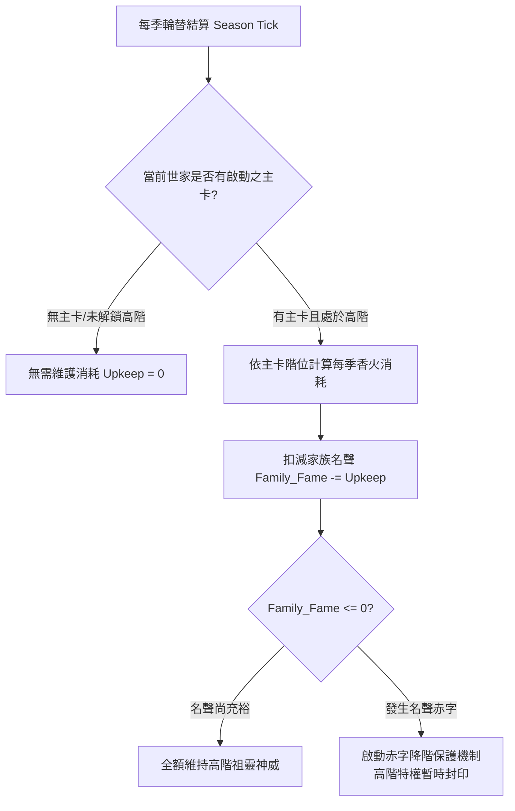
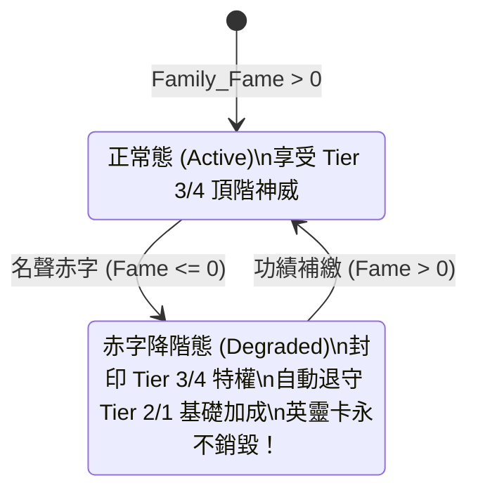

<!-- doc_id: doc_spec_0447 -->
# 家族名聲值供養消耗與赤字降階保護數值規格書

## 1. 核心定位與職責範圍

本規格書定義世家英靈卡高階神位運轉時的「家族名聲值（Family Fame）」消耗模型、宗族聲譽維護，以及面臨名聲赤字時的「降階不銷毀」保護機制，對應 WBS **SPI-08**。
先祖英靈卡的強大加成並非毫無成本的常駐能力，必須消耗全族世代累積的令名與香火。
同時，面對族人叛逆或重大治家失誤，系統設有防崩潰安全閥：名聲耗盡時僅暫時封印高階神威，絕不抹殺先祖實體，給予玩家重振門風的翻盤機會。

---

## 2. 家族名聲值季度消耗與動態收支

### 2.1 各階門閥每季維護費率
| 啟動階位 | 門閥稱謂 | 每季名聲消耗（$Upkeep$） | 備註說明 |
|:---:|:---:|:---:|---|
| **Tier 1** | 傳家之寶 | **`0`** | 寒門入門階，基礎庇佑完全免消耗。 |
| **Tier 2** | 名門望族 | **`20`** / 季 | 次級祖靈加成之常規宗族香火維護。 |
| **Tier 3** | 萬世宗親 | **`60`** / 季 | 跨代供養與流金動態光效之能量消耗。 |
| **Tier 4** | 武聖神祇 | **`150`** / 季 | 神祇真身顯化與頂階傳道奧義之龐大供奉。 |

### 2.2 宗族聲譽反噬（名聲扣減事件）
當家族成員在朝堂或戰場出現違背家風行為時，引發名聲劇烈下挫：
- **陣前倒戈/叛逃**：扣減 `500` 點名聲。
- **作惡被戮/惡評結局**：扣減 `300` 點名聲。
- **治理貪墨被黜**：扣減 `200` 點名聲。

---

## 3. 赤字降階保護機制（Deficit Degradation Protection）

### 3.1 零銷毀神格保全原則
- **先祖永存**：即使家族名聲跌至負值（赤字狀態），**任何英靈卡實體絕不被刪除、降級或回收**。
- **特權暫時封印**：
  - Tier 4 武聖神祇之傳道技能暫時無法傳授給後代。
  - Tier 3 之跨代加成暫時停用，數值退守至 Tier 2 甚至 Tier 1 之基礎保底（單項封頂退守至 +15）。
  - 卡面光效由金色烈芒暗淡為微弱冷光，提示玩家門風衰退。

### 3.2 門風重振滿血復原
- 玩家無須花費額外代價「重新修煉」或「重新升階」。只要族人重新立下戰功、建立德政，使 `Family_Fame > 0`，系統**自動即刻解鎖原本達到之最高門閥特權**。

---

## 4. 介面警示與多語契約

1. **赤字預警提示**：
   - 當剩餘名聲值不足以支付下一季維持費時，世家面板彈出黃色警告標籤 `UI_FAM_UPKEEP_WARNING`。
   - 正式進入赤字時，全螢幕頂部派發紅色警訊 `UI_FAM_DEFICIT_DEGRADED`：「宗族名望不振，先祖庇佑暫隱，請儘速建功補名！」

---

## 5. 驗收標準與單元測試契約

1. **維護扣款準確性**：
   - 世家處於 Tier 3，每季自動扣減 60 點名聲，驗證數值變動無溢出或多扣。
2. **赤字降階判定驗證**：
   - 注入名聲值 50，下一季消耗 60 導致名聲變為 -10。驗證：英靈卡實體依然在冊，但當前生效階位標記由 Tier 3 降為 Tier 2。
3. **回正即時恢復驗證**：
   - 赤字態下注入 100 點名聲使餘額變為 +90，驗證當前生效階位立即自動還原為 Tier 3。
