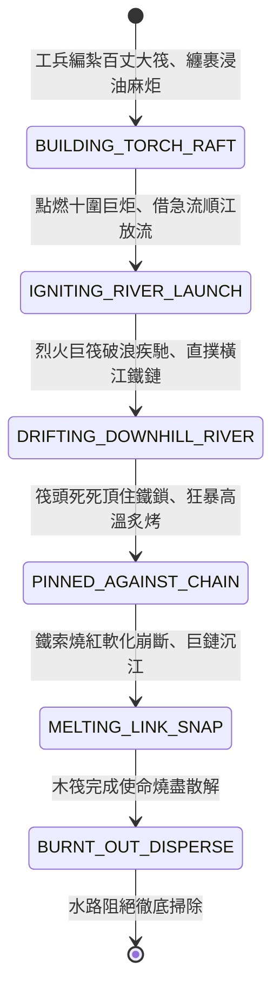

<!-- doc_id: doc_spec_0834 -->
# 3KLife 巨型桐油火炬大筏順流引火燒熔江面橫鎖狀態機規格書

## 模組基本資訊
- **模組代號**：`OIL-TORCH-RAFT-MELT-CHAIN01`
- **系統定位**：三國水軍重型破障特種火攻裝備系統，負責巨型木筏編組、桐油浸透麻布巨炬安設、順江急流推動、抵住橫江鐵索烈火高溫燒熔之完整狀態流。
- **架構依賴**：`WaterGridSystem`、`NavalShipMovement`、`FireSpreadEngine`、`VFXBlockRegistry`。

---

## 核心設計概念
晉將王濬率巴蜀萬艘樓船沿江東下伐吳，面對東吳「千尋鐵鎖橫江」與生鐵暗錐，王濬巧思奇謀製造「巨型火炬大筏」：以巨木數百根編紮成百餘丈長之平底巨筏，筏上立數十根長達十餘丈、粗達十圍之大木柱，柱身密密層層纏裹浸透麻油、魚膏與熟桐油之粗麻布。點火後巨炬烈焰升騰數丈，順長江急湍推動直撞橫江鐵索。巨炬死死頂住鐵鏈持續狂燒，生鐵受極高溫灼烤軟化熔斷，鐵鎖崩落江中，樓船艦隊順流長驅直入。



---

## 狀態機定義與轉換條件

### 1. `BUILDING_TORCH_RAFT`（組裝火筏狀態）
- **進入條件**：水軍基地消耗 300 份巨木材、80 桶桐油與 50 匹粗麻布。
- **行為表現**：
  - 構造長度達 3 格之浮動木筏實體，中央立起 3 具十圍高聳油炬。
  - 防火隔離層保護筏尾，無人操控全憑江流漂引。
- **轉換**：組裝完畢 -> 轉移至 `IGNITING_RIVER_LAUNCH`。

### 2. `IGNITING_RIVER_LAUNCH`（點火放流狀態）
- **行為表現**：
  - 引火藥繩點燃巨炬，爆發高達 4 丈之熾熱火柱。
  - 解開纜繩推入長江主河道，進入順流無人漂浮模式。
- **轉換**：進入水流加速區 -> 轉移至 `DRIFTING_DOWNHILL_RIVER`。

### 3. `DRIFTING_DOWNHILL_RIVER`（急流疾馳狀態）
- **行為表現**：
  - 隨長江水流方向以每回合 5 格速度狂飆。
  - 江面留下一道長條燃燒火帶，阻絕兩側敵軍輕舟靠近。
- **轉換**：筏頭撞上橫江鐵鎖地格 -> 轉移至 `PINNED_AGAINST_CHAIN`。

### 4. `PINNED_AGAINST_CHAIN`（抵鏈烘烤狀態）
- **行為表現**：
  - 巨筏前進受阻，在江水強大推力下死死壓緊橫江鐵索。
  - 3 具巨型火炬對鐵環進行 1200 度高溫局部噴烤。
  - 鐵鏈每秒扣減耐久 80 點，鐵索泛出由黑轉暗紅、亮橘紅之發光漸層。
- **轉換**：鐵索耐久降至 0 -> 轉移至 `MELTING_LINK_SNAP`。

### 5. `MELTING_LINK_SNAP`（熔斷崩解狀態）
- **行為表現**：
  - 燒透之生鐵鏈環屈服強度耗盡，在江流巨大拉扯下「轟」然崩斷。
  - 鐵鏈斷口噴射火花，沉沒於江底沙石之中。
- **轉換**：阻礙清除 -> 轉移至 `BURNT_OUT_DISPERSE`。

### 6. `BURNT_OUT_DISPERSE`（焚盡解體狀態）
- **行為表現**：
  - 木筏油料耗盡，化為無數漂浮木炭隨波逐流熄滅。
- **轉換**：殘骸沉沒 -> 結束退出。

---

## 數值公式與配置契約

```typescript
export interface TorchRaftMeltConfig {
  raftId: string;
  riverDriftSpeedGrids: number;   // 順流漂流每回合格數
  burnFlameHeightMeters: number;  // 火焰高度 (米)
  flameCoreTemperatureCelsius: number; // 核心溫度 (度)
  chainMeltDamageRatePerSec: number;   // 每秒熔蝕鐵索傷害
  raftBurnLifetimeSeconds: number;// 火筏燃燒自毀總時長
}

export const TORCH_RAFT_PRESETS: Record<string, TorchRaftMeltConfig> = {
  WANGJUN_MEGA_TORCH_RAFT: {
    raftId: 'RAFT_TORCH_01',
    riverDriftSpeedGrids: 5,
    burnFlameHeightMeters: 12,
    flameCoreTemperatureCelsius: 1200,
    chainMeltDamageRatePerSec: 80,
    raftBurnLifetimeSeconds: 120,
  }
};
```

---

## 單元測試與驗收標準
1. **順流無人漂移導航**：火筏推入河道後，100% 沿水流向量直線奔馳，不受水手士氣與指令干擾。
2. **抵索鎖死高溫烘烤**：接觸橫江鐵鏈後，火筏航速強制歸零並自動轉入持續烘烤，穩定每秒扣除 80 點鐵索耐久。
3. **熔斷破鎖通道淨空**：鐵索耐久歸零時，地格通行阻絕判定即時消失，主力艦隊無阻航行通過。
