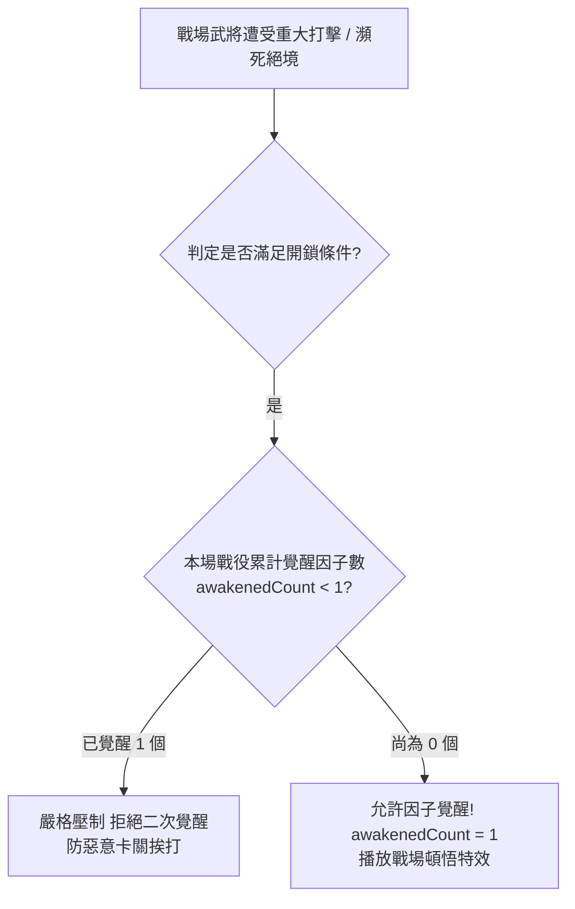
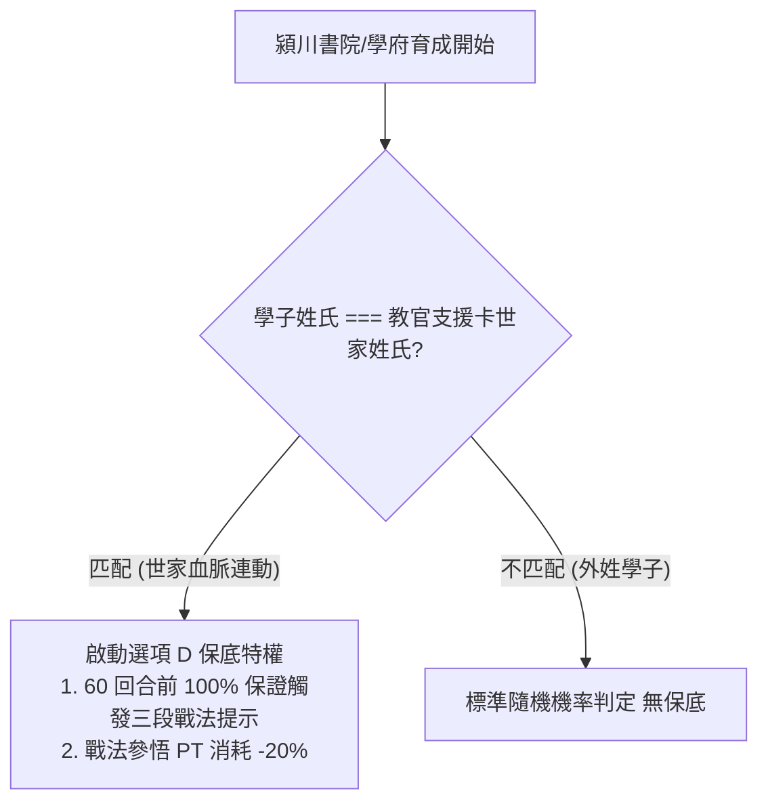

<!-- doc_id: doc_spec_0451 -->
# 幼兒內政戰場單場覺醒與姓氏戰法保證三條MCQ規則規格書

## 1. 核心定位與職責範圍

本規格書統整落實專案核心 MCQ 裁決之三條重要系統交互規則（Q51、Q52、Q32），對應 WBS **SPI-13**。
這三項裁決徹底釐清了：
1. **未滿 15 歲幼兒之內政參與邊界（MCQ Q51）**。
2. **戰場逆境受創時潛藏因子覺醒之單場硬上限（MCQ Q52）**。
3. **世家血脈姓氏匹配支援卡之戰法提示保底機制（MCQ Q32）**。
三者皆以純邏輯狀態機定義，消除了舊規格間的模稜兩可，杜絕玩家惡意挨打刷因子或幼童混入戰場立繪之異常。

---

## 2. MCQ Q51：未成年幼兒低效內政參與模型

```mermaid
flowchart TD
    AssignReq[太守府內政指派請求] --> CheckAge{武將年齡 age < 15 歲?}
    
    CheckAge -- 否 (已及冠成年) --> NormalAssign[正常指派軍政各項任務 100% 效率]
    CheckAge -- 是 (未成年幼兒) --> CheckTaskType{指派任務類型}
    
    CheckTaskType -- 軍事出征/巡邏/鎮壓 --> BlockMilitary[嚴格禁止出戰 Blocked]
    CheckTaskType -- 高階外交/重大工程 --> BlockHighGov[禁止高階政務 Blocked]
    CheckTaskType -- 特定低階雜務 (灑掃/採集/安撫) --> AllowLowWork[允許指派 產出效率 20% (折損 80%)]
```

### 2.1 規則契約與安全邊界
- **軍事絕對禁絕**：未滿 15 歲幼兒**絕對禁止編入出征軍勢或擔任參謀/後勤官**，選將清單中直接被過濾。
- **特定低效內政（選項 B 裁決）**：僅開放基礎雜務（如太守府掃除、後園採集），其內政貢獻效率固定為成人的 **20%**。
- **美術保護**：低效內政介面統一採用幼童 Q 版剪影或通用小僮圖示，不強行拉伸成人戰鬥立繪。

---

## 3. MCQ Q52：戰場單次因子覺醒上限模型



### 3.1 規則契約（選項 B 裁決）
- **每場上限 1 個**：在單一場戰役沙盤中，不論該武將遭受多少次殘血打擊或瀕死救援，**潛藏因子覺醒次數上限嚴格鎖死為 1 個**（`maxAwakenedPerBattle: 1`）。
- **杜絕惡意卡關**：徹底防止玩家利用治療輔助刻意維持殘血挨打，在一場戰役中刷滿 5 格因子的作弊行為。

---

## 4. MCQ Q32：姓氏匹配戰法提示保底模型



### 4.1 規則契約（選項 D 裁決）
- **保底回合**：學子若承襲該教官所屬門閥姓氏，三段戰法傳授事件必定在 **第 60 回合前全數觸發完畢**。
- **修煉折扣**：學習該戰法所需的修煉點數（PT）享受 **$-20\%$ 專屬宗族折扣**，彰顯家學淵源。

---

## 5. 驗收標準與單元測試契約

1. **幼兒軍事指派防禦驗證**：
   - 嘗試指派 10 歲幼兒出征，系統拋出 `AGE_INELIGIBLE` 錯誤。指派低階採集時，驗證產出值恰好為成人的 20%。
2. **單場覺醒上限驗證**：
   - 模擬單場戰鬥連續 10 次觸發瀕死，驗證僅第 1 次成功覺醒因子，後續 9 次均被壓制。
3. **姓氏保底驗證**：
   - 趙姓學子指派趙雲支援卡，推進至第 59 回合時若尚未觸發第三段戰法，系統強制發起戰法傳授事件，且消耗 PT 降低 20%。
