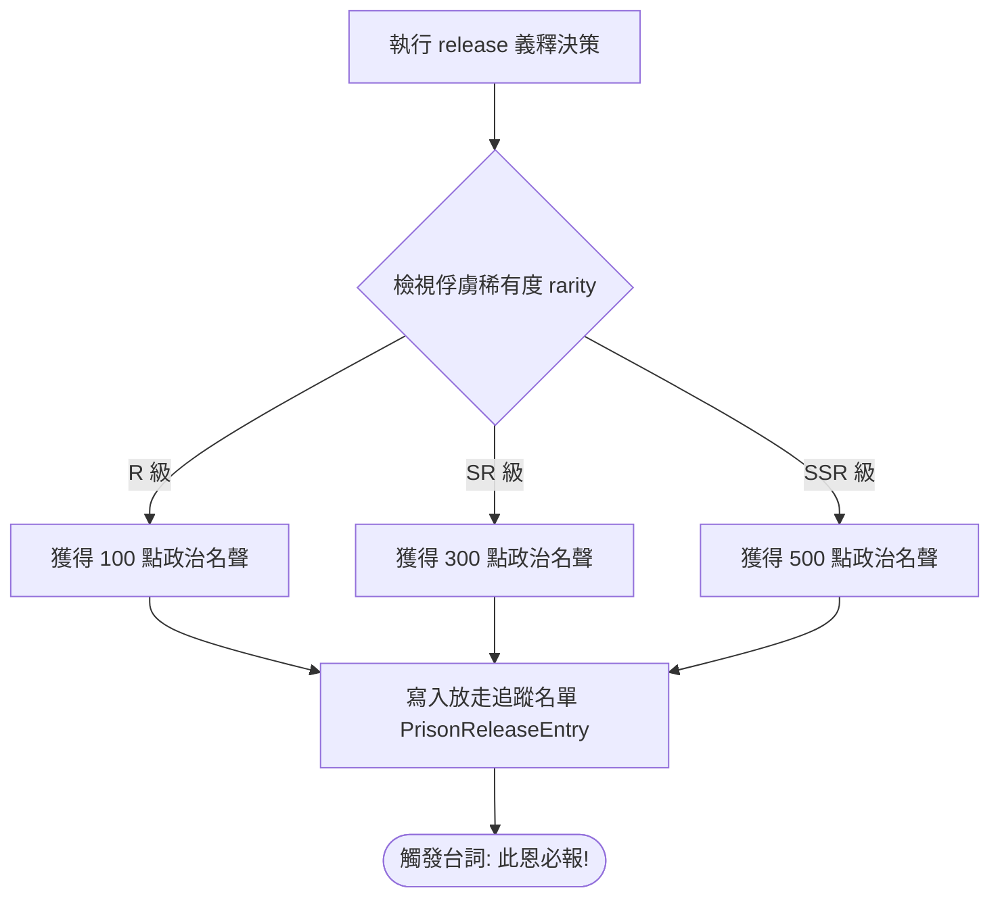
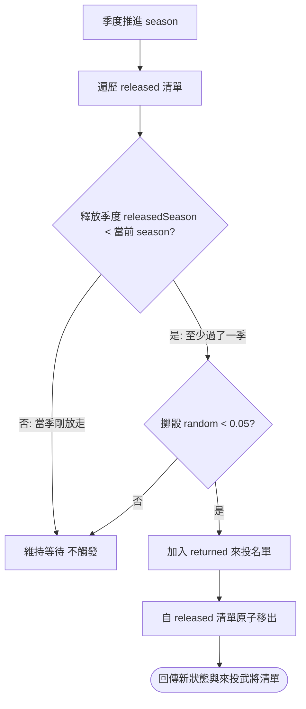

<!-- doc_id: doc_spec_0507 -->
<!-- spec_id: POW-07 -->
# 戰俘放走名聲回報與每季五趴未來來投演算法規格書

> 標籤：`系統規格` `戰場俘虜` `義釋放走` `名聲回報` `未來來投` `POW-07`
> 狀態：`正式生效` · 責任模組：`PrisonerOfWar` · 參照：`POW-07` / `doc_spec_0021`

---

## 1. 模組定位與設計理念

在三國亂世中，以德服人、義釋敵將（如曹操釋關羽、諸葛亮七擒孟獲）是贏得天下人心與長線吸引名將來投的仁道典範。
本規格書定義戰後俘虜「義釋放走（Release）」之名聲回報與未來主動來投演算法（`PrisonerOfWar.ts`），遵循以下原則：
1. **即時名聲反饋**：釋放敵將立即獲取政治名聲（Fame），名聲多寡與俘虜稀有度成正比。
2. **跨季感恩記憶追蹤**：被釋放將領記入歷史名單，長期埋下感念仁德之種子。
3. **每季微機率主動歸附**：被釋放名將在後續季度中，每季具備確定性的 5% 機率主動前來投奔。
4. **狀態隔離與原子移出**：一旦觸發來投，該將領立即自放走追蹤清單移除並加入正式名冊，防止重複觸發。

---

## 2. 義釋放走名聲回報矩陣 (RELEASE_FAME)

當玩家對戰後俘虜執行 `release` 決策時，即時獲取勢力名聲加成：



| 俘虜稀有度 (`PowRarity`) | 義釋獲取名聲 (`RELEASE_FAME`) | 象徵意義與天下反響 |
|:---:|:---:|---|
| **`R`** (精銳) | **100** | 仁厚待士，基層士卒傳頌仁德 |
| **`SR`** (良將) | **300** | 寬宥將領，地方州郡名士信服 |
| **`SSR`** (名將) | **500** | 國士之風，威名遠播中原震撼各方諸侯 |

---

## 3. 跨季感念來投演算法 (rollFutureReturns)

每季季初結算時，系統遍歷目前放走中的俘虜名單（`state.released`）：



### 3.1 數學模型與常數定義
- `FUTURE_RETURN_CHANCE = 0.05`（每季固定 5% 機率）。
- **觸發資格守衛**：
  $$\text{eligible} = (\text{entry.releasedSeason} < \text{currentSeason})$$
  當季剛剛放走的武將絕不在當季立刻折返，確保時間節奏自然。
- **抽樣公式**：
  $$\text{shouldReturn} = \text{eligible} \quad \land \quad (\text{random}() < 0.05)$$

---

## 4. 存檔資料結構與單元測試契約

### 4.1 存檔資料結構 (PrisonReleaseEntry)
```typescript
export interface PrisonReleaseEntry {
    targetUid: string;       // 武將唯一識別碼
    targetName: string;      // 武將姓名
    releasedSeason: number;  // 被釋放時的絕對季度
}
```

### 4.2 驗收標準與單元測試
1. **即時名聲驗證**：釋放 SSR 武將，`fameGained` 必須精確回傳 500。
2. **同季防回流**：在第 3 季被放走的武將，於第 3 季結算時不進行來投擲骰，`returned` 必為空。
3. **跨季來投原子性**：第 3 季放走，第 4 季擲出 $< 0.05$ 命中時，該條目移入 `returned` 陣列，`state.released` 中該條目被完全剔除，後續季度不重複檢定。
