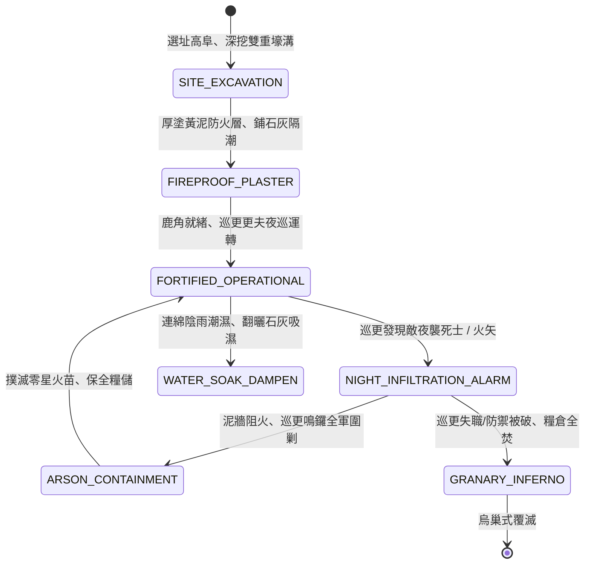

<!-- doc_id: doc_spec_0811 -->
# 3KLife 戰地野戰糧倉囤聚防潮防火與深溝高壘巡更防夜襲狀態機規格書

## 模組基本資訊
- **模組代號**：`DEPOT-GRANARY-DEFENSE01`
- **系統定位**：三國戰場前線野戰糧倉防護與夜巡防禦系統，負責糧聚選址、泥漿塗牆阻燃、防潮排澇、雙重壕溝架設與巡更更夫夜襲預警之完整狀態流。
- **架構依賴**：`BattleGridSystem`、`SupplyLineEngine`、`CampFortificationSystem`、`VFXBlockRegistry`。

---

## 核心設計概念
官渡烏巢之劫，袁紹萬車糧草一夕化為焦炭，致使十萬河北大軍瞬間崩潰。此慘痛教訓使三國各方高度重視前線野戰中轉糧倉之防禦工程。規範糧倉必設於乾燥高阜地段，外牆厚塗厚黃泥濕漿阻隔火箭燃燒；底層鋪設竹蓆生石灰吸濕防潮；外圍深掘雙重乾壕溝並栽植鹿角。糧倉四角高立箭樓，更夫按更次敲梆巡察，嚴防敵軍輕騎換裝號衣奇襲放火。



---

## 狀態機定義與轉換條件

### 1. `SITE_EXCAVATION`（營建開挖狀態）
- **進入條件**：軍隊於後方高地地格選址，下達「構築野戰糧倉」指令。
- **行為表現**：
  - 挖掘寬 2 丈、深 1 丈之雙重環形壕溝，立木柵阻絕。
  - 耐久度基礎值 1500 點。
- **轉換**：土方工程完畢 -> 轉移至 `FIREPROOF_PLASTER`。

### 2. `FIREPROOF_PLASTER`（塗泥防潮狀態）
- **行為表現**：
  - 外牆均勻塗抹 3 寸厚黃泥生石膏混合漿，火箭引燃機率降低 80%。
  - 底層堆疊生石灰與曬乾竹蓆，防潮防腐霉變。
- **轉換**：物料風乾成型 -> 轉移至 `FORTIFIED_OPERATIONAL`。

### 3. `FORTIFIED_OPERATIONAL`（防禦運轉狀態）
- **行為表現**：
  - 儲存高達 20000 單位軍糧，每日安全損耗率低於 0.5%。
  - 箭樓更夫每 2 小時打更巡邏，夜間偵測半徑維持 4 格。
- **轉換**：
  - 夜間偵測到敵軍偽裝潛入或火箭射入 -> 轉移至 `NIGHT_INFILTRATION_ALARM`。
  - 遭遇持續大雨超過 3 回合 -> 轉移至 `WATER_SOAK_DAMPEN`。

### 4. `NIGHT_INFILTRATION_ALARM`（夜襲報警狀態）
- **行為表現**：
  - 更夫敲響銅鑼，全營警報拉響，守軍部隊立即進入戰備。
  - 壕溝拒馬有效阻滯敵夜襲騎兵衝擊。
- **轉換**：
  - 敵火攻被泥牆阻隔且守軍在 2 回合內消滅夜襲敵軍 -> 轉移至 `ARSON_CONTAINMENT`。
  - 敵軍炸開大門直撲主庫並成功引燃火油 -> 轉移至 `GRANARY_INFERNO`。

### 5. `ARSON_CONTAINMENT`（火情撲滅狀態）
- **行為表現**：
  - 守軍使用備用水缸與濕沙覆蓋火星，糧草損失小於 5%。
  - 狀態迅速恢復穩定。
- **轉換**：火勢撲滅 -> 回歸 `FORTIFIED_OPERATIONAL`。

### 6. `GRANARY_INFERNO`（糧倉大火覆滅狀態）
- **行為表現**：
  - 發生「烏巢式大爆炸」，萬石糧草化為灰燼。
  - 大營全體士氣暴降 50 點，防禦工程永久損毀。
- **轉換**：燒盡成灰 -> 結束退出。

---

## 數值公式與配置契約

```typescript
export interface GranaryDefenseConfig {
  granaryId: string;
  storageMaxCapacity: number;     // 糧草最大容量
  mudPlasterFireResistance: number;// 泥牆阻火抗性比 (0.0 ~ 1.0)
  moistureDecayReduction: number;  // 防潮減損率
  watchmanAlarmRadiusGrid: number;// 巡更銅鑼預警半徑
  arsonVulnerabilityThreshold: number; // 遭受大火焚毀承受時長
}

export const GRANARY_PRESETS: Record<string, GranaryDefenseConfig> = {
  FORTIFIED_DEPOT_HEAVY: {
    granaryId: 'GRANARY_FORT_01',
    storageMaxCapacity: 20000,
    mudPlasterFireResistance: 0.80,
    moistureDecayReduction: 0.90,
    watchmanAlarmRadiusGrid: 4,
    arsonVulnerabilityThreshold: 3,
  }
};
```

---

## 單元測試與驗收標準
1. **泥牆火箭抗性**：敵弓弩手射發常規火箭時，塗抹泥漿之糧倉僅有 20% 機率產生小火星，且不觸發全面蔓延。
2. **夜更警報半徑**：夜間敵特種死士進入糧倉 4 格半徑時，巡更更夫 100% 觸發鳴鑼報警，全營駐軍免受偷襲混亂。
3. **烏巢大火大潰敗**：若敵軍連續 3 回合持續灌注猛火油焚燒，糧倉轉入 `GRANARY_INFERNO`，前線大營士氣即刻扣除 50 點。
