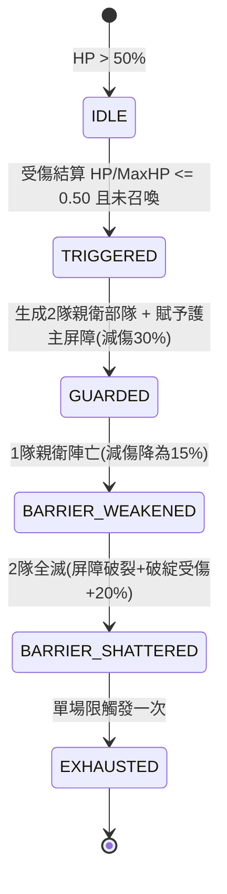

# 戰場BOSS半血親衛隊召喚與護主屏障狀態機規格書

<!-- doc_id: doc_spec_0604 -->

> 本規格書依據 WBS `LVL-11`（Boss AI：主將血量<50% 召喚親衛隊與護主屏障狀態機）制定，為關卡首領戰對決單一真相來源（Single Source of Truth）。
> 核心約束：無副作用純邏輯架構、生命值閾值單場一次性觸發、螺旋外圈合法地格生成、護主屏障與親衛存活數動態聯動、全繁體中文台灣慣用術語。

---

## 1. 業務情境與狀態機

敵方首領（如呂布、曹操）生命值結算跌破 50% 時，觸發一次性親衛隊進場與「護主屏障」，建立攻防縱深。



### 1.1 觸發規則
1. **單場限觸發一次**：每位 Boss 單場戰鬥僅限觸發 1 次（`hasTriggered === false`），後續回血再跌破不重複觸發。
2. **結算時機點**：單次攻擊／戰法／DOT 傷害完全結算且 Boss 存活（`HP > 0`）之 Tick 點。
3. **免控中斷**：屬於被動機制，無視眩暈、沉默、凍結等控制狀態。

---

## 2. 親衛兵種與螺旋地格生成

### 2.1 專屬親衛模板
- **呂布 (`BOSS_LU_BU`)**：2 隊陷陣營重步兵（反擊傷害 +30%、免退），偏好首領左右橫向相鄰格。
- **曹操 (`BOSS_CAO_CAO`)**：2 隊虎豹騎突擊騎（忽視 20% 防禦、高機動），偏好首領正前方兩側斜角格。
- **預設首領 (`DEFAULT_BOSS`)**：2 隊鐵甲親衛隊（分攤 50% 傷害），偏好首領周圍半徑 1 格。

### 2.2 螺旋外圈可用地格搜尋
若偏好格被佔或為阻擋／危害地形，依順時針螺旋搜尋半徑 $R \in [1, 2]$ 之合法空格。若戰場全滿無空格，轉化為 Boss 怒氣 SP +100 與持續 2 回合減傷 50% 之金身補償。

---

## 3. 護主屏障（Guard Barrier）動態減傷

Boss 掛載 `BUFF_GUARD_BARRIER`，傷害減免率與在場親衛存活數連動：

$$\text{DamageReduction} = \begin{cases} 30\% & \text{（2 隊親衛存活）} \\ 15\% & \text{（1 隊親衛存活）} \\ 0\% & \text{（親衛全滅，轉化為破綻）} \end{cases}$$

親衛隊全數陣亡時移除屏障，並附加持續 1 回合之 `DEBUFF_EXPOSED`（受傷加深 20%，無法閃避格擋）。

---

## 4. 資料模型與狀態推進函式

```typescript
export interface IGridPos { readonly x: number; readonly y: number; }

export interface IBossSummonState {
    readonly bossId: string;
    readonly hasTriggered: boolean;
    readonly guardUnitIds: readonly string[];
    readonly aliveGuardsCount: number;
    readonly barrierActive: boolean;
    readonly barrierReductionRate: number;
    readonly isExposed: boolean;
}

export interface ISummonEvalResult {
    readonly shouldTrigger: boolean;
    readonly nextState: IBossSummonState;
    readonly spawns: readonly { readonly templateId: string; readonly pos: IGridPos }[];
    readonly fallbackBuff: boolean;
}

export function evaluateBossHealthTick(
    st: IBossSummonState,
    hp: number,
    maxHp: number,
    bossPos: IGridPos,
    prefOffsets: readonly IGridPos[],
    guardTplId: string,
    isAvailable: (p: IGridPos) => boolean
): ISummonEvalResult {
    if (st.hasTriggered || hp <= 0 || (hp / maxHp) > 0.50) {
        return { shouldTrigger: false, nextState: st, spawns: [], fallbackBuff: false };
    }

    const spawns: { templateId: string; pos: IGridPos }[] = [];
    const occupied = new Set<string>();

    for (let i = 0; i < 2; i++) {
        const offset = prefOffsets[i] ?? { x: i === 0 ? -1 : 1, y: 0 };
        const candidate: IGridPos = { x: bossPos.x + offset.x, y: bossPos.y + offset.y };
        const key = `${candidate.x},${candidate.y}`;
        if (candidate.x >= 0 && candidate.x < 8 && candidate.y >= 0 && candidate.y < 5 && isAvailable(candidate) && !occupied.has(key)) {
            spawns.push({ templateId: guardTplId, pos: candidate });
            occupied.add(key);
        }
    }

    if (spawns.length === 0) {
        return {
            shouldTrigger: true,
            nextState: { ...st, hasTriggered: true, barrierActive: true, barrierReductionRate: 0.50, isExposed: false },
            spawns: [],
            fallbackBuff: true,
        };
    }

    const unitIds = spawns.map((_, idx) => `GUARD_${st.bossId}_${idx + 1}`);
    return {
        shouldTrigger: true,
        nextState: {
            bossId: st.bossId,
            hasTriggered: true,
            guardUnitIds: unitIds,
            aliveGuardsCount: spawns.length,
            barrierActive: true,
            barrierReductionRate: spawns.length === 2 ? 0.30 : 0.15,
            isExposed: false,
        },
        spawns,
        fallbackBuff: false,
    };
}
```

---

## 5. 驗收測試案例（Test Cases）

| 測試編號 | 測試情境 | 輸入條件 | 預期輸出 |
|---|---|---|---|
| `TC-BOSS-01` | 半血觸發親衛召喚 | 曹操 HP 跌至 45%（未曾觸發） | `shouldTrigger=true`，生成 2 隊虎豹騎，減傷率 30% |
| `TC-BOSS-02` | 二度跌破防重複 | 曹操回血至 60% 再跌至 30% | `shouldTrigger=false`，不重複生成，狀態維持 |
| `TC-BOSS-03` | 親衛陣亡屏障遞減破裂 | 擊殺第 1 隊親衛；擊殺第 2 隊 | 減傷率降至 15%；全滅時屏障消失且掛載破綻 (+20%受傷) |
| `TC-BOSS-04` | 無可用地格極端補償 | 首領周圍全滿無合法空格 | `spawns=[]`，觸發補償獲得 50% 減傷金身 |
