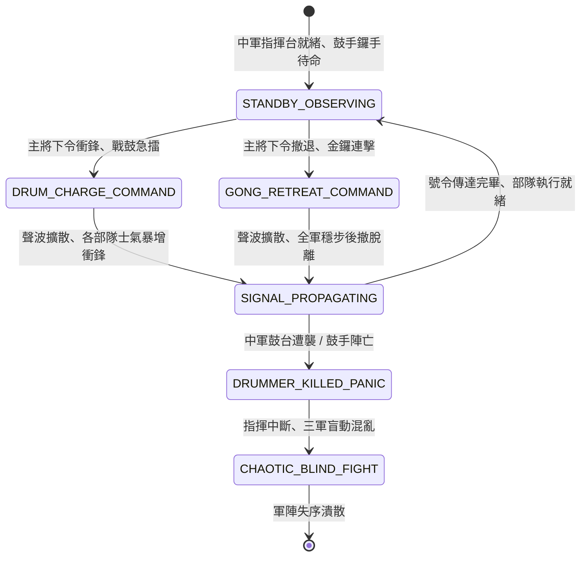

<!-- doc_id: doc_spec_0806 -->
# 3KLife 戰場中軍金鼓齊鳴號角吹奏與三軍進退號令指令狀態機規格書

## 模組基本資訊
- **模組代號**：`DRUM-GONG-SIGNAL-CMD01`
- **系統定位**：三國戰場宏觀聲學指揮與三軍陣型調度系統，負責中軍鼓樓擊鼓衝鋒、鳴金收兵、牛角號列陣、風向聲學衰減與鼓手遭襲失控判定之完整狀態流。
- **架構依賴**：`BattleCommandController`、`MoraleSystem`、`SoundAcousticGridEngine`、`VFXBlockRegistry`。

---

## 核心設計概念
三國古代大規模野戰中，部隊蔓延數里，將領肉嗓難以傳達萬人。全軍調度全賴「聞鼓則進、聞金則退」。中軍主將於高台設巨型雷鼓與紫銅金鑼：擊鼓聲如奔雷，催動前鋒突刺與全軍衝鋒；鳴金清脆穿透，指令部隊交替掩護回撤。若戰場遭遇大風、暴雨或敵軍精銳直插中軍斬殺鼓手，號令中斷將導致各營各自為戰甚至潰亂。



---

## 狀態機定義與轉換條件

### 1. `STANDBY_OBSERVING`（中軍觀察待命狀態）
- **進入條件**：戰鬥開始，中軍大帳或帥旗高台建立完成。
- **行為表現**：
  - 4 名力士持槌待命，紫銅金鑼懸掛於高架。
  - 保持全場視野感知，監控前鋒與左右翼動態。
- **轉換**：主將發布「全軍突擊」或「鳴金收兵」指令 -> 轉移至 `DRUM_CHARGE_COMMAND` 或 `GONG_RETREAT_COMMAND`。

### 2. `DRUM_CHARGE_COMMAND`（戰鼓雷鳴衝鋒狀態）
- **行為表現**：
  - 擂響三通戰鼓（節奏 120 BPM），釋放「戰鼓震天」聲學特效。
  - 全軍受號令部隊士氣即刻 +20 點，移動力 +1，近戰攻擊力 +15%。
- **轉換**：聲波沿地格傳播 -> 轉移至 `SIGNAL_PROPAGATING`。

### 3. `GONG_RETREAT_COMMAND`（鳴金收兵穩退狀態）
- **行為表現**：
  - 連續敲擊紫銅大鑼，發出高頻金屬鳴響。
  - 指令所有交戰部隊脫離纏鬥，防禦力 +25%，後撤不受藉機攻擊懲罰。
- **轉換**：聲波沿地格傳播 -> 轉移至 `SIGNAL_PROPAGATING`。

### 4. `SIGNAL_PROPAGATING`（聲學衰減傳播狀態）
- **行為表現**：
  - 聲波半徑覆蓋 12 格；計算風向加成：順風傳播距離 +4 格，逆風衰減 -3 格。
  - 大雨天氣下傳播半徑縮減 30%。
- **轉換**：
  - 中軍指揮台遭受敵軍騎兵突襲或遠程火箭集中射擊 -> 轉移至 `DRUMMER_KILLED_PANIC`。
  - 所有有效範圍支部隊接收號令完畢 -> 回歸 `STANDBY_OBSERVING`。

### 5. `DRUMMER_KILLED_PANIC`（鼓手遇襲中斷狀態）
- **行為表現**：
  - 鼓皮被射穿、力士中箭倒地，號令戛然而止。
  - 戰場三軍失去統一協同指令，無法響應後續變更。
- **轉換**：副鼓手未能在 1 回合內補位 -> 轉移至 `CHAOTIC_BLIND_FIGHT`。

### 6. `CHAOTIC_BLIND_FIGHT`（失控盲動混亂狀態）
- **行為表現**：
  - 各部隊轉入獨立 AI 判定，士氣每回合 -10 點。
  - 陣型無法維持，有 30% 機率在前線盲目潰退。
- **轉換**：重新豎起帥旗並更換鼓手，或全軍潰滅 -> 結束退出。

---

## 數值公式與配置契約

```typescript
export interface DrumSignalConfig {
  signalId: string;
  maxAcousticRadiusGrid: number;  // 基礎聲學傳播半徑 (格)
  chargeMoraleBonus: number;       // 戰鼓衝鋒士氣加成
  chargeAttackBonusPercent: number;// 攻擊力加成比 (0.0 ~ 1.0)
  retreatDefenseBonusPercent: number; // 鳴金防禦加成比 (0.0 ~ 1.0)
  windAcousticModifier: number;    // 風向對傳播半徑影響係數
  rainAttenuationRate: number;     // 雨天聲學衰減率
}

export const DRUM_SIGNAL_PRESETS: Record<string, DrumSignalConfig> = {
  GRAND_COMMAND_DRUM: {
    signalId: 'SIG_DRUM_01',
    maxAcousticRadiusGrid: 12,
    chargeMoraleBonus: 20,
    chargeAttackBonusPercent: 0.15,
    retreatDefenseBonusPercent: 0.25,
    windAcousticModifier: 4.0,
    rainAttenuationRate: 0.30,
  }
};
```

---

## 單元測試與驗收標準
1. **風向聲學傳播範圍**：在 2 級順風下，戰鼓指令傳播半徑精確擴展至 16 格；逆風環境衰減至 9 格。
2. **鳴金撤退防禦補償**：處於纏鬥狀態之步兵接獲鳴金信號後撤時，完全免疫「脫離戰鬥藉機攻擊」，防禦力提升 25%。
3. **鼓手中繼失控**：當鼓手中箭身亡且未指派副鼓手時，全軍即刻陷入 `CHAOTIC_BLIND_FIGHT`，無法接受主將手動指令。
