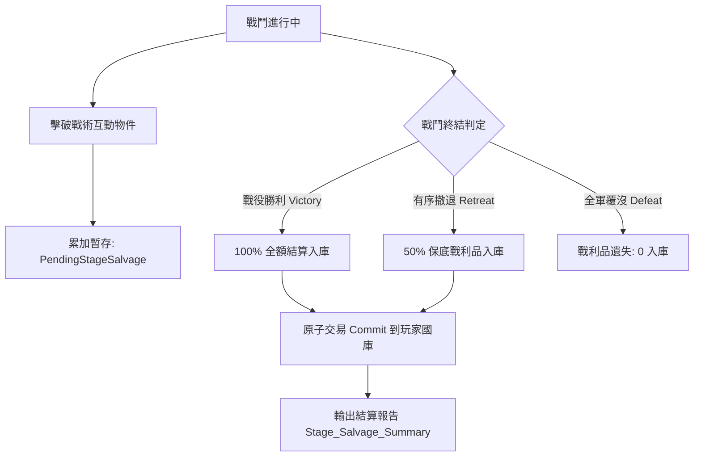

# 戰場互動戰利品戰後一次性原子結算入庫規格書

<!-- doc_id: doc_spec_0603 -->

> 標記：Single Source of Truth（單一真相來源）  
> 涵蓋工作包：`LVL-09`  
> 狀態：正式發布 / 核心邏輯規格

---

## 1. 系統定位與架構

本模組規範戰役關卡中透過擊破戰術互動物件（如敵軍輜重營帳、落石機關、攔水水閘、暗樁陷阱群）所掠奪之「戰場戰利品（Stage Salvage）」的累加與結算機制。

為防範實時戰場併發寫入造成帳號經濟髒數據或斷線漏洞，本架構確立嚴格的「戰中暫存累積，戰後原子入庫（Atomic Settlement on Battle End）」鐵律：戰鬥進行時僅在內存記憶體維護 `PendingStageSalvage` 狀態；當戰事宣告終結（勝利或有序撤退）時，在戰後結算介面統一進行單次原子寫入，將物資無縫注入玩家國家國庫。



---

## 2. 戰術戰利品分類與資料模型（LVL-09）

### 2.1 四大戰利品類型
1. **城建石材（Stone）**：來源於摧毀落石機關與石壘箭塔，用於太守府與城防升級。
2. **防禦木材（Wood）**：來源於破壞防禦拒馬、水庫木閘與敵營木柵。
3. **軍需補給（Supply / Food）**：來源於破壞敵方輜重糧草庫，直接折算為國家糧草。
4. **軍事情報（Intel）**：來源於搜查敵軍中軍大帳與密信匣，折算為軍師情報點數。

### 2.2 核心資料結構
```typescript
export interface IStageSalvageSummary {
  readonly stageId: string;
  readonly battleResult: 'VICTORY' | 'RETREAT' | 'DEFEAT';
  readonly gainedStone: number;
  readonly gainedWood: number;
  readonly gainedSupply: number;
  readonly gainedIntel: number;
  readonly settledTimestamp: number;
}

export class PendingStageSalvage {
  private stone = 0;
  private wood = 0;
  private supply = 0;
  private intel = 0;

  public recordBreak(type: 'STONE' | 'WOOD' | 'SUPPLY' | 'INTEL', amount: number): void {
    if (type === 'STONE') this.stone += amount;
    else if (type === 'WOOD') this.wood += amount;
    else if (type === 'SUPPLY') this.supply += amount;
    else if (type === 'INTEL') this.intel += amount;
  }

  public settle(result: 'VICTORY' | 'RETREAT' | 'DEFEAT'): {
    stone: number;
    wood: number;
    supply: number;
    intel: number;
  } {
    const ratio = result === 'VICTORY' ? 1.0 : result === 'RETREAT' ? 0.50 : 0.0;
    return {
      stone: Math.floor(this.stone * ratio),
      wood: Math.floor(this.wood * ratio),
      supply: Math.floor(this.supply * ratio),
      intel: Math.floor(this.intel * ratio),
    };
  }
}
```

---

## 3. 戰後原子結算入庫處理

1. **零戰中入庫鐵律**：
   - 戰場實體（如 `InteractiveObject`）被擊破時，僅發送事件通知 `PendingStageSalvage` 累加數值，嚴禁調用 `PlayerEconomyService`。
2. **結算交易提交（Atomic Transaction）**：
   - 戰鬥結算階段，`BattleSession` 呼叫 `PendingStageSalvage.settle(result)`，將四項物資包裹在單一原子操作中，一次性遞增國庫欄位。若存檔或網路超時，整筆結算回滾，不產生部分寫入。

---

## 4. 驗收與測試標準

1. **勝利全額入庫測試（TC-LVL-09-01）**：
   - 戰中累計獲取 100 石材與 50 木材，戰鬥獲勝時，檢核國庫精確增加 100 石材與 50 木材。
2. **撤退 50% 折半保底測試（TC-LVL-09-02）**：
   - 戰中累計獲取 100 補給，部隊選擇有序撤退時，檢核國庫精確增加 50 補給。
3. **戰中隔離防護（TC-LVL-09-03）**：
   - 驗證在戰鬥進行中，國庫實時數值保持不變，直到發送 `BATTLE_ENDED` 事件後才發生跳變。
