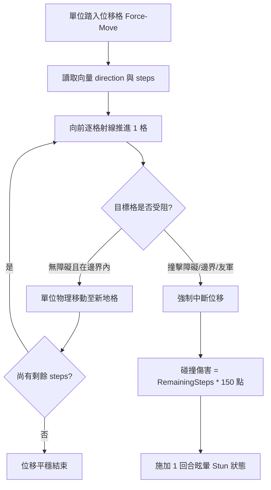

<!-- doc_id: doc_spec_0600 -->
# 戰場位移地格水淹推退與受阻碰撞傷害狀態機規格書

> 標記：Single Source of Truth（單一真相來源）  
> 涵蓋工作包：`GRD-03`  
> 狀態：正式發布 / 核心邏輯規格

---

## 1. 系統定位與架構

本模組規範 $5 \times 8$ 戰術棋盤中「強制位移地格（Force-Move Tile）」的物理推移演算法與受阻碰撞動能轉化機制。以「決堤水淹（Flood Current）」與「流沙陷坑（Quicksand）」為核心表現型態，當單位在自動移動或戰術推進中踏入位移地格時，立即被施加預設方向之強制向量位移。若位移路徑受阻於棋盤邊界、岩石障礙物或已有單位佔據之阻擋格，剩餘位移動能立即轉化為「碎甲碰撞傷害（Collision Impact Damage）」並附加眩暈控制。



---

## 2. 強制位移地格資料模型（GRD-03）

```typescript
export type ForceMoveDirection = 'NORTH' | 'SOUTH' | 'EAST' | 'WEST';

export interface IForceMoveTileData {
  readonly tileX: number;
  readonly tileY: number;
  readonly direction: ForceMoveDirection; // 水流/強風強制推退方向
  readonly steps: number;                  // 強制推退格數（通常為 1 ~ 2 格）
  readonly damageOnCollision: number;      // 每次受阻碰撞基礎傷害（預設 150）
}
```

---

## 3. 受阻碰撞動能轉化演算法

### 3.1 碰撞判定條件
單位在推進過程中，若目標地格符合以下任一條件，判定為「受阻碰撞（Collision Interrupted）」：
1. **棋盤世界邊界越界**：目標座標 $X < 0$ 或 $X \ge 5$，或 $Y < 0$ 或 $Y \ge 8$。
2. **地形障礙物阻擋**：目標地格為不可通行的城牆、碎石阻擋格或山丘。
3. **單位重疊衝突**：目標地格已有其他友軍或敵軍武將駐留。

### 3.2 碰撞傷害與眩暈公式
當發生受阻碰撞時，位移立即終止，剩餘步數依下列公式轉化為傷害：
$$\text{CollisionDamage} = \text{RemainingSteps} \times \text{damageOnCollision} + \lfloor \text{TargetMaxHP} \times 0.05 \rfloor$$
- 附加效果：承受碰撞之單位強制掛載 `STUNNED` 狀態，下 1 回合無法行動（跳過行動輪次）。
- 若被撞擊目標格為敵方單位，則雙方單位各承受 $50\%$ 的反衝碰撞傷害。

---

## 4. 核心演算法介面實作

```typescript
export interface IForceMoveResult {
  finalX: number;
  finalY: number;
  isCollided: boolean;
  damageTaken: number;
  isStunned: boolean;
}

export function executeForceMove(
  startPos: { x: number; y: number; maxHp: number },
  tile: IForceMoveTileData,
  isOccupiedOrBlocked: (x: number, y: number) => boolean
): IForceMoveResult {
  const dirOffsets: Record<ForceMoveDirection, { dx: number; dy: number }> = {
    NORTH: { dx: 0, dy: -1 },
    SOUTH: { dx: 0, dy: 1 },
    EAST:  { dx: 1, dy: 0 },
    WEST:  { dx: -1, dy: 0 },
  };

  let currentX = startPos.x;
  let currentY = startPos.y;
  let remainingSteps = tile.steps;
  const offset = dirOffsets[tile.direction];

  while (remainingSteps > 0) {
    const nextX = currentX + offset.dx;
    const nextY = currentY + offset.dy;

    // 邊界檢查 (5x8 棋盤)
    const isOutOfBounds = nextX < 0 || nextX >= 5 || nextY < 0 || nextY >= 8;
    if (isOutOfBounds || isOccupiedOrBlocked(nextX, nextY)) {
      // 發生碰撞
      const damageTaken = remainingSteps * tile.damageOnCollision + Math.floor(startPos.maxHp * 0.05);
      return {
        finalX: currentX,
        finalY: currentY,
        isCollided: true,
        damageTaken,
        isStunned: true,
      };
    }

    currentX = nextX;
    currentY = nextY;
    remainingSteps -= 1;
  }

  return {
    finalX: currentX,
    finalY: currentY,
    isCollided: false,
    damageTaken: 0,
    isStunned: false,
  };
}
```

---

## 5. 驗收與測試標準

1. **無障礙完整推退（TC-GRD-03-01）**：
   - 單位在座標 $(2, 2)$ 踏入推退 2 格向南的水流格，前方暢通，檢核最終座標精確到達 $(2, 4)$，`isCollided = false`。
2. **邊界碰撞與動能折算（TC-GRD-03-02）**：
   - 單位在座標 $(4, 3)$ 踏入向東推退 2 格地格，第 1 格即撞擊邊界（$X=5$ 越界），檢核停留在 $(4, 3)$，承受 2 步碰撞高傷且附加眩暈。
3. **單位相撞雙向受創（TC-GRD-03-03）**：
   - 驗證推退過程撞擊已有單位駐留之地格時，立即中斷位移並觸發受阻狀態。
