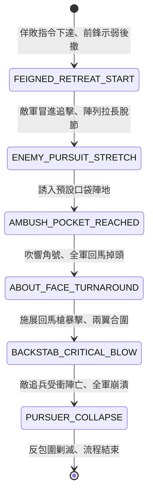

<!-- doc_id: doc_spec_0804 -->
# 3KLife 戰場假退佯敗誘敵深入與全軍回馬槍回頭反打狀態機規格書

## 模組基本資訊
- **模組代號**：`FEIGNED-RETREAT-AMBUSH01`
- **系統定位**：三國誘敵包圍與絕地反擊戰術系統，負責先鋒詐敗示弱、敵軍貪功脫節追擊、誘至預設死地與全軍回馬槍猛烈反打之完整狀態流。
- **架構依賴**：`BattleFormationController`、`MoraleSystem`、`AmbushCombatController`、`VFXBlockRegistry`。

---

## 核心設計概念
三國名將精通奇正相生之術（如趙雲長坂坡反突擊、張飛回馬斷喝、徐晃詐敗誘關平）。主將令前鋒部隊交鋒數合即故意散亂陣型、拋棄旌旗輜重佯裝潰逃。敵將若智力不足或性格急躁，必下達全軍急速追擊指令，致使陣型拉長脫節、前後無法呼應。當敵軍追入狹長谷道或平野包圍圈時，己方前鋒隨號角突發勒馬掉頭，以致命「回馬槍」重整陣容反身衝刺，配合兩翼伏兵合圍聚殲。



---

## 狀態機定義與轉換條件

### 1. `FEIGNED_RETREAT_START`（詐敗佯退狀態）
- **進入條件**：己方指揮官發動「詐敗誘敵」戰術，指定一支先鋒騎步隊伍。
- **行為表現**：
  - 己方先鋒部隊移動力 +1，沿預設後撤路線撤退。
  - 主動丟棄部分輜重糧草車，引誘敵軍。
- **轉換**：敵軍將領受貪功檢定影響並展開追擊 -> 轉移至 `ENEMY_PURSUIT_STRETCH`。

### 2. `ENEMY_PURSUIT_STRETCH`（脫節冒進狀態）
- **行為表現**：
  - 敵軍前鋒與中軍脫節距離 >= 3 格，防禦力降低 30%。
  - 敵軍部隊陷入「盲目輕敵」狀態，無法主動施放防禦陣型技能。
- **轉換**：敵前鋒踏入己方預設「伏擊口袋區」 -> 轉移至 `AMBUSH_POCKET_REACHED`。

### 3. `AMBUSH_POCKET_REACHED`（誘入死地狀態）
- **行為表現**：
  - 己方伏擊信號旗揮動，封閉口袋區出口。
  - 敵軍前鋒追擊阻滯，發現地形受限。
- **轉換**：戰術時機成熟 -> 轉移至 `ABOUT_FACE_TURNAROUND`。

### 4. `ABOUT_FACE_TURNAROUND`（回馬掉頭狀態）
- **行為表現**：
  - 原本潰退之先鋒部隊勒馬急停，全軍瞬間完成 180 度掉頭轉向。
  - 部隊士氣不降反升，立即獲得「破釜絕境」增益（士氣 +25，攻擊力 +35%）。
- **轉換**：掉頭完成（耗時 0.5 秒） -> 轉移至 `BACKSTAB_CRITICAL_BLOW`。

### 5. `BACKSTAB_CRITICAL_BLOW`（回馬槍暴擊反打狀態）
- **行為表現**：
  - **致命反衝**：回身衝刺敵軍前鋒無防備正面，必定觸發「回馬槍暴擊」（傷害 2.2 倍）。
  - **兩翼伏兵出擊**：相鄰草叢伏兵同步現身夾擊，切斷敵軍後退路線。
- **轉換**：首輪反擊打擊結算完成 -> 轉移至 `PURSUER_COLLAPSE`。

### 6. `PURSUER_COLLAPSE`（敵軍覆滅狀態）
- **行為表現**：
  - 敵軍前鋒部隊瞬間損失 50% 以上兵力，主將被挑落馬下或陷入重傷。
  - 敵軍全軍陷入「前後脫節驚駭」，士氣暴跌 45 點。
- **轉換**：敵殘軍潰逃或被俘 -> 結束退出。

---

## 數值公式與配置契約

```typescript
export interface FeignedRetreatConfig {
  tacticId: string;
  greedAITriggerThreshold: number; // 敵將貪功冒進性格閾值 (0 ~ 100)
  retreatSpeedBonus: number;       // 佯退時移動力加成
  enemyFormationStretchGrid: number; // 脫節所需最小格數
  turnaroundCritMultiplier: number; // 回馬槍暴擊傷害倍率
  moraleReboundBonus: number;      // 掉頭部隊士氣回升值
  pursuerMoraleShock: number;      // 追兵遭反噬士氣震懾值
}

export const FEIGNED_RETREAT_PRESETS: Record<string, FeignedRetreatConfig> = {
  ZHAOYUN_TURNAROUND: {
    tacticId: 'TAC_FEIGN_01',
    greedAITriggerThreshold: 40,
    retreatSpeedBonus: 2,
    enemyFormationStretchGrid: 3,
    turnaroundCritMultiplier: 2.2,
    moraleReboundBonus: 25,
    pursuerMoraleShock: -45,
  }
};
```

---

## 單元測試與驗收標準
1. **敵軍脫節判定**：敵軍前鋒與後軍距離拉開達到 3 格時，防禦力確實扣減 30% 且無法結成圓陣。
2. **回馬槍必定暴擊**：完成 180 度掉頭之部隊發動首輪攻擊，傷害必定按 2.2 倍暴擊乘數結算。
3. **士氣倒戈逆轉**：己方佯退部隊在轉向瞬間士氣提升 25 點，受衝擊之敵前鋒士氣即刻扣減 45 點。
