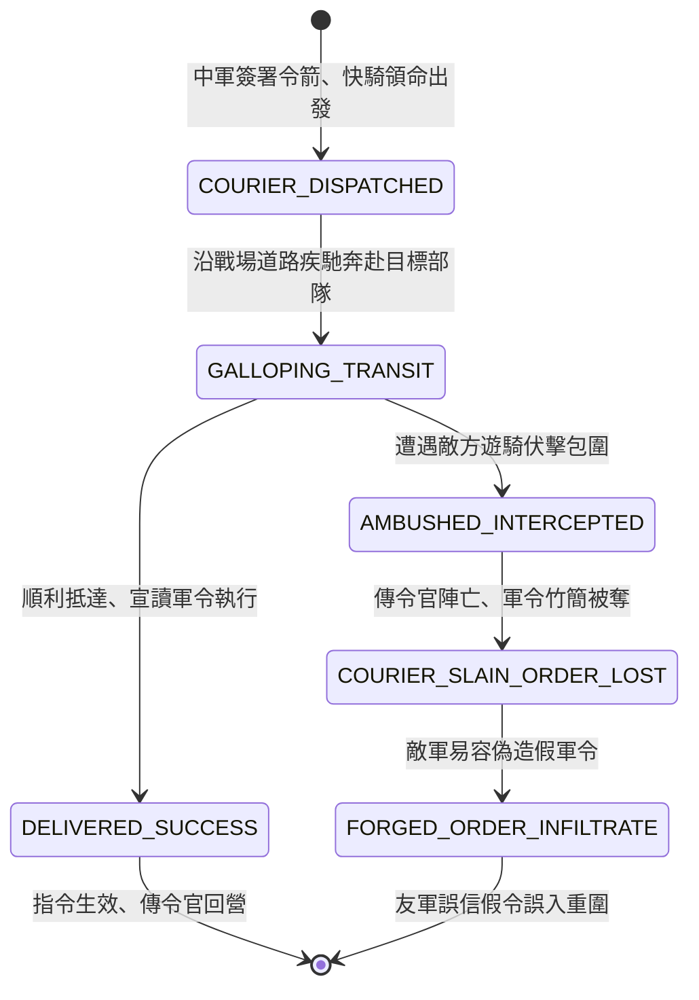

<!-- doc_id: doc_spec_0807 -->
# 3KLife 戰場傳令快騎奔馳送信與敵軍斥候半途截殺搶奪密令狀態機規格書

## 模組基本資訊
- **模組代號**：`COURIER-DISPATCH-INTERCEPT01`
- **系統定位**：三國戰場動態通訊實體傳令與軍情截殺系統，負責背旗快騎派遣、地圖實體奔馳導航、敵軍斥候中途截殺、密令奪取偽造與假傳軍令之完整狀態流。
- **架構依賴**：`BattleCommandController`、`BattleGridSystem`、`TroopTypeMovement`、`VFXBlockRegistry`。

---

## 核心設計概念
在超出中軍金鼓聲響範圍（或暴雨迷霧難辨旗號）時，三國大將調度側翼部隊必須派遣「背負令旗之紅翎快馬傳令官」。傳令快騎為地圖上具備高機動、低耐久之獨立實體單位。敵方常於兩軍空隙或要道隘口部署游騎斥候展開「截殺傳令」。若傳令官遭斬殺，密令被奪，敵將不僅可預知己方戰術企圖，甚至可指派死士換裝號衣「假傳軍令」，調動己方伏兵提前暴露。



---

## 狀態機定義與轉換條件

### 1. `COURIER_DISPATCHED`（簽發遣騎狀態）
- **進入條件**：主將對距離中軍超過 10 格之孤立或埋伏部隊下達「變更作戰指令」。
- **行為表現**：
  - 生成 1 騎傳令兵實體（耐久度 150 點，移動力 6 格/回合）。
  - 攜帶加密「主將符節與軍令簡牘」。
- **轉換**：出陣疾馳 -> 轉移至 `GALLOPING_TRANSIT`。

### 2. `GALLOPING_TRANSIT`（快馬奔馳狀態）
- **行為表現**：
  - 沿最短路徑向目標部隊導航奔馳，避開敵軍重步兵方陣。
  - 具備「急件快騎」特質，路徑地格泥濘懲罰減半。
- **轉換**：
  - 順利進入目標友軍相鄰 1 格 -> 轉移至 `DELIVERED_SUCCESS`。
  - 進入敵方斥候視野 2 格範圍內遭受截擊 -> 轉移至 `AMBUSHED_INTERCEPTED`。

### 3. `AMBUSHED_INTERCEPTED`（中途遭截狀態）
- **行為表現**：
  - 敵方斥候發射絆馬索或密集短弩射擊。
  - 傳令兵若未在 1 回合內衝破阻截，耐久快速下降。
- **轉換**：耐久歸零 -> 轉移至 `COURIER_SLAIN_ORDER_LOST`。

### 4. `COURIER_SLAIN_ORDER_LOST`（密令被奪狀態）
- **行為表現**：
  - 傳令官中箭落馬身亡，敵方獲得「截獲之軍令」道具。
  - 敵軍指揮官即時獲悉己方目標部隊之下一步調動方位。
- **轉換**：敵方具備「特務/偽裝」特長 -> 轉移至 `FORGED_ORDER_INFILTRATE`。

### 5. `FORGED_ORDER_INFILTRATE`（假傳軍令滲透狀態）
- **行為表現**：
  - 敵斥候偽裝己方快騎，持奪獲之符節奔赴目標部隊。
  - 誘騙友軍「即刻主動出擊」或「解除防禦陣型」，誘使其踏入敵軍埋伏圈。
- **轉換**：目標部隊識破檢定失敗受騙 -> 流程結束退出。

### 6. `DELIVERED_SUCCESS`（軍令送達狀態）
- **行為表現**：
  - 傳令官宣讀主將鈞令，目標部隊立即切換為新戰術狀態（如撤退、改道、全軍出擊）。
- **轉換**：指令切換完成 -> 結束退出。

---

## 數值公式與配置契約

```typescript
export interface CourierDispatchConfig {
  courierId: string;
  movementSpeedGrids: number;     // 傳令兵每回合移動格數
  courierMaxHp: number;           // 傳令兵生命值
  interceptDetectionRadius: number;// 敵斥候截擊感知半徑
  forgeryDeceptionRate: number;   // 假傳軍令成功欺瞞機率
  mudCostReductionPercent: number;// 泥濘減免比
}

export const COURIER_PRESETS: Record<string, CourierDispatchConfig> = {
  RED_FEATHER_EXPRESS: {
    courierId: 'COURIER_RED_01',
    movementSpeedGrids: 6,
    courierMaxHp: 150,
    interceptDetectionRadius: 2.0,
    forgeryDeceptionRate: 0.65,
    mudCostReductionPercent: 0.50,
  }
};
```

---

## 單元測試與驗收標準
1. **實體路徑到達判定**：傳令快騎移動耗費 2 回合順利抵達目標部隊相鄰格時，指令即刻切換，並無全圖無延遲同步。
2. **截殺密令奪取**：敵方斥候在傳令官經過時截擊擊殺，己方介面提示「傳令騎失聯」，目標部隊維持原本行動不變。
3. **假令欺瞞檢定**：敵斥候持符節假傳軍令，若目標將領智力低於 70，有 65% 機率受騙擅自出擊。
