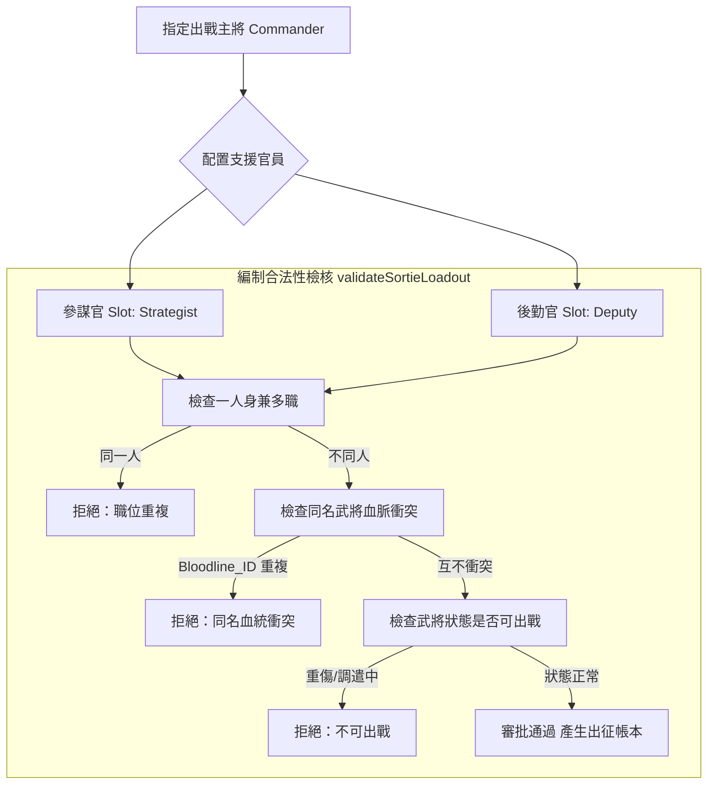

<!-- doc_id: doc_spec_0430 -->
# 戰場參謀官與後勤官出征配置SortieLoadout數值規格書

## 1. 核心定位與職責範圍

本規格書定義出征編制畫面（`SortieSetupController.ts`）與出征帳本（`SortieDeploy.ts`）中的支援職位配置機制，對應 WBS **EQP-10**。
出征編制以主將（Commander）為核心，可指派至多一位**參謀官（Strategist）**與一位**後勤官（Deputy）**。
- **純輔助鐵律**：參謀官與後勤官純粹提供全軍數值與計謀資源增幅，**絕對不佔用、不增加戰場上場部隊槽位**，亦不作為獨立戰鬥小隊部署於沙盤之上。
- **純邏輯架構**：編制校驗、加成推導與候選輪播均為無副作用純運算，與 Cocos 畫面呈現層完全解耦。

---

## 2. 出征編制角色約束與同名防護



---

## 3. 支援官員數值加成模型

### 3.1 參謀官加成公式（計謀點體系）
參謀官之智力（`INT`）與政治（`POL`）屬性決定戰場計謀點數規模：
1. **綜合資質評分**：
   $$Score = \text{INT} \times 0.7 + \text{POL} \times 0.5$$
2. **計謀點上限加成（`maxTacticBonus`）**：
   $$\text{maxTacticBonus} = \min(30, \lfloor Score / 10 \rfloor)$$
3. **開局起始點數加成（`startTacticBonus`）**：
   $$\text{startTacticBonus} = \min(15, \lfloor \text{maxTacticBonus} \times 0.5 \rfloor)$$
- **戰場實效**：戰場基礎計謀點上限為 30、開局值 12。指派頂級軍師（如諸葛亮、荀彧）最高可擴充上限至 60 點，並以 27 點開局。

### 3.2 後勤官加成公式（軍糧體系）
後勤官之統率（`LEA`）與政治（`POL`）屬性決定戰役隨軍糧草補給：
1. **軍糧加成比率（$Rate$）**：
   $$Rate = \min(0.18, 0.03 + \text{LEA} \times 0.001 + \text{POL} \times 0.0006)$$
2. **軍糧額外補給（`foodCapBonus`）**：
   $$\text{foodCapBonus} = \lfloor \text{baseFoodCap} \times Rate \rfloor$$
- **戰場實效**：額外糧草直接擴充本場最大軍糧與開局可用軍糧（$Rate \le 18\%$），大幅降低虎符精銳與攻城重械之調遣門檻。

---

## 4. 控制器互動狀態機與預設保存

### 4.1 候選名單輪播（`cycle`）
- 候選清單第一格固定為「不派（`null`）」，確保隨時可卸除支援。
- 循環切換支援者時，若下位候選人存在同名血統或不可出戰問題，控制器自動順延至下一位有效人選，最多循環搜尋一整圈。

### 4.2 出征預設（`SortiePresetStore`）
- 系統以主將 ID 為鍵值（Key），於本機儲存專屬之支援搭檔預設：
  ```typescript
  export type SortiePresetStore = Readonly<Record<string, SortieSupport>>;
  ```
- 當玩家切換主將時，系統優先嘗試套用該主將之專屬預設；若預設中之官員因陣亡、調派或重傷不可用，則無損回退為「不派」，確保主線絕不因缺人而卡死。

---

## 5. 戰場 HUD 與驗收標準

1. **HUD 資訊呈現契約**：
   - 參謀官摘要：顯示武將姓名、頭像、計謀點上限增量（`+X`）與開局補點（`+Y`），標註提示文案「（進戰場後生效）」。
   - 後勤官摘要：顯示武將姓名、頭像、額外軍糧補給量（`+Z 糧`）。
   - 部隊欄位嚴格隔離：畫面絕不渲染額外部隊頭像或出征方塊，保持三軍編制視覺清爽。
2. **單元測試驗收覆蓋**：
   - 驗證同名武將（相同 `bloodlineId`）同時編入主將與支援槽時必報錯攔截。
   - 驗證參謀官加成與後勤官加成各項數值於極端五維（0 與 100+）下之上下限截斷完全正確。
