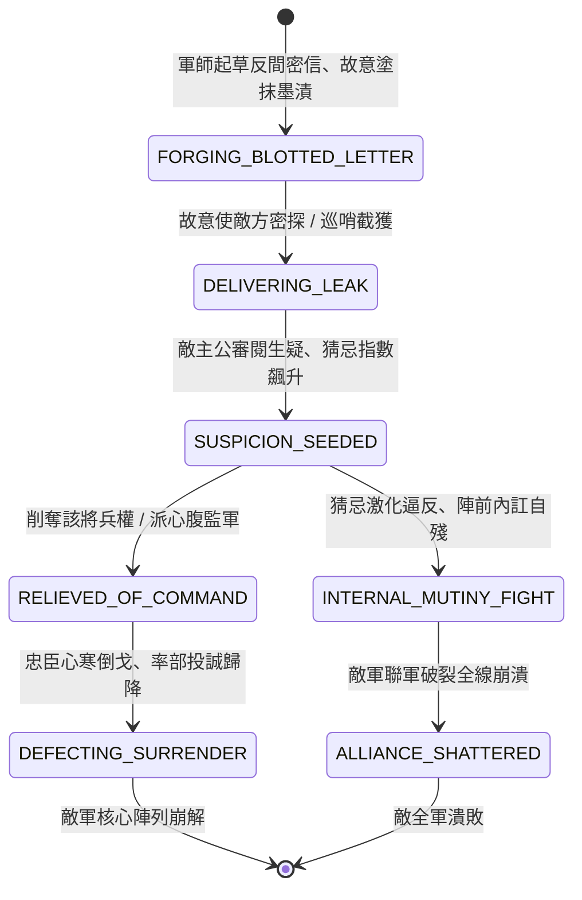

<!-- doc_id: doc_spec_0815 -->
# 3KLife 戰場反間密信塗改離間君臣與疑心自相殘殺狀態機規格書

## 模組基本資訊
- **模組代號**：`DISCORD-COUNTER-LETTER01`
- **系統定位**：三國戰場高階情報謀略與離間策反系統，負責偽造密信、墨跡塗改製造私通嫌疑、激發君臣猜忌疑心、兵權削奪與陣前火併自相殘殺之完整狀態流。
- **架構依賴**：`BattleCommandController`、`MoraleSystem`、`FactionRelationshipEngine`、`VFXBlockRegistry`。

---

## 核心設計概念
三國歷史上著名反間之策（如賈詡抹書間韓遂、周瑜借蔣幹除蔡瑁張允）。當敵方聯軍勢大或名將坐鎮時，正面交鋒代價極高。軍師可令密探偽造主帥與敵將之私密書信，並於關鍵條款處故意用墨汁塗抹遮蓋數十言。故意讓敵主公截獲此信，敵主公見塗抹之處必疑心是該將自作聰明滅口掩飾，猜忌頓生。隨著疑雲加劇，敵方陣營內部發生爭吵火併，甚至迫使名將陣前倒戈歸降。



---

## 狀態機定義與轉換條件

### 1. `FORGING_BLOTTED_LETTER`（起草塗抹狀態）
- **進入條件**：軍師智力 >= 85 且消耗 100 點計謀點，選定目標敵將與敵主公。
- **行為表現**：
  - 書信言辭含糊、若即若離，關鍵名詞與約定時日特意用黑墨厚塗抹去。
  - 封入火漆官印，製造十萬火急假象。
- **轉換**：書信偽造完成 -> 轉移至 `DELIVERING_LEAK`。

### 2. `DELIVERING_LEAK`（洩漏被截狀態）
- **行為表現**：
  - 信使假意於敵軍巡哨前露出破綻，書信「意外」被搜出呈報敵主公。
  - 偽造可信度檢定：受軍師智力與敵主公性格影響。
- **轉換**：敵主公疑心檢定成功觸發 -> 轉移至 `SUSPICION_SEEDED`。

### 3. `SUSPICION_SEEDED`（猜忌萌生狀態）
- **行為表現**：
  - 敵主公頭像附加「疑神疑鬼」減益，對目標將領之信任度扣減 60 點。
  - 陣前相見時主公言辭試探，目標將領百口莫辯。
- **轉換**：
  - 敵主公性格屬於「多疑專橫（如曹操/袁紹）」 -> 轉移至 `RELIEVED_OF_COMMAND`。
  - 目標將領性格剛烈脾氣暴躁（如馬超） -> 轉移至 `INTERNAL_MUTINY_FIGHT`。

### 4. `RELIEVED_OF_COMMAND`（削權奪兵狀態）
- **行為表現**：
  - 敵主公派監軍接掌目標將領兵符，該支部隊戰力削弱 40%。
  - 將領忠誠度跌至冰點（小於 20 點）。
- **轉換**：主將心寒且己方派使者接洽 -> 轉移至 `DEFECTING_SURRENDER`。

### 5. `INTERNAL_MUTINY_FIGHT`（陣前內訌火併狀態）
- **行為表現**：
  - 兩軍在陣營內部拔刀相向，爆發局部血戰。
  - 敵軍自相殘殺損失 30% 總兵力，全軍士氣暴跌 45 點。
- **轉換**：內訌結算完畢 -> 轉移至 `ALLIANCE_SHATTERED`。

### 6. `DEFECTING_SURRENDER`（陣前倒戈降順狀態）
- **行為表現**：
  - 目標名將率所屬精銳部隊反戈一擊，就地轉變為己方友軍。
  - 戰場局勢發生根本性逆轉。
- **轉換**：編入己方陣營 -> 結束退出。

---

## 數值公式與配置契約

```typescript
export interface DiscordLetterConfig {
  tacticId: string;
  strategistIntRequirement: number;// 軍師智力門檻
  suspicionIncreaseBase: number;   // 猜忌值激增基礎點數
  warlordParanoiaMultiplier: number;// 疑心性格放大倍率
  mutinyDamagePercent: number;     // 內訌自相殘殺兵力損耗比
  defectionSuccessChance: number;  // 逼反倒戈機率 (0.0 ~ 1.0)
}

export const DISCORD_PRESETS: Record<string, DiscordLetterConfig> = {
  JIAXU_ERASED_LETTER: {
    tacticId: 'DISCORD_JIAXU_01',
    strategistIntRequirement: 85,
    suspicionIncreaseBase: 60,
    warlordParanoiaMultiplier: 1.5,
    mutinyDamagePercent: 0.30,
    defectionSuccessChance: 0.70,
  }
};
```

---

## 單元測試與驗收標準
1. **多疑性格乘數**：當敵主公具備「多疑」標籤時，猜忌點數乘上 1.5 倍（由 60 暴增至 90），必定觸發削權或內訌。
2. **內訌火併自損檢定**：觸發 `INTERNAL_MUTINY_FIGHT` 後，敵方陣列立刻扣除 30% 兵力且士氣扣除 45 點。
3. **倒戈部隊陣營反轉**：目標將領倒戈成功後，其實體隊伍所屬 factionId 即刻轉為己方，受己方直接指揮。
