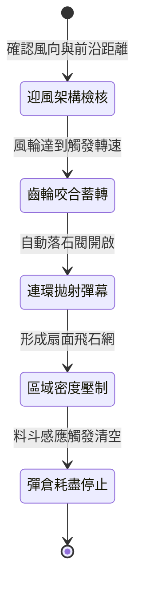

<!-- doc_id: doc_spec_0986 -->
# 戰場夜戰順風施放連環風力飛石彈幕車壓制敵軍陣線狀態機規格書

## 模組識別碼
- 模組編號：`FORM-205`
- 狀態機代碼：`WIND-ROTARY-STONE-BARRAGE-SUPPRESS01`
- 類別：戰場夜戰順風遠程壓制重械狀態機
- 適用場景：平原野戰、夜間作戰、順風壓制、反制密集步兵方陣

---

## 1. 核心概念與作戰原型

夜間作戰中，步兵方陣常因視線不良而難以察覺遠程打擊。為在不暴露火光的前提下實施大面積壓制，工兵營研製出「連環風力飛石彈幕車」。

### 1.1 機構運作與戰術配合
1. **多翼風帆動能傳動**：戰車頂部裝設六聯裝帆布風輪，於順風 3 級以上推進時，透過車軸齒輪系將動能傳遞至車身內部的雙層水平彈射盤。
2. **自動落石餵料系統**：車箱上部置有漏斗狀儲石倉，內裝重約半斤之鵝卵石與硬陶碎塊，藉由齒輪撥爪每秒均勻落入彈射槽。
3. **扇形廣角彈幕拋射**：高速旋轉的彈射盤利用離心力，將碎石以每秒二十枚的頻率甩向前方六十步扇形區域，形成高密度覆蓋。
4. **聲響干擾與士氣壓制**：飛石破空與落地產生密集雜音，能有效干擾敵軍前線金鼓與旗語指揮，使敵方步兵陷入防禦混亂。

---

## 2. 數值參數與影響權重

| 參數名稱 | 數值 / 範圍 | 說明 |
| :--- | :--- | :--- |
| **風力增益係數 (`WindBonusFactor`)** | 每級順風 +15% 射程 | 依據戰場環境風速即時調整射程與初速 |
| **壓制命中覆蓋率 (`SuppressionCoverage`)** | 正前方 4~7 格扇形 70% | 範圍內敵軍移動速度降低 35% |
| **陣型凝聚力損耗 (`MoraleDisruption`)** | 每秒降低 2 點士氣 | 持續壓制削弱敵軍維持緊密防禦能力 |
| **單發衝擊傷害 (`StoneImpactDamage`)** | 80 ~ 140 點鈍擊 | 對無盾防護單位造成輕微但高頻的損耗 |
| **備彈持續時間 (`OperationalDuration`)** | 18 秒 (共 360 枚飛石) | 投射完畢後轉為普通阻礙掩體 |

---

## 3. 狀態機轉換定義

### 3.1 狀態細節描述
- **迎風架構檢核 (CHECK_WIND)**：感應器檢測戰場順風條件是否大於等於 3 級。
- **齒輪咬合蓄轉 (GEAR_ENGAGED)**：離合器閉合，雙層旋盤轉速突破 400 RPM。
- **連環拋射彈幕 (CONTINUOUS_BARRAGE)**：撥爪啟動，石塊依序滑入離心導軌甩出。
- **區域密度壓制 (SUPPRESSION_ZONE)**：目標扇形區域受擊，敵軍步兵強制陷入護面防守姿態。
- **彈倉耗盡停止 (AMMO_EMPTY)**：戰車關閉進料口，風輪空轉滑行。

---

## 4. 戰鬥公式與判定

### 4.1 命中與壓制判定
$$\text{SuppressionImpact} = \text{BaseRate} \times (1 + \text{WindForce} \times 0.15) \times (1 - \text{ShieldDefenseRatio})$$

若目標敵軍未舉盾，移動速度強制降低 35%，並有 60% 機率打斷當前正在準備的戰法引導。

### 4.2 陣型鬆散度判定
$$\text{FormationPenalty} = \min(0.50, \text{ExposureDuration} \times 0.05)$$

每處於壓制區域 1 秒，敵方步兵方陣之協同防禦減免降低 5%，最高累計降低 50%。

---

## 5. 反制與失效機制

1. **大木盾密合龜甲陣**：若敵軍迅速以大盾嚴密封鎖正面與頂部，可抵消 95% 飛石衝擊。
2. **正面突擊破壞風輪**：騎兵高速正面衝撞可輕易擊碎車頂木質風帆結構，使其失去動力。
3. **風向轉變動能阻斷**：一旦風向轉為側風或逆風，旋盤轉速急遽衰減，有效射程縮短至 2 格以內。

---

## 6. 驗收標準與測試案例

- [x] **TC-205-01**：驗證順風 3 級條件下，戰車於 3 秒內進入連環拋射狀態。
- [x] **TC-205-02**：驗證扇形覆蓋區域內敵軍移動速度正確施加 35% 減速效果。
- [x] **TC-205-03**：驗證投射 18 秒後料斗完全清空，狀態機平滑終止無報錯。
