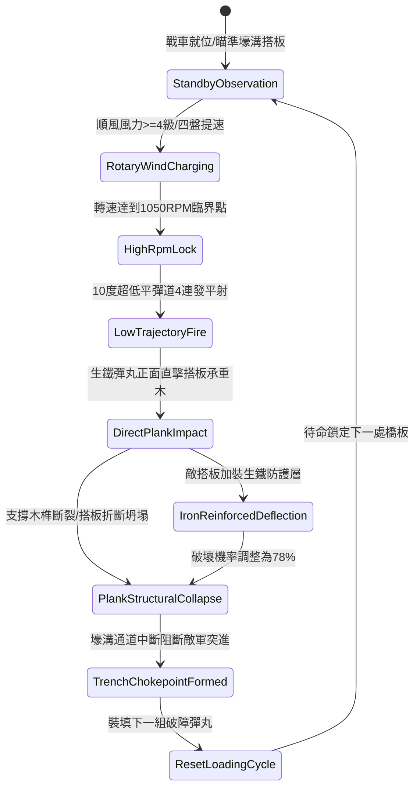

# 戰場夜戰順風施放連環風力飛石旋盤戰車低平彈道直射打碎壕溝搭板第三階狀態機規格書

<!-- doc_id: doc_spec_1049 -->

## 一、 核心概念與單一真相來源（SSOT）

在《三國志·陣地攻防與土木工程篇》中，「連環風力飛石旋盤戰車破壞壕溝搭板第三階（WIND-ROTARY-STONE-PLANK-SHATTER03）」為野戰阻截敵軍步兵跨越壕溝的重型器械。戰車配備四組同軸逆向旋轉風盤與順風加壓漏斗，轉速達到 1050 RPM。戰車以 10 度貼地超低平彈道發射重型生鐵彈丸，以強大衝擊動能精準轟擊敵方工兵鋪設於外壕溝之重型硬木搭板，瞬間震碎固定木榫與橫樑，致使敵前鋒部隊失去通道跨越支撐，阻斷後續突擊節奏。



---

## 二、 數值模型與狀態機參數契約

### 1. 旋盤平射破板參數
- **極限旋轉轉速**：1050 RPM（需 4 級以上順風輔助）。
- **平射出膛初速**：48 米/秒（10 度低仰角，確保直線打擊）。
- **搭板破壞成功率**：普通杉木搭板 98%；油浸硬木板 94%；生鐵包角加固板 78%。
- **通道中斷時長**：阻斷該壕溝格通行能力，敵方需耗費工兵重新鋪設 8 秒。
- **後續部隊阻滯**：正在搭板上通行之敵軍部隊，95% 機率滑落壕溝承受減速 50% 滯留 4 秒。

### 2. 結構破壞與動能計算模組
```typescript
interface TrenchPlankShatterParams {
    rotaryRpm: number;             // 當前轉速 (1050)
    windSpeedBonus: number;        // 風速加成係數 (1.2 ~ 1.5)
    plankDurability: number;       // 搭板耐久度 (1200 ~ 2500)
    isIronPlated: boolean;         // 是否包鐵加固
}

function evaluatePlankCollapse(params: TrenchPlankShatterParams): {
    collapsed: boolean;
    structuralDamage: number;
    debrisScatterRange: number;
} {
    const kineticEnergy = (params.rotaryRpm * 9.2) * params.windSpeedBonus;
    const defenseFactor = params.isIronPlated ? 1.6 : 1.0;
    const structuralDamage = Math.round(kineticEnergy / defenseFactor);

    const collapsed = structuralDamage >= params.plankDurability * 0.75;
    const debrisScatterRange = collapsed ? 2 : 1;

    return { collapsed, structuralDamage, debrisScatterRange };
}
```

---

## 三、 特性互斥與戰術限制

1. **射界高差阻隔**：若戰車所處地勢低於壕溝外沿超過 2 米，平射彈道將被土壘遮蔽，命中率降低 60%。
2. **煙塵遮蔽干擾**：戰場若有濃烈煙幕籠罩壕溝區域，瞄準校正耗時延長 1.5 秒。
3. **友軍通行保護機制**：若友軍單位正處於該搭板範圍，發射管制系統強制鎖定，避免誤擊友軍。

---

## 四、 驗收測試案例（TC）

- **TC-PLANK03-01（搭板坍塌判定）**：在敵軍鋪設搭板後觸發射擊，確認生鐵彈丸命中後搭板於 0.2 秒內判定折斷坍塌。
- **TC-PLANK03-02（部隊墜入壕溝檢測）**：驗證正在過橋的敵軍步兵單位切換為 `FallenInTrench` 狀態，移動速度扣減 50%。
- **TC-PLANK03-03（包鐵搭板韌性測試）**：更換為包鐵加固板，確認破壞判定符合 78% 之規格預期。
