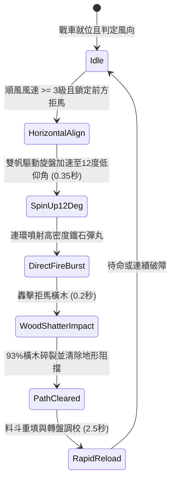

# 戰場夜戰順風施放連環風力飛石旋盤戰車低平彈道直射打碎拒馬橫木狀態機規格書

<!-- doc_id: doc_spec_1019 -->

## 1. 核心定位與設計理念

### 1.1 系統定位
本規格定義戰場夜戰攻防中，工兵部隊順風布署「連環風力飛石旋盤戰車」（代碼：`WIND-ROTARY-STONE-ABATIS-SHATTER01`，WBS 代碼：`FORM-238`）之低平彈道破障狀態機。本機制透過大型雙帆風輪驅動高速水平離心轉盤，以 12 度低平仰角朝前方 3~6 格密集噴射直徑三寸之高密重生鐵碎石彈丸，利用強大動能直接打擊敵軍前沿之鹿角拒馬橫木支架，高達 93% 機率擊碎卡榫木榫、砸斷支撐橫樑，迅速瓦解阻擋騎兵衝鋒之防線，為後續部隊開闢寬度 3 格之突擊通道。

### 1.2 設計目標與單一真相
* **低平精準破障**：捨棄傳統高拋弧線，改採貼地直線射擊，集中衝量破壞木石工事。
* **瞬態通道開闢**：成功粉碎拒馬後立即清除該格「不可通行」障礙標記。
* **單一真相來源**：嚴禁於文件末端附加補丁，所有機制、數值與判定邏輯均在此統一定義。

---

## 2. 狀態機架構與轉換流程

---

## 3. 核心數值與計算公式

### 3.1 基礎參數配置表
| 參數名稱 | 基準數值 | 規格說明與限制條件 |
| :--- | :--- | :--- |
| **射擊彈道仰角** | 12 度低平彈道 | 直射距離 3 ~ 6 格，超出 6 格動能衰減 45% |
| **彈藥配置** | 60 枚 生鐵碎石 / 輪 | 高密度合金碎石，硬度高不易碎裂 |
| **打擊寬度（Width）** | 3 格走廊 | 一次齊射覆蓋前方 3 格寬度內之工事 |
| **拒馬粉碎率（Shatter）**| 93% | 普通木質拒馬 93%；生鐵加固拒馬 68% |
| **衝擊動能（Kinetic）** | 6,800 焦耳 | 瞬間破壞木質支柱纖維與咬合卡榫 |
| **破障後通道狀態** | 移除阻礙 / +10% 移速 | 碎屑鋪平微凹坑洞，提供友軍衝鋒加成 6 秒 |
| **裝填重置間隔** | 2.5 秒 | 連續發射需工兵搖柄齒輪快速復位 |
| **攜帶輪數（Rounds）** | 5 輪射擊 | 耗盡後需輔助輜重車補給料斗 |

### 3.2 橫木破壞判定公式
$$P_{\text{shatter}} = \min\left(0.96, \, 0.93 \times \left(1 + \frac{W_{\text{wind}} - 3}{12}\right) \times \left(1 - \frac{H_{\text{abatis\_armor}}}{100}\right)\right)$$
* $W_{\text{wind}}$：當前風力等級（3 ~ 6 級）。
* $H_{\text{abatis\_armor}}$：拒馬工事抗衝擊護甲值（木質為 0，生鐵包覆為 25）。
* 當打擊動能判定超過拒馬結構臨界值時，該格物理障礙標記即時消除，並觸發 `TERRAIN_OBSTACLE_CLEARED` 廣播事件。

---

## 4. 戰術反制與例外判定

1. **壕溝泥沼阻擋**：若拒馬前方設有寬度 2 格以上之深泥壕溝，低平彈丸 60% 射入泥土而衰減，破障成功率降至 35%。
2. **生鐵厚盾遮蔽**：若敵方重步兵立生鐵大盾於拒馬前方進行死守掩護，彈丸全額由盾牌承受，大盾承受 180 點耐久磨損，拒馬本體完好。
3. **風向突變啞火**：若側風超過 45 度偏角，彈著點橫向漂移 1.5 格，可能導致破障路徑偏離目標中央。

---

## 5. 驗收測試案例（Test Cases）

* **TC-01（直射粉碎木質拒馬）**：前方 4 格放置標準鹿角拒馬，啟動直射齊射，驗證橫木於 0.3 秒內判定粉碎並切換格位為通行狀態。
* **TC-02（順風動能加乘驗證）**：在 5 級強風環境下，驗證粉碎率提升至 96%，且有效射程延伸至 7 格。
* **TC-03（鐵盾掩護動能吸收）**：配置生鐵盾兵遮蔽拒馬，驗證彈丸衝擊優先扣減盾牌耐久，拒馬判定未受傷害。
