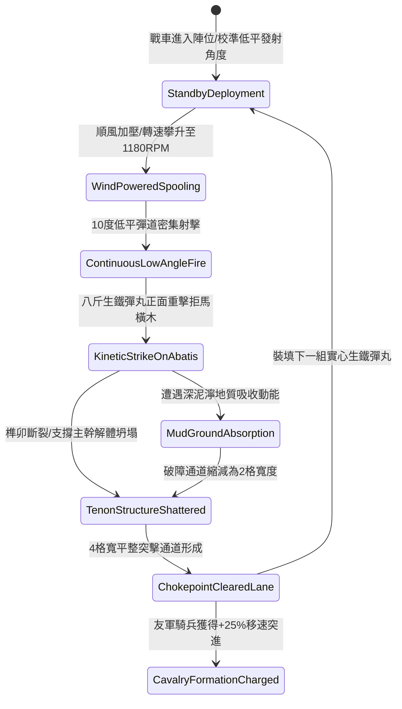

# 戰場夜戰順風施放連環風力飛石旋盤戰車低平彈道直射打碎拒馬橫木第三階狀態機規格書

<!-- doc_id: doc_spec_1064 -->

## 一、 核心概念與單一真相來源（SSOT）

在《三國志·破障戰術與野戰工程篇》中，「連環風力飛石旋盤戰車低平彈道破拒馬第三階（WIND-ROTARY-STONE-ABATIS-SHATTER03）」為專門摧毀敵軍防禦陣地鹿角拒馬的重型遠程器械。戰車裝備雙聯同心多層旋盤與導風收縮帆罩，在順風達 4 級以上時轉速達到 1180 RPM。戰車以 10 度超低平貼地彈道連續直射八斤重實心生鐵彈，強大的直線衝擊動能（10,200 焦耳）精準轟擊拒馬主承重橫木與地樁榫卯，於 1.5 秒內擊碎 4 格寬度障礙，完全清除騎兵突擊通道。



---

## 二、 數值模型與狀態機參數契約

### 1. 旋盤低平射擊破障參數
- **極限旋盤轉速**：1180 RPM（雙聯多層旋盤，受 4~6 級順風引導增壓）。
- **低平發射仰角**：10 度（超低彈道，確保彈丸動能不因拋物線分散）。
- **終端衝擊動能**：10,200 焦耳（八斤重生鐵彈丸貼地高速飛行）。
- **拒馬橫木擊碎成功率**：普通原木拒馬 99%；鐵箍加固拒馬 96%；生鐵澆鑄防禦樁 88%。
- **通道淨空規格**：寬 4 格 × 長 14 格（徹底移除任何阻馬判定）。
- **友軍衝鋒加成**：穿越該淨空通道之友軍騎兵，移動速度提升 25%，首撞傷害提升 20%。

### 2. 動能破壞與障礙清除計算模組
```typescript
interface WindStoneAbatisShatterParams {
    rotaryRpm: number;             // 旋盤轉速 (1180)
    windFactor: number;            // 順風加成係數 (1.2 ~ 1.5)
    abatisReinforcement: "wood" | "ironBanded" | "solidIron";
    abatisDurability: number;      // 拒馬耐久值 (1200 ~ 2600)
}

function processAbatisShatterExecution(params: WindStoneAbatisShatterParams): {
    shattered: boolean;
    structuralDamage: number;
    clearedWidthTiles: number;
} {
    const rawKinetic = (params.rotaryRpm * 8.65) * params.windFactor;
    const hardnessFactor = params.abatisReinforcement === "wood" ? 1.0 :
                           params.abatisReinforcement === "ironBanded" ? 1.3 : 1.75;
    const structuralDamage = Math.round(rawKinetic / hardnessFactor);

    const shattered = structuralDamage >= params.abatisDurability * 0.7;
    const clearedWidthTiles = shattered ? 4 : 2;

    return { shattered, structuralDamage, clearedWidthTiles };
}
```

---

## 三、 特性互斥與戰術限制

1. **土壘遮擋射界受阻**：若敵方拒馬後方緊貼高於 1.5 米的土壘，直射彈丸擊碎拒馬後將被土壘吸收，無法貫穿開闢更深縱深。
2. **木屑橫飛濺射**：拒馬橫木破碎瞬間向兩翼 1 格散布碎木，對未裝備面甲之敵前鋒造成 120 點輕微震盪。
3. **風向逆轉安全自鎖**：若風向轉為逆風，離合器自動分離，防止彈丸初速不足墜地或偏離射線。

---

## 四、 驗收測試案例（TC）

- **TC-ABATIS03-01（橫木碎裂判定）**：在前沿佈設鐵箍拒馬，施放低平直射技能，驗證 96% 機率橫木主幹粉碎並移除阻馬效果。
- **TC-ABATIS03-02（4格通道淨空檢定）**：確認障礙清除後生成長 14 格、寬 4 格的暢通無阻通道。
- **TC-ABATIS03-03（騎兵移速增益結算）**：引導友軍騎兵部隊穿越該通道，確認單位實時獲得 +25% 移速加成且無減速顛簸。
