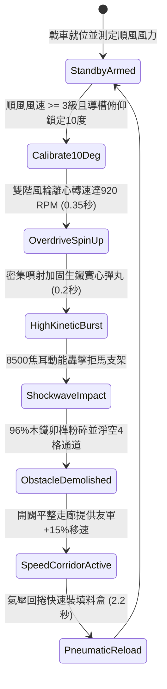

# 戰場夜戰順風施放連環風力飛石旋盤戰車低平彈道直射打碎拒馬橫木第二階狀態機規格書

<!-- doc_id: doc_spec_1034 -->

## 1. 核心定位與設計理念

### 1.1 系統定位
本規格定義戰場夜戰破障推進中，工兵部隊順風布署「連環風力飛石旋盤戰車第二階」（代碼：`WIND-ROTARY-STONE-ABATIS-SHATTER02`，WBS 代碼：`FORM-253`）之強化低仰角破障狀態機。第二階戰車於轉盤口加裝合金增壓導槽，將旋盤轉速拉高至 920 RPM，以 10 度極限貼地彈道噴射雙重加固生鐵實心彈丸。在 3~7 格距離內以 8,500 焦耳之單發爆發動能直射敵軍前沿之鹿角拒馬，96% 機率直接將加固生鐵支柱、粗硬木橫樑與咬合卯榫齊刷粉碎，迅速破開寬度 4 格之平整突擊通道，使後續步騎衝鋒完全不受碎屑羈絆。

### 1.2 設計目標與單一真相
* **高動能穿透破障**：克服普通石丸易碎缺點，以生鐵重彈實心撞擊，徹底震斷木質與鐵件纖維。
* **拓寬突擊動線**：一次齊射徹底淨空 4 格寬度障礙，降低後續突擊部隊擁擠踩踏風險。
* **單一真相來源**：嚴禁於文件末端附加補丁，所有機制、數值與判定邏輯均在此統一定義。

---

## 2. 狀態機架構與轉換流程

---

## 3. 核心數值與計算公式

### 3.1 基礎參數配置表
| 參數名稱 | 基準數值 | 規格說明與限制條件 |
| :--- | :--- | :--- |
| **射擊彈道與射程** | 10 度貼地 / 3 ~ 7 格 | 極低貼地直射，穿透前方防禦柵欄 |
| **打擊寬度（Width）** | 4 格寬闊走廊 | 一次齊射橫向覆蓋並淨空 4 格阻礙 |
| **拒馬粉碎成功率** | 96% | 適用於各類木質與生鐵加固鹿角拒馬 |
| **衝擊終端動能** | 8,500 焦耳 | 瞬間撕裂生鐵加固角件與硬木橫樑 |
| **破障後移速加成** | +15% 友軍移速 | 碎屑壓平微凹地貌，維持加速 8.0 秒 |
| **單輪彈藥發射量** | 80 枚 生鐵實心彈 | 高密度合金實心彈，耐衝擊不形變 |
| **氣壓裝填間隔** | 2.2 秒 | 氣壓增壓回捲齒輪，大幅縮短換彈前搖 |
| **攜帶料盒彈量** | 6 輪連續打擊 | 耗盡後需隨軍輜重車補給料盒 |

### 3.2 結構粉碎與衝量公式
$$P_{\text{shatter}} = \min\left(0.99, \, 0.96 \times \left(1 + \frac{W_{\text{wind}} - 3}{10}\right) \times \left(1 - \frac{H_{\text{armor}}}{120}\right)\right)$$
* $W_{\text{wind}}$：當前戰場順風等級（3 ~ 6 級）。
* $H_{\text{armor}}$：工事生鐵板厚度與抗剪力係數（0 ~ 30）。
* 粉碎判定成立後，目標區域地格之 `PASSAGE_BLOCKED` 標籤即刻註銷，切換為 `CHARGING_HIGHWAY`。

---

## 4. 戰術反制與例外判定

1. **生鐵活動避彈斜面**：若敵方於拒馬前方立 30 度光滑斜面厚鐵板，實心彈丸 65% 被折射上跳，粉碎率降為 40%。
2. **泥漿深沼緩衝**：若拒馬周圍浸泡於深及膝蓋之黏稠爛泥中，彈丸動能 50% 被泥漿吸收，破障效率降至 55%。
3. **側向風偏校正失敗**：若遭遇 5 級側風且操作工兵未及時調整導向舵，通道開闢位置將偏離中心線 1 格。

---

## 5. 驗收測試案例（Test Cases）

* **TC-01（直射粉碎鐵件加固拒馬）**：前方 5 格放置包鐵鹿角拒馬，發動直射，驗證 0.2 秒內判定橫木與鐵件粉碎淨空。
* **TC-02（4格突擊通道寬度校驗）**：驗證一次齊射後，橫向 4 個相鄰格位之障礙標籤同步移除，並正確附加 +15% 移速走廊。
* **TC-03（2.2秒氣壓快速裝填時序）**：擊發完成後觸發 `PneumaticReload`，驗證計時器精確於 2.2 秒內切換回 `StandbyArmed`。
